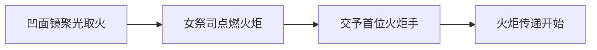
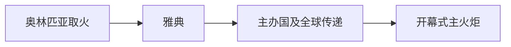

# 奥林匹克圣火采集与火炬传递仪式传统

## 奥林匹克圣火采集与火炬传递仪式传统

这是现代奥运会最具仪式感的文化符号之一。但在最初几届现代奥运会上，并没有点火仪式。为什么后来要增加这一环节？火种从哪里来，又怎么传到开幕式现场？我们从一道真题开始理解：

> 国际奥委会决定，在奥运会期间，从开幕式到闭幕时，主要会场要燃烧象征光明、团结、友谊、和平和正义的奥林匹克圣火，火种必须从___采集，以___的形式传到奥运会主办城市。

答案指向两个关键词：**奥林匹亚** 和 **火炬接力**。这便是整个传统的基石。

### 火种采集：为什么要回到奥林匹亚

==火种必须取自希腊奥林匹亚的赫拉神庙遗址前==。采集方式不靠打火机，而是由女祭司用**凹面镜汇聚太阳光取火**。这一设计强调的是圣火的“纯洁性”——它来自太阳，不掺杂任何人造火源。

采集仪式中会有一段流程：女祭司点燃第一棒火炬，交给首位火炬手，然后火炬接力就此启动。

> [!IMPORTANT]
> 火种取自奥林匹亚，以火炬接力方式传递到主办城市。这是南邮《体育理论》考试中的核心定义，也是选择题的高频挖空点。

### 火炬传递：从哪一届开始的

==现代奥运会的火炬传递传统始于 1936 年柏林奥运会==。在此之前，虽然有圣火的概念（1928 年阿姆斯特丹奥运会曾在主会场点燃高塔火焰），但没有从奥林匹亚取火并进行跨国接力传递的完整仪式。柏林奥运会首次将这个流程制度化，此后每届延续。

> [!TIP]
> 记忆口诀：点火的柏林（1936），传递的起源。注意与 1928 年阿姆斯特丹的“高塔火焰”区分——后者只是会场火盆，不涉及取火与接力。

### 传递路线有什么讲究

奥运圣火从奥林匹亚采集后，==第一站总是传到雅典==，再从雅典传往各届主办城市。这意味着无论主办国在哪，圣火都会先在希腊境内传递，并向雅典卫城致敬。

以一道真题为例：

> 雅典奥运会圣火途经\_\_个国家。

答案是 62 个。2004 年雅典奥运会是奥运回归故乡的一届，圣火首次完成**全球五大洲传递**，途经国家数量创下当时之最。

常见的路线结构如下：

> [!CAUTION]
> 很多同学会把“雅典”和“奥林匹亚”混为一谈。请记住：**采集地在奥林匹亚**（赫拉神庙前），而传递的第一大站是**雅典**。

### 开幕式点火：经典瞬间与常见考点

火炬传递的终点是开幕式主体育场。最后一棒火炬手通常是主办国的标志性人物，其点火方式往往成为奥运会历史的经典。

真题中有一道考的是：

> 悉尼奥运会开幕式中\_\_在水中点燃圣火。

答案是 **弗里曼**（Cathy Freeman），澳大利亚土著田径运动员。她从水中点燃主火炬的画面，成为奥运点火仪式的经典之一。

### 易混淆点自查

| 易混项 | 正确结论 | 说明 |
|--------|----------|------|
| 火炬传递从何年开始？ | ==1936 年柏林奥运会== | 不是 1928（仅有火盆）也不是 1896（首届无此传统） |
| 火种在哪采集？ | ==奥林匹亚==（希腊） | 不是雅典 |
| 圣火先传到哪？ | ==雅典== | 再从雅典传向主办城市 |
| 谁点燃悉尼主火炬？ | ==弗里曼== | 不是萨马兰奇或罗格（国际奥委会主席不担任火炬手点火） |

> [!WARNING]
> 选择题常设的坑：把“奥林匹亚”偷换成“雅典”，把“1936 柏林”偷换成“1928 阿姆斯特丹”或“1896 雅典”。遇到年份题先想清楚：完整的取火+接力仪式，而非单纯的会场火焰。

理解了这条时间线，火炬传递的考点就不会混淆：**奥林匹亚取火 → 雅典首站 → 全球传递 → 开幕式点火**，而这一切的完整形态，从 1936 年柏林开始。
