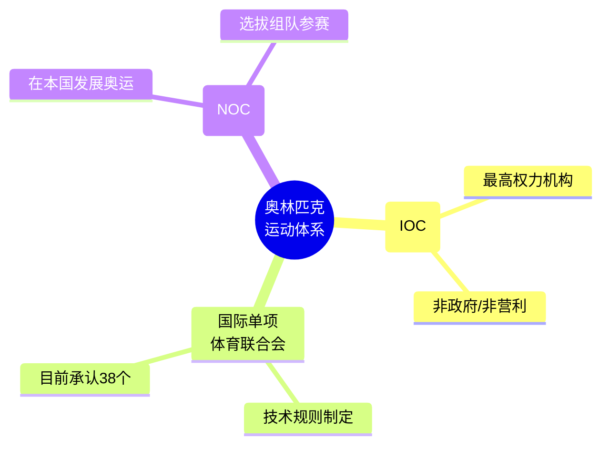

# 《奥林匹克宪章》的地位与核心内容
《奥林匹克宪章》（Olympic Charter）是国际奥委会制定的**根本大法**。它不仅是奥林匹克运动的组织章程，更是其思想、原则和规则的总汇。如果把奥林匹克运动比作一个国家，《宪章》就是它的宪法；如果比作一家公司，它就是最高层级的公司章程。

> [!IMPORTANT]
> **核心地位**：它是奥林匹克运动的**最高法律文件**，所有奥林匹克家庭成员（国际奥委会、国家奥委会、国际单项体育联合会等）必须严格遵守。

## 为什么需要《宪章》？

现代奥运会涉及全球200多个国家和地区，如何确保比赛公平、组织有序、理念统一？靠口头约定显然不够。《宪章》确立了==三大支柱==的权责边界，解决了“谁说了算”和“按什么规则办”的问题。

## 核心内容解析

《宪章》的核心在于明确奥林匹克主义的宗旨与原则。回顾历年真题，我们可以提炼出以下关键点：

1.  **宗旨**：顾拜旦提出奥林匹克运动以==团结、和平、友谊==为宗旨。注意区分“口号”与“宗旨”：
    *   **宗旨**：团结、和平、友谊（侧重社会价值，选C）。
    *   **格言**：更快、更高、更强——更团结（侧重竞技精神，选A是干扰项）。
2.  **组织性质**：国际奥委会（IOC）是一个==国际性、非政府、非营利==的组织。它不属于任何单一国家政府，也不以赚钱为目的。
3.  **诞生标志**：现代奥林匹克运动诞生的重要标志是==1896年第一届雅典奥运会的举行==，而非顾拜旦思想的形成或古希腊奥运会。

> [!TIP]
> **记忆技巧**：看到“宗旨”想“和平友谊”，看到“IOC性质”想“三无”（无政府、无营利、有国际性）。

## 常见误区与辨析

学生常混淆古代与现代奥运会的背景及形式，以下表格帮助厘清：

| 维度 | 古代奥运会 | 现代奥运会 |
| :--- | :--- | :--- |
| **社会背景** | ==奴隶制==社会（选C） | 资本主义/现代社会 |
| **起源地** | 希腊奥林匹亚 | 法国巴黎（顾拜旦发起） |
| **主要形式** | 宗教祭祀+竞技 | ==竞技运动==为主（选C） |
| **参与范围** | 仅限希腊自由民 | 全球各国运动员 |

> [!WARNING]
> **易错坑**：题目问“现代奥运会采用何种形式”，答案选**法国**（指起源/发起国背景）或强调其**竞技性**。注意题干问的是“形式”还是“起源国”。若问起源国，顾拜旦是法国人，现代奥运复兴源于法国。

## 典型例题演练

**题目**：国际奥委会是奥林匹克运动的最高权力机构，它是一个＿的组织。
*   A. 国际性
*   B. 政府性
*   C. 限期性
*   D. 营利性

**解析**：根据《奥林匹克宪章》，IOC是独立的国际组织，不隶属于任何政府（排除B），永久存在（排除C），且非营利（排除D）。因此，正确答案是 **A**。这道题直接考察了对IOC性质的理解，是《宪章》中关于组织架构的基础考点。
