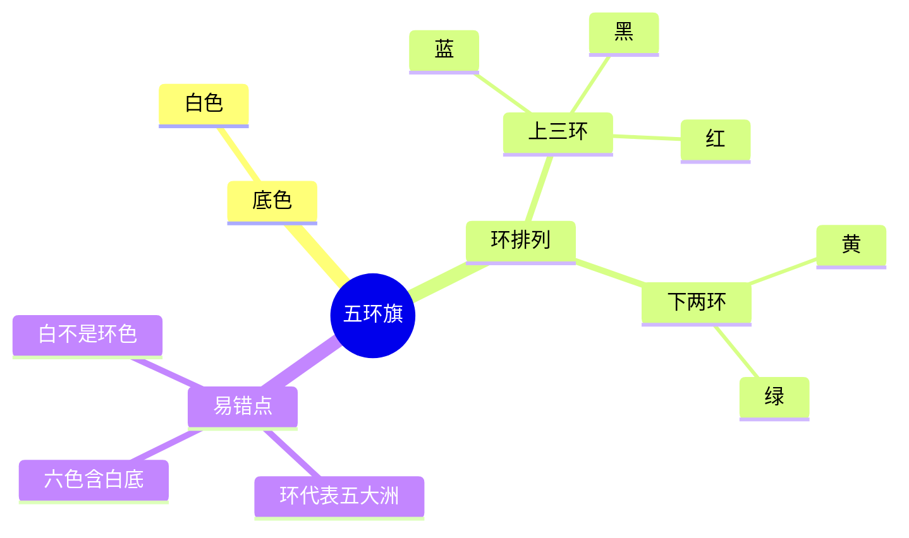

# 奥林匹克五环旗的含义与设计
当你看到一面白底上套连着五个彩色圆环的旗帜，脑子里冒出的第一个念头可能是“五种颜色挺好看”。但这个简单的图形，藏着现代奥林匹克运动最核心的两件事：**团结**与**全球性**。

### 为什么需要一面旗？

现代奥运会诞生时，顾拜旦面对一个难题：如何让说着不同语言、来自不同政治体制的人，在同一个赛场上产生“我们是一起的”这种感觉？口号可以翻译，但图形不需要翻译。五环旗要扮演的，就是一个 **==超越语言的视觉条约==**——运动员入场时看到它，就知道自己进入了体育的“共同体”。

> [!IMPORTANT]
> **核心考点**：奥林匹克会旗为 **白底**，由顾拜旦建议确定。

### 五个环到底在说什么？

[!NOTE]
> **辨析**：五环的“环环相扣”代表的是 **世界五大洲的团结**，而非五个具体的国家或某届比赛的排名。

正式的解释是：五个套连的圆环代表世界五大洲（Europe, Asia, Africa, Oceania, America），它们扣在一起，象征奥林匹克精神将不同大陆联结为一体。

但这里有个**常见的坑**，也是选择第 58 题的考点——

> [!WARNING]
> **五环的颜色是固定的六种？不，是六种，但五环本身只有五种。**

顾拜旦在 1913 年设计的版本里，用 ==蓝、黄、黑、绿、红== 这五种纯色作为五个环的颜色，加上白底，一共六种颜色。他专门选择这组颜色，是因为当时世界各国的国旗里，**几乎都能找到至少其中一种颜色**。换句话说，无论你代表哪个国家参赛，你都能在这面旗上看见自己国旗的一角。

五环本身的五种颜色是：
- 蓝
- 黄
- 黑
- 绿
- 红

因此，**白色不是环的颜色，是旗底的颜色**——选出白色（选项 B）就踩中了考题的核心雷区。

### 一张图记住五环与误区

### 一个算对了的例子

我们直接拿两道真题来演练，看你能不能从五环的“设计思路”倒推出正确答案。

**题目 1（选择 58）**
> 不是奥林匹克环颜色的是：A. 红  B. 白  C. 蓝  D. 黑

如果你记得“白是底，不是环”，这道题立刻锁定 **B**。这里不需要任何推理，纯粹是 ==白色是旗底== 这个知识点的直接调用。

**题目 2（选择 59）**
> 奥林匹克会旗为＿底：A. 红  B. 白  C. 蓝  D. 黑

同样是白底，答案是 **B**。这题追问的是“底”，所以白色成了答案。两个题合在一起，强化一个记忆点：**白是背景舞台，环是台上的主角，别把舞台颜色当成环的颜色。**

[!TIP]
> **记色诀**：“蓝黄黑绿红，白底托五洲”——看到白底选项，先判断题目问的是“环”还是“旗”，防踩雷。

### 顾拜旦的设计动机

顾拜旦在 1914 年巴黎奥林匹克代表大会上首次展示这面旗，他说过大意如此的话：“这五个环代表世界上五个部分，它们联合在奥林匹克主义之下。”他选的颜色是 ==从当时各国国旗里提取出的公共色谱==，追求的是最大程度的包容。1920 年安特卫普奥运会，五环旗第一次在赛场升起，此后成为开幕式的固定仪式。

---

现在去看那道“奥林匹克会旗是在谁建议下确定的”题，你应该能毫不犹豫选出 **A. 顾拜旦**——他是五环旗的设计者和提议者，也是现代奥林匹克运动的创始人。
