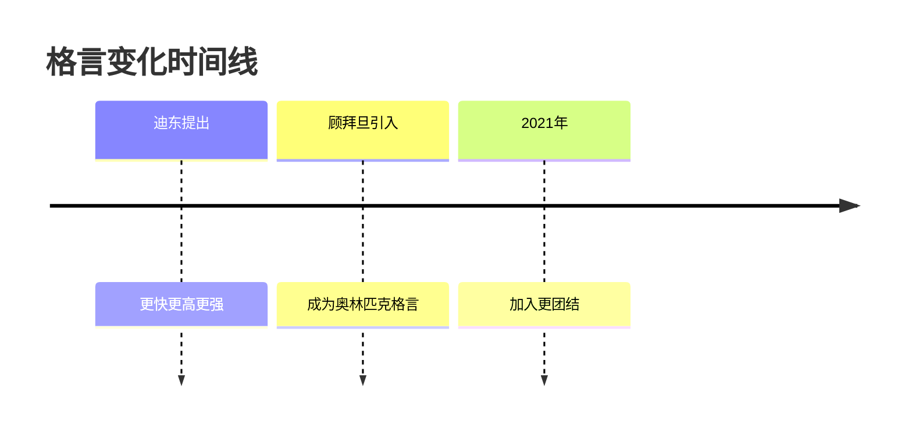

# 奥林匹克格言（更快、更高、更强——更团结）

## 它是什么

奥林匹克格言（Olympic Motto）亦称奥林匹克口号，是奥林匹克运动著名的口号表达。

它最早来自顾拜旦的好友、巴黎阿奎埃尔修道院院长迪东（Henri Didon）。他在学生户外运动会上鼓励大家说：“在这里，你们的口号是：更快、更高、更强。”后来顾拜旦将其引入奥林匹克运动。

其拉丁文为：

$$
\text{Citius, Altius, Fortius}
$$

对应中文：==更快、更高、更强==。

2021 年 7 月 20 日，国际奥委会第 138 次全会在东京通过决议，把“更团结”（together）加入格言。因此现在完整表述是：

> ==更快、更高、更强——更团结==

## 为什么需要它

格言不是单纯喊口号，而是表达奥林匹克运动的自我超越方向：

- 更快：追求运动表现极限
- 更高：追求难度、成绩、境界
- 更强：追求意志与能力
- 更团结：在竞争之外强调人类共同面对世界

## 怎么做：记忆与考试怎么用

考试常把“格言”和“名言”放在一起考。先想一个问题：如果题目问“口号/格言”，是“参与”还是“更快更高更强”？

看对比表：

| 名称 | 内容 | 课件定位 |
|---|---|---|
| 奥林匹克格言 | ==更快、更高、更强——更团结== | 口号 Motto |
| 奥林匹克名言 | 重要的是参加，而不是取胜 / 参与比取胜更重要 | 另一句著名表述 |
| 奥林匹克精神 | 强调公平竞争 | 精神内涵 |
| 奥林匹克主义核心 | 奥林匹克主义 | 思想体系核心 |

## 相近概念的区别

学生最容易混的是“格言”和“名言”：

- 题目出现拉丁文 $Citius, Altius, Fortius$，一定选 ==更快、更高、更强==
- 题目问“奥林匹克名言”，答案选 ==参与比取胜更重要==
- 题目问奥林匹克运动宗旨，答案是通过体育运动教育青年，为建立和平更美好世界作贡献
- 题目问思想体系核心，答案选 ==奥林匹克主义==

> [!IMPORTANT]
> 核心结论：格言是“更快、更高、更强——更团结”；名言是“参与比取胜更重要”。两者完全不同。

## 常见的坑

> [!WARNING]
> 坑一：把顺序写反。“更高、更快、更强”是错项，课件原文是“更快、更高、更强”。

> [!WARNING]
> 坑二：2021 后考题若写完整格言，要补上“——更团结”，不能只答老版。

> [!WARNING]
> 坑三：第 7 题问顾拜旦宗旨，不要选“更快更高更强”，那是格言不是宗旨。

## 一个算对了的例子

看这道选择题：

> 奥林匹克格言的内容是____，其拉丁文为 “Citius, Altius, Fortius”
>
> A. 手拉手，心连心  
> B. 更快、更高、更强  
> C. 更高、更快、更强  
> D. 重在参与，永不言败

解题过程：

1. 拉丁文对应格言，不是名言
2. 课件原文顺序是“更快、更高、更强”
3. “更高、更快、更强”顺序错，“重在参与”是名言

所以答案是 ==B==。
