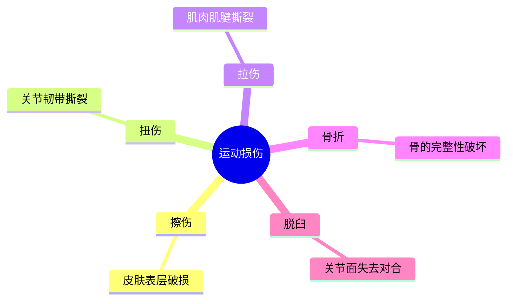

# 常见运动损伤类型（擦伤、扭伤、拉伤、骨折、脱臼）

运动损伤是体育锻炼中因外力或自身动作不当造成的组织损害。为什么必须先分清类型？因为==错误急救会加重伤情==，比如把骨折当扭伤揉搓，可能导致骨刺扎破血管。

## 五种常见损伤辨析

先想一个问题：皮肤表面蹭破了和脚踝“崴”了一下，受伤的组织一样吗？显然不同。根据受损结构，可划分为以下五类：

> [!IMPORTANT]
> 核心定义与受损靶点必须精准对应：
> - **擦伤**：皮肤表层被粗糙物摩擦破损，伴渗血或组织液渗出。
> - **扭伤**：==关节韧带==过度扭转或牵拉导致的撕裂（如踝关节内翻）。
> - **拉伤**：==肌肉或肌腱==在主动收缩或被动拉长时超出极限而撕裂。
> - **骨折**：骨的连续性或完整性中断，分闭合性与开放性。
> - **脱臼**：构成关节的骨端关节面脱离正常位置，常伴关节囊撕裂。

| 损伤类型 | 受损主要组织 | 典型场景 | 核心体征 |
| :---: | :---: | :---: | :---: |
| 擦伤 | 皮肤表皮 | 摔倒滑行、器械摩擦 | 创面渗血、疼痛 |
| 扭伤 | 韧带 | 踩空、落地不稳 | 关节肿胀、活动受限 |
| 拉伤 | 肌肉/肌腱 | 冲刺跑、大力扣杀 | 局部剧痛、发力困难 |
| 骨折 | 骨骼 | 剧烈撞击、高处坠落 | 畸形、骨擦音、假关节活动 |
| 脱臼 | 关节面 | 跌倒手掌撑地（肩脱臼） | 关节盂空虚、弹性固定 |

## 相近概念的区别

最容易混淆的是**扭伤**与**拉伤**。记住一个判断标准：==痛点在关节处多为扭伤，痛点在肌肉腹部多为拉伤==。扭伤伤的是连接“骨与骨”的韧带；拉伤伤的是连接“骨与肉”的肌腱或肌肉本身。

另一个易混点是**骨折**与**脱臼**。两者都会导致肢体变形和剧痛，但骨折是骨头断了，脱臼是骨头“跑偏了”。现场若无法鉴别，一律按骨折处理原则进行固定。

## 现场怎么做

> [!TIP]
> 急性软组织损伤（扭伤、拉伤）初期遵循 RICE 原则：休息（Rest）、冰敷（Ice）、加压包扎（Compression）、抬高患肢（Elevation）。

遇到出血或创伤需要包扎止血时，必须选对工具和方法。结合题库中的真题来验证：

**【例题】** 对于包扎技术，下列的工具不属于包扎工具的是（ ）。
A. 纱布、绷带 B. 自粘贴、三角巾 C. 尼龙网套 D. 改锥

**解析：**
1. 包扎的目的是保护伤口、压迫止血、固定敷料。
2. 常用包扎材料包括：纱布、绷带、三角巾、自粘贴及尼龙网套等。
3. 改锥属于五金维修工具，不仅不能包扎，反而可能造成二次感染或机械性损伤。
4. 答案为 ==D==。

> [!WARNING]
> 发生擦伤时，切忌直接用未消毒的纸巾擦拭创面；怀疑骨折或脱臼时，==严禁盲目复位或揉搓患处==，应就地利用夹板或健侧肢体固定后送医。
