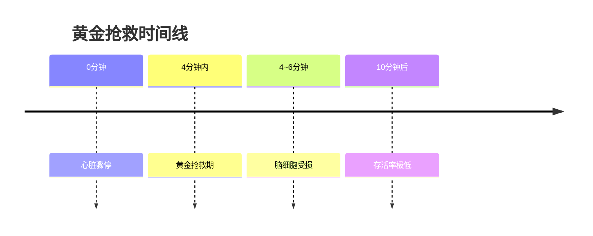
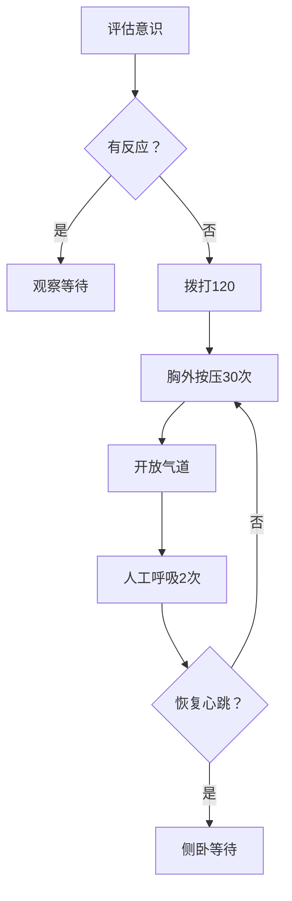

# 心肺复苏（CPR）的操作步骤与黄金抢救时间

> [!IMPORTANT]
> 心肺复苏（CPR）是针对呼吸、心脏骤停伤病员的==简单救治方法==，适用于急性心肌梗死、脑卒中、严重创伤、电击伤、溺水、挤压伤、踩踏伤、中毒等多种原因引起的骤停。

## 为什么需要它

当心脏骤停后，大脑对缺氧极度敏感。思考一下：如果血液停止流动，脑细胞能撑多久？

答案是：==黄金抢救时间仅为 4～6 分钟==。超过这个窗口，脑细胞将发生不可逆损伤甚至死亡。因此，在专业急救人员到达前，现场第一目击者立即实施 CPR 是挽救生命的关键。

## 怎么做

CPR 的核心操作遵循 **C-A-B** 顺序：

1. **评估与呼救**：判断环境安全，拍打双肩并大声呼唤确认意识；若无反应且无正常呼吸，立即拨打 120。
2. **C（Compressions，胸外按压）**：将患者仰卧于坚硬平面，双手交叠，掌根置于两乳头连线中点（胸骨下半部），以 $5 \sim 6\text{ cm}$ 深度、$100 \sim 120\text{ 次/分}$ 频率按压。
3. **A（Airway，开放气道）**：清除口腔异物，采用仰头举颏法打开气道。
4. **B（Breathing，人工呼吸）**：捏住鼻翼，口对口吹气 2 次，每次约 1 秒，见胸廓起伏即可。

按压与通气比例为 ==$30:2$==，即 30 次按压后接 2 次人工呼吸，循环进行直至 AED 到达或专业人员接手。

## 相近概念辨析

结合课件考点，需区分“现场救护”中的不同技术与原则：

| 技术/行为 | 适用场景 | 核心目的 |
|---|---|---|
| 心肺复苏（CPR） | 呼吸、心脏骤停 | 维持血液循环与供氧 |
| 止血技术 | 外伤出血 | 控制失血 |
| 固定技术 | 骨折/关节脱位 | 防止二次损伤 |
| 冰敷 | 闭合性软组织损伤 | 消肿止痛 |

> [!NOTE]
> 志愿者现场救护的基本任务是“救命为主，保持气道畅通”和“对伤员分级处理”，而==“旁观”绝不是基本任务==。“迅速转移伤员”在未做初步处理前盲目进行也是错误的。

## 常见的坑

> [!WARNING]
> 拨打 120 时，必须报告人与伤员信息、具体所在地、最危重情况。但==绝不能自己说完立即挂断电话==，应等调度员确认信息完毕后再挂机。

> [!CAUTION]
> 志愿者救治伤员时，“别的无所谓，拼命救治”是错误做法。必须先做好个人防护（自我保护）、表明身份，并在过程中给予心理安慰。

> [!TIP]
> 防踩踏姿势：拥挤中一手握另一手腕，手肘撑开平放胸前微弯腰，目的是==保持呼吸道畅通==并形成生存空间；若被挤倒无法站起，应立即就地卧倒滚向墙角，而非强行挤出。

## 真题实战

**题目**：适用于由急性心肌梗、脑卒中、严重创伤、电击伤、溺水、挤压伤、踩踏伤、中毒等多种原因引起的呼吸、心脏骤停的伤病员的简单救治方法是？

- A. 心肺复苏
- B. 止血技术
- C. 固定技术
- D. 冰敷

**解析**：题干关键词为“呼吸、心脏骤停”。对照上表，止血针对出血，固定针对骨折，冰敷针对软组织肿胀，只有 CPR 专门应对骤停。答案选 ==A==。
