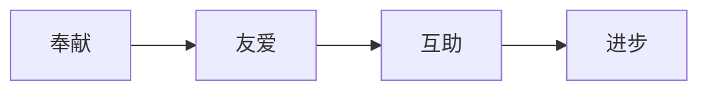

# 奥运志愿者服务岗位职责与行为规范

## 奥运志愿者服务岗位职责与行为规范

先问一个问题：一场奥运会，运动员、裁判、官员、媒体、观众加起来几十万人，为什么能在一个月内有序运转？答案很大程度上在于——志愿者。他们不是“免费劳动力”，而是赛事运行的“润滑剂”和主办城市形象的“第一张名片”。

### 志愿者精神的核心是什么

南邮《体育理论》考试反复考一个四词组合，必须记准：

> [!IMPORTANT]
> 志愿者精神的本质是 ==奉献、友爱、互助、进步==。

这四个词之间有逻辑递进关系：

- **奉献**：不计报酬、自愿付出时间和精力。
- **友爱**：欣赏他人、与人为善、有爱无碍、平等尊重。
- **互助**：互相帮助、助人自助，不是单方面施舍。
- **进步**：通过服务提升自己、推动社会文明进步。

> [!TIP]
> 记忆口诀：“**奉友互进**”——“奉献”打头，“友爱”随后，“互助”搭桥，“进步”收尾。选答案时看到“团结”混进来要警惕，那是干扰项。

### 一个常考的背景知识

2001年“国际志愿者年”启动仪式上，==联合国秘书长科菲·安南==指出：“志愿精神核心是服务、团结的理想和共同使这个世界变得更加美好的信念。”

这道题容易误选“萨马兰奇”或“江泽民”。记法：志愿者是全球性事业，由联合国推动，所以是**联合国秘书长**安南，不是国际奥委会的人。

### 奥运志愿者的岗位职责

志愿者的总目标是“确保赛会顺利进行”，具体包括：

- 为各国运动员、官员、媒体、观众提供信息咨询、语言翻译、场馆引导等服务
- 协助检票、安检、秩序维护、颁奖礼仪等赛会运行工作
- 及时沟通，解决各类突发问题
- 传播主办国文化，展示城市形象

> [!WARNING]
> 考试陷阱：==“勤工俭学，借机挣钱”不是正确的志愿服务目的==。奥运志愿服务以无偿为原则（有餐食、交通等基本保障，但不以挣钱为目的）。

### 对志愿者的要求

| 维度 | 具体要求 |
|------|----------|
| 道德 | 崇高的道德修养，诚信守时 |
| 知识 | 扎实的知识基础，熟悉场馆、赛程、礼仪 |
| 能力 | 灵活的处事能力，善于沟通应变 |
| 态度 | 热情、耐心、尊重多元文化 |

> [!CAUTION]
> 题目问“对奥运志愿者的要求**没有**”哪一项时，答案是 ==统一的外表==。志愿者服装是统一的，但外表（长相、身高、体型等）没有统一要求。别把“统一服装”和“统一外表”混淆。

### 志愿者需要不断提升的能力

志愿者应不断提升：

1. **人际交往能力**——与不同文化背景的人打交道
2. **突发事件处理能力**——赛场内外情况多变
3. **扶残助残能力**——服务残奥会及特殊需求人士

> [!NOTE]
> ==“争取更高职位能力”不属于志愿者应提升的能力==。志愿者精神是服务，不是晋升。这道题选项中看到“更高职位”就可以直接排除。

### 一道带你“算对”的题

**选择 199**：志愿服务提倡志愿者“欣赏他人，与人为善，有爱无碍，平等尊重。”这体现了（　　）精神。

**分析**：

- 题干关键词“欣赏他人”“有爱无碍”“平等尊重”指向的是对他人友善、平等相待的态度
- “奉献”侧重付出不求回报
- “互助”侧重相互帮助
- “进步”侧重自我与社会提升
- ==“友爱”== 的核心定义就是“欣赏他人、与人为善、有爱无碍、平等尊重”

**答案**：B. 友爱

### 常见坑总结

| 易错点 | 正确结论 |
|--------|----------|
| 志愿者精神里有“团结” | ❌ 四个词是“奉献、友爱、互助、进步”，没有“团结” |
| 安南的身份 | ❌ 别记成“国际奥委会主席”，是**联合国秘书长** |
| 志愿目的可以是挣钱 | ❌ “勤工俭学、借机挣钱”不是正确目的 |
| 志愿者外表要统一 | ❌ 服装统一，外形不要求统一 |
| 要争取更高职位 | ❌ 志愿者提升的是服务能力，不是职位 |
