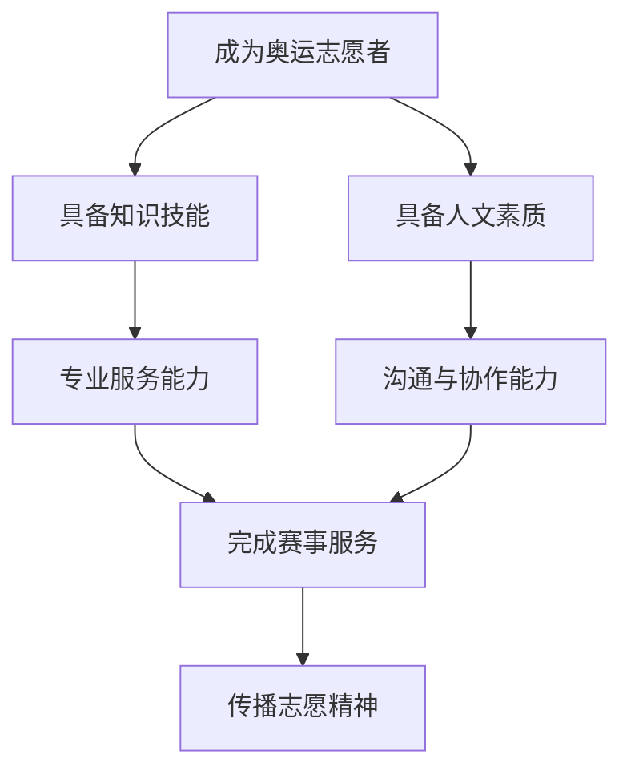

# 奥运志愿者的定义、精神与基本素质要求

## 什么是奥运志愿者

奥运志愿者是为奥运会、残奥会及相关赛事提供无偿服务的人员。他们并非只承担“检票、递水”等事务，还包括语言翻译、媒体接待、场馆引导、秩序维护、运动员服务、观赛引导以及赛后遗产服务等工作。

2008年北京奥运会约有 ==30 万名志愿者== 投入赛事服务，说明大型综合性赛事需要大量公共服务人员，也需要志愿者以自身行动传播奥林匹克精神。

## 为什么需要奥运志愿者

奥运会具有参与人数多、观众规模大、场馆分布广、项目差异明显和服务要求高等特点。专业工作人员负责竞赛组织和技术工作，志愿者则补充公共服务力量，帮助参赛人员、观众和媒体顺利完成赛会活动。

> [!IMPORTANT]
> 志愿者是赛事服务的重要参与者，但其服务以自愿、无偿和公益为基本特征，不等同于职业工作人员。

## 志愿者精神是什么

北京奥运会将志愿者精神概括为：

> ==奉献、友爱、互助、进步==

- **奉献**：不计报酬，主动承担服务责任。
- **友爱**：关怀他人，尊重不同文化与身份。
- **互助**：志愿者之间相互支持，也与赛事参与者协作。
- **进步**：提升专业能力，在服务中学习并推动社会进步。

联合国秘书长科菲·安南指出，志愿精神的核心是“服务、团结的理想和共同使这个世界变得更加美好的信念”。这说明志愿服务不仅强调个人付出，也强调团结协作与美好信念。

| 精神 | 主要表现 | 易混点 |
|---|---|---|
| 奉献 | 主动服务、无偿付出 | 不等于只做苦力 |
| 友爱 | 理解、尊重、关怀他人 | 不等于迎合所有要求 |
| 互助 | 相互支持、共同协作 | 重点在双向帮助 |
| 进步 | 学习服务、优化工作 | 不只指个人成绩提升 |

## 基本素质要求

奥运志愿者既要具备必要的知识与技能，也要有较强的服务意识、服务精神、服务能力和 ==较高综合人文素质==。具体可从以下方面理解：

1. **道德修养**：诚实守信、尊重他人、认真负责，不因疏忽影响赛事。
2. **知识与技能**：掌握外语、礼仪、急救、场馆知识和基本操作技能。
3. **服务能力**：能主动发现问题，准确理解需求，并提供恰当帮助。
4. **沟通与应变**：语言表达清楚，灵活处理突发情况。
5. **人文素质**：了解奥林匹克文化、不同民族习俗，具备开放、包容和跨文化交流意识。

## 与相近概念的区别

| 概念 | 核心属性 | 与奥运志愿者的区别 |
|---|---|---|
| 职业工作人员 | 契约劳动，通常领取报酬 | 志愿者通常无偿服务 |
| 社会志愿者 | 广泛参与社会公益服务 | 奥运志愿者特指服务奥运赛事者 |
| 赛事观众 | 主要是体育赛事的观看者 | 志愿者也可能是观众，但承担服务职责 |

## 常见易错点

> [!WARNING]
> “对奥运志愿者的要求”中不包括“统一的外表”。志愿服务强调内在素质、实际能力和规范行为，不是靠统一服装来判断是否合格。

另外，“欣赏他人、与人为善、有爱无碍、平等尊重”主要体现 ==友爱== 精神；“服务、团结的理想和共同使世界更加美好的信念”对应的是志愿服务精神的核心表述，不要把两者混为一谈。

> [!TIP]
> 记忆口诀：**志愿精神“奉友互进”**；素质可概括为“德、知、能、变、博”，即道德修养、知识技能、服务与应变能力、人文素质。
