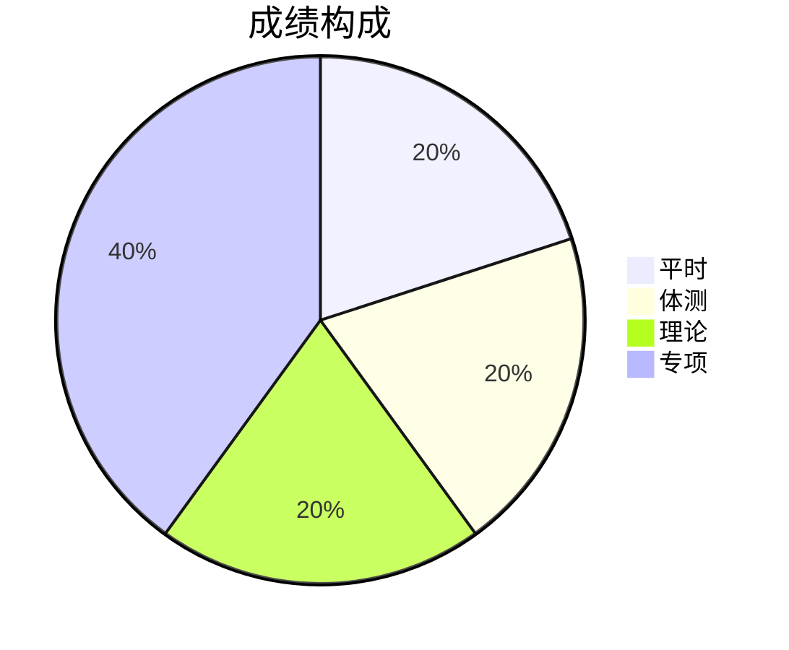

# 体育课程成绩评定构成（平时、体测、理论、专项）

> [!IMPORTANT]
> 体育课程成绩并非只看期末跑多快，而是由 ==平时、体测、理论、专项== 四部分按权重综合计算得出。

## 它是什么与为什么需要

你在南邮修读《体育理论》或任何体育课，最终拿到一个总评成绩。这个成绩是怎么来的？如果只考一次跑步，那天感冒了怎么办？因此，学校将考核拆分为四个维度，全面评价你的运动参与、体质水平、知识储备和专项技能。

> [!NOTE]
> 上图比例为示意结构，具体各项权重以当学期体育部公布的教学大纲为准。

## 怎么做：各部分拆解

- **平时**：包含出勤、课堂表现及早锻炼次数。若早锻炼次数不合格，==三年级以后都可补所欠的次数==。
- **体测**：即国家学生体质健康测试（如男生引体向上、女生仰卧起坐、BMI等）。注意：体测不仅影响体育课成绩，还直接挂钩评优——==体质测试成绩评定达到良好及以上者，才可以评奖评优==。
- **理论**：考查体育理论知识，例如课件中涉及的“奥林匹克文化”等内容。
- **专项**：你所选运动项目（如篮球、武术等）的期末技能考核。

## 相近概念的区别

很多同学容易把“体育课成绩”和“体测成绩”混为一谈，或者搞错查分渠道。

| 对比项 | 体育课成绩 | 体测成绩 |
| :--- | :--- | :--- |
| **性质** | 课程总评（含四项） | 单一维度的体质达标测试 |
| **用途** | 计入学分绩点 | 决定能否评奖评优（需达良好及以上） |
| **查询系统** | ==教务处正方系统== | 国家体质健康网/校内平台 |

> [!WARNING]
> 遇到“体育课考试成绩以哪个系统为准”的问题，正确答案是 **D. 教务处正方系统**。不要轻信小程序或仅看任课教师口头公布。

## 常见的坑

1. **生病缺考的误区**：因病无法参加期末专项或体测，不能直接“躺平”等补考，必须走缓考流程。需要准备的材料包括：==三甲医院诊断证明、缓考申请表、辅导员签字、学院盖章==（注意：不需要任课教师签字）。
2. **求助找错人**：遇到选课、成绩录入等教务问题，可以咨询学生所在学院的教学秘书、体育部教学秘书或教务处，但辅导员通常不负责处理具体的体育教务系统数据。
3. **资源浪费无关项**：在复习时注意区分知识点边界，比如“不合理利用和浪费消费资源的结果是资源枯竭”，这属于环保常识题，别和体育评分标准记串了。

> [!CAUTION]
> 缓考材料缺一不可！尤其是“三甲医院”证明，普通校医院或小诊所的证明可能不被认可。

## 算对了的例子

假设某同学本学期各项得分如下：平时 $90$ 分，体测 $85$ 分，理论 $80$ 分，专项 $95$ 分。若按权重公式计算总评：

$$
\text{总评} = \text{平时} \times W_1 + \text{体测} \times W_2 + \text{理论} \times W_3 + \text{专项} \times W_4
$$

代入权重（假设平时 $20\%$、体测 $20\%$、理论 $20\%$、专项 $40\%$）：

$$
\text{总评} = 90 \times 0.2 + 85 \times 0.2 + 80 \times 0.2 + 95 \times 0.4 = 18 + 17 + 16 + 38 = 89
$$

该生最终在教务处正方系统中查到的体育成绩即为 $89$ 分；同时其体测 $85$ 分达到了“良好”等级，具备本学年评奖评优资格。

> [!TIP]
> 记忆口诀：**“平体理专四合一，正方系统查成绩；体测良好能评优，缓考三甲骨章齐。”**
