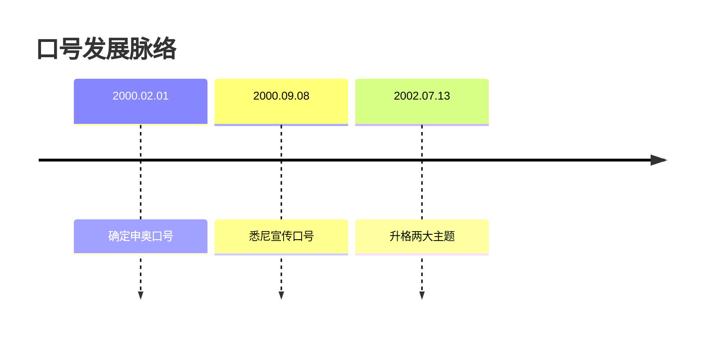
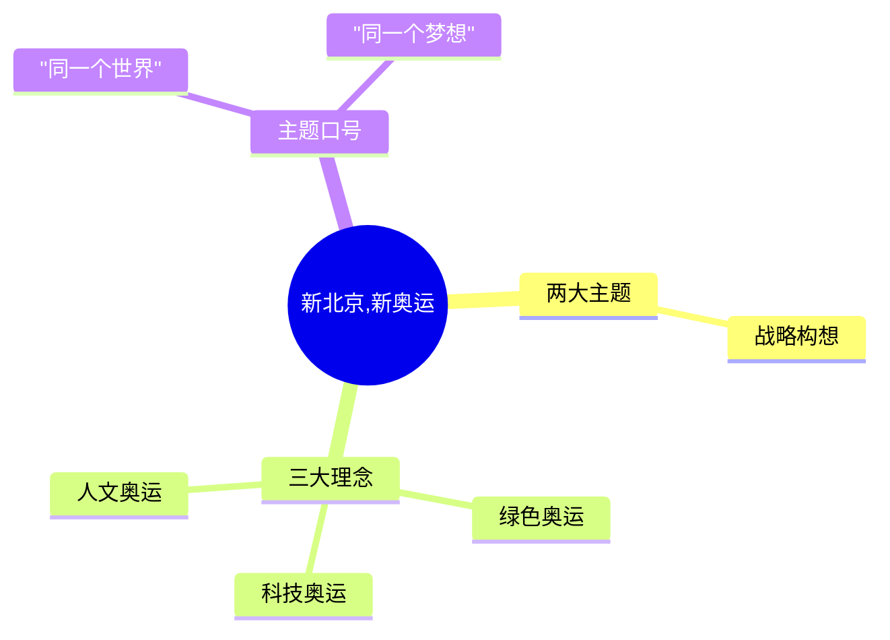

# “新北京，新奥运”口号及其内涵

北京要申办奥运会，如果只喊“我们要办奥运”，能打动国际奥委会吗？显然不够。一座城市需要一句响亮的口号，把自己的独特优势和承诺浓缩在一起。“新北京，新奥运”正是为此而生的==战略构想==。

## 它是什么

“新北京，新奥运”是2000年2月1日正式确定的北京申奥口号。在2002年7月13日公布的《北京奥运行动规划》中，它被明确提升为北京奥运会的==两大主题==。

> [!IMPORTANT]
> 它是筹办工作的总体战略目标，统领着具体的办奥理念。

用时间线来看它的提出与落地：

- **2000年2月1日**：确定申奥会徽与口号，申奥网站开通。
- **2000年9月8日**：王伟秘书长带队赴悉尼，借2000年悉尼奥运会向世界宣传该口号。
- **2002年7月13日**：北京市政府和北京奥组委共同制定并公布实施《北京奥运行动规划》，正式将其确立为两大主题。

## 为什么需要

北京是一座有着3000多年历史的文化古都，但申奥不能只讲“老故事”。这句口号回答了国际社会的疑问：中国能给奥林匹克带来什么新东西？

- **“新北京”**：展示改革开放后北京的现代化新面貌，以及深厚历史文化与现代都市的融合。
- **“新奥运”**：承诺为奥林匹克运动注入东方文明的新活力，留下一份独特的奥运遗产。

## 怎么做：两大主题与三大理念

口号如何落地？靠的是具体的行动指南。《北京奥运行动规划》将“新北京，新奥运”作为两大主题，并在其指导下提出了三大理念：

| 维度 | 内容 | 实践举例（真题考点） |
| :--- | :--- | :--- |
| ==两大主题== | 新北京，新奥运 | 筹办工作的总体战略构想 |
| 三大理念 | 绿色奥运 | 设施规划建设中把环境保护作为首要条件 |
| | 科技奥运 | 运用高新技术保障赛事运行 |
| | 人文奥运 | 突出“中国字”“中国印”等传统文化元素 |

> [!NOTE]
> “新北京，新奥运”是==战略构想==；“绿色、科技、人文”是落实构想的==三大理念==；“同一个世界，同一个梦想”则是面向全球公众的==主题口号==。三者层级不同，切勿混淆。

## 常见的坑与辨析

> [!WARNING]
> 考试极易将“战略构想”“三大理念”和“主题口号”混在一个选项中让你挑。记住定位：“新北京，新奥运”对应的是==战略构想==。

> [!CAUTION]
> 不要看到“奥运”二字就选它。题目问“总体目标/战略构想”时选A；问“首要条件”时选环境保护（绿色奥运）；问“文化元素”时选人文奥运。

> [!TIP]
> 记忆口诀：**“两新”定方向（战略），“三色”抓落地（理念），“同一”传天下（口号）。**

## 真题实战

我们拿一道经典考题来验证：

**题干**：北京奥运会组委会筹办工作的总体目标是举办一届“有特色，高水平”的奥运会和残奥会，实现____的战略构想。
A. 新北京，新奥运
B. 绿色奥运
C. 科技奥运
D. 人文奥运

**解析步骤**：
1. 审题眼：题目问的是“==战略构想==”。
2. 排除干扰项：B、C、D 属于“三大理念”，是用来支撑战略的具体原则，不是战略构想本身。
3. 锁定答案：根据《北京奥运行动规划》，“新北京，新奥运”正是这两大主题构成的战略构想。

**答案**：==A==
