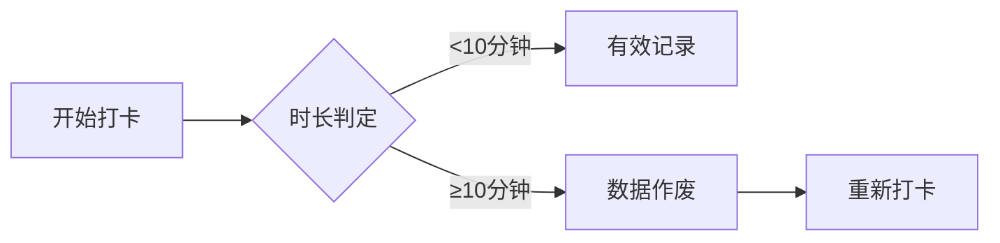

# 早操打卡与课外锻炼考勤制度

## 制度定位与核心意义

早操打卡与课外锻炼考勤并非单纯的“签到任务”，而是南邮《体育理论》课程中==过程性评价的关键组成==。它直接挂钩体育课平时成绩，更是毕业体质健康测试达标的前置保障。若忽视此项，不仅影响单科绩点，更可能因缺勤触发重修红线。

> [!IMPORTANT]
> ==体育课缺勤达总课时 1/3 即需重修==，早操与课外锻炼缺勤均计入此比例。

## 打卡实操与数据查询

仙林校区早操打卡依托专用小程序完成，系统对单次锻炼时长有严格阈值控制。许多同学误以为“跑得越久越好”，实则超时同样无效。

当需要核实减免数据或历史记录时，应通过哪个渠道确认？是询问老师、同学，还是登录成绩系统？正确答案是使用==早操系统（相关小程序）==自主查询，这是唯一实时准确的数据源。

> [!TIP]
> 打卡时间控制在 ==10 分钟以内==，超时系统自动判定无效，切勿盲目延长锻炼时长。

## 补卡机制与常见误区

如果学期内早锻炼次数未达标，是否意味着只能挂科？并非如此。学校设置了补救窗口，但时间节点极为特殊。

| 对比维度 | 正确做法 | 常见错误认知 |
| :--- | :--- | :--- |
| 补卡时间 | ==三年级及以后== | 寒暑假、大四随时可补 |
| 数据查询 | 早操小程序 | 体育课成绩系统 |
| 缺勤后果 | 计入1/3重修线 | 仅扣平时分 |

> [!WARNING]
> 补欠次数仅限==三年级以后==进行，大一、大二期间无法提前补卡，寒暑假亦不开放补卡通道。

## 算对一道典型题

以真题为例：“若早锻炼次数不合格，应该在何时可以补所欠的次数？”选项涵盖寒暑假期、四年级、三年级以后、任何时间。根据制度规定，补卡窗口始于大三，贯穿后续学年，因此正确答案为“三年级以后都可”。这道题考查的正是对==补卡时间边界==的精准记忆，而非模糊的“以后可以补”印象。

> [!CAUTION]
> 切勿将“课外锻炼”与“早操打卡”混淆，两者虽同属考勤体系，但==打卡平台、时间要求、补卡规则均独立执行==，不可互相替代。

掌握这套制度，本质上是在管理自己的学业风险。把规则当作工具而非负担，才能让体育锻炼真正服务于身心健康与学业顺利完成。
