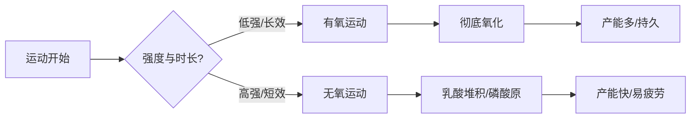

# 有氧运动与无氧运动的区别及生理特点

# 有氧运动与无氧运动的区别及生理特点

## 核心定义与能量来源

人体运动的本质是能量的释放与利用。正如考题所示，释放能量的唯一来源是**有机物质的氧化分解**（答案 D）。根据供能系统中氧气参与的程度，运动分为有氧和无氧两类。

> [!IMPORTANT]
> ==核心区别==：取决于运动强度下，身体主要依赖“有氧氧化系统”还是“无氧酵解/磷酸原系统”供能。

- **有氧运动**：强度低、持续时间长。氧气供应充足，糖、脂肪彻底氧化为 $CO_2$ 和 $H_2O$，产生大量 ATP。
- **无氧运动**：强度高、持续时间短。氧气供应不足，依赖肌糖原无氧酵解产生乳酸，或磷酸原分解，ATP 生成少且快。

## 生理特点对比

心肺功能是将氧气和==营养物质==运送到组织的关键能力（参考考题 10，答案 C）。两种运动对心肺及代谢的影响截然不同：

| 特征 | 有氧运动 | 无氧运动 |
| :--- | :--- | :--- |
| **能量底物** | 糖、脂肪、蛋白质 | 肌糖原、磷酸肌酸 |
| **代谢产物** | $CO_2$、$H_2O$ | 乳酸、氢离子 |
| **心率区间** | 最大心率的 60%-80% | 最大心率的 80%-90%+ |
| **典型项目** | 慢跑、游泳、骑行 | 百米冲刺、举重、跳高 |

> [!NOTE]
> 大脑在正常情况下主要依赖**葡萄糖**供能（参考考题 6，答案 B）。有氧运动能更稳定地维持血糖水平，保障中枢神经系统功能。

## 常见误区与辨析

> [!WARNING]
> **误区**：“无氧运动完全不消耗氧气”。
> **正解**：无氧运动是指供能主导方式不依赖氧气，但呼吸从未停止。只是摄氧量无法满足即时能量需求，产生“氧亏”。

> [!TIP]
> **判断技巧**：能否边运动边完整说话？
> - 能顺畅交谈 $\rightarrow$ 有氧区间
> - 气喘吁吁，只能崩单词 $\rightarrow$ 无氧区间

## 实例分析

以“400 米跑”为例：
1.  **前 10 秒**：主要依靠磷酸原系统（无氧），爆发力极强。
2.  **中段**：糖酵解系统主导（无氧），乳酸迅速堆积，肌肉酸痛感加剧。
3.  **后程**：若速度下降但仍坚持，有氧系统参与比例逐渐上升，帮助清除部分乳酸。

因此，区分两者并非绝对割裂，而是看**主导供能系统**。对于南邮《体育理论》考试，重点掌握：**有氧重耐力与心肺功能提升，无氧重力量与速度爆发，且二者均源于有机物的氧化分解。**
