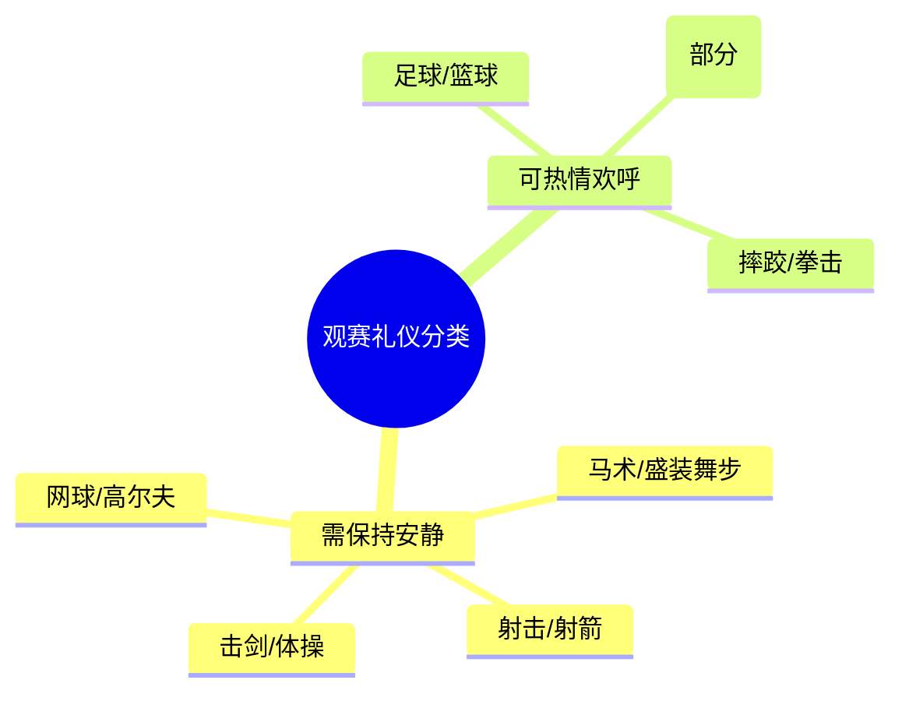

# 特定项目（如网球、田径、体操）的特殊观赛礼仪要求

# 特定项目（如网球、田径、体操）的特殊观赛礼仪要求

观赛礼仪不仅是文明素养的体现，更是保障比赛公平、安全进行的必要条件。不同运动项目因技术特点、环境要求及安全风险差异，对观众行为有截然不同的规范。

## 为什么需要区分观赛礼仪？

早期奥运会项目设置随意，缺乏统一规则。随着奥林匹克运动进入规范化阶段（1920年后），竞赛项目逐渐固定，对赛场环境的要求也日益明确。
*   **安静类项目**：如网球、高尔夫、马术、射击、击剑。运动员需要高度专注或听声辨位，噪音会直接干扰竞技状态。
*   **热烈类项目**：如足球、篮球、排球。观众的热情呐喊能激发运动员斗志，营造主场氛围。

> [!IMPORTANT]
> ==核心原则==：尊重项目特性。在需要“静”的项目中喧哗是失礼，在需要“动”的项目中冷漠也是失礼。

## 怎么做：典型项目礼仪指南

### 1. 网球与高尔夫：绅士的沉默
这类项目要求观众在发球或击球瞬间保持绝对安静。
*   **禁忌**：走动、大声交谈、使用闪光灯。
*   **正确做法**：仅在死球或得分后鼓掌。

### 2. 马术（盛装舞步）：人马合一的境界
盛装舞步被称为“马术芭蕾”，最高境界是只听见呼吸声。
*   **禁忌**：摇旗呐喊、挥舞旗帜饰品、向场内抛掷杂物。
*   **正确做法**：全程保持肃静，避免惊吓马匹。

### 3. 乒乓球与羽毛球：尊重的掌声
虽然对抗激烈，但需注意时机。
*   **关键点**：当对手打出精彩好球，或非本国选手表现优异时，应给予公正的掌声。
*   **禁忌**：在发球瞬间拍照（闪光灯干扰）、喝倒彩。

### 4. 公路自行车：安全第一
*   **禁忌**：冲进赛道、泼洒饮料（导致路面湿滑摔车）。
*   **正确做法**：在警戒线外热情欢呼，确保自身与运动员安全。

> [!WARNING]
> **常见误区**：认为所有比赛都可以像足球一样全程呐喊。例如在**击剑**比赛中，必须在裁判喊“停”后才能喝彩，否则会干扰裁判判罚和运动员节奏。

## 易错点辨析与真题示例

许多同学容易混淆“热情”与“干扰”的界限。请看以下对比：

| 项目 | 适宜行为 | 禁止行为 | 原因 |
| :--- | :--- | :--- | :--- |
| **花样滑冰** | 结束后起立鼓掌 | 表演中吹口哨、开闪光灯 | 影响情绪与视线 |
| **摔跤** | 适度加油 | 带有强烈倾向性的辱骂 | 保持体育精神 |
| **跳水/体操** | 动作完成后鼓掌 | 助跑/起跳时喧哗 | 避免分散注意力 |

> [!TIP]
> **解题技巧**：遇到观赛礼仪题，先判断该项目是否依赖**听觉专注**（如射击、马术）或**视觉平衡**（如体操、跳水）。若是，则选“安静”；若是团体对抗且无精细操作要求（如足球），则选“热烈”。

**真题回顾（选择 218）**：
在马术盛装舞步比赛中，哪种行为不恰当？
*   A. 保持安静
*   B. 不摇摆旗帜
*   C. **摇旗呐喊** (正确答案)
*   D. 不抛掷杂物

**解析**：马匹易受惊，摇旗呐喊会破坏“只听得到呼吸”的比赛环境，属于严重违规。
