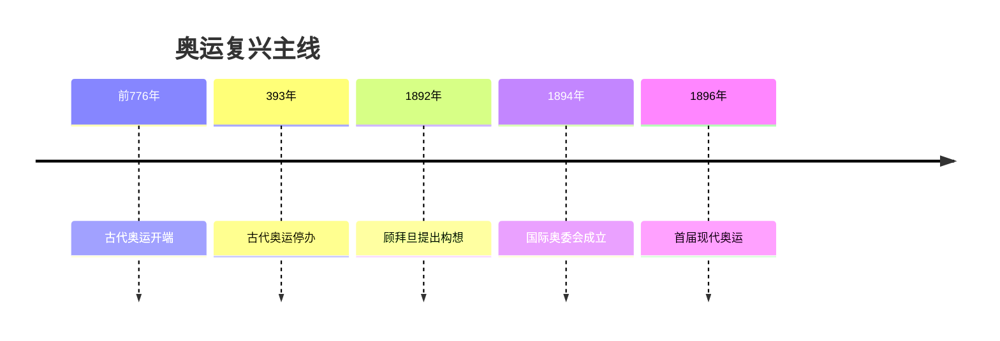

# 现代奥林匹克运动的复兴与顾拜旦的贡献

现代奥林匹克运动不是古代奥运会的简单恢复，而是在近代社会条件下形成的国际体育文化运动。复习时要抓住一条主线：==时代发展提出需要，顾拜旦推动复兴，奥运会成为实现奥林匹克理想的重要形式==。

## 为什么会在近代复兴

古代奥运会每4年在古希腊**奥林匹亚**举行，自公元前776年至公元393年，共举办293届，历时1169年。它为后世留下了定期竞赛、和平交往等文化遗产，但古代奥运会已经停办，不能直接等同于现代奥林匹克运动。

现代奥林匹克运动兴起于==欧洲资本主义工业化时期==。工业化和教育发展改变了社会生活，人们对体育、健康和国际交往提出了新的要求。因此，题目问“兴起的驱动因素”时，应选**时代的发展**；古代奥运会是文化渊源，工业化是重要时代条件，二者不能混作唯一答案。

## 顾拜旦作出了什么贡献

法国教育家皮埃尔·德·顾拜旦被称为“现代奥林匹克之父”。他的贡献不只是“提议办一次比赛”，而是把体育与教育、和平及国际友谊联系起来，并推动建立持续运行的国际组织和制度。

==1892年==，顾拜旦正式提出复兴奥运会的具体想法；1894年，国际奥林匹克委员会成立；1896年，第一届现代奥运会在雅典举行。由此可见，“提出构想”“建立组织”“举办首届奥运会”是三个不同节点。

他提出奥林匹克运动以==团结、和平、友谊==为宗旨，强调通过体育促进人的发展和不同国家、民族之间的理解。这比单纯追求比赛成绩更能说明复兴奥运会的目的。

## 相近概念怎么区分

| 概念 | 核心含义 | 常见混淆 |
|---|---|---|
| 古代奥运会 | 古希腊奥林匹亚的定期赛会 | 不是现代奥运会 |
| 现代奥林匹克运动 | 以体育促进教育、和平与友谊的国际运动 | 不只等于四年一届的比赛 |
| 现代奥运会 | 奥林匹克运动的重要实践形式 | 首届于1896年举行 |
| 顾拜旦的贡献 | 提出构想、推动组织与制度建立 | 不是古代奥运会创办者 |

> [!WARNING]
> “更快、更高、更强”是奥林匹克格言，“重在参与”强调参与精神，都不能替代题干所问的“团结、和平、友谊”这一宗旨。1892年也勿误选为1896年。

## 例题

**题目：**奥林匹克运动兴起于什么时期？

A. 欧洲资本主义工业化时期　B. 旧石器时期　C. 新石器时期　D. 欧洲文艺复兴时期

**答案：A。**先判断题目问的是现代奥林匹克运动的社会背景，而不是古代奥运会或文艺复兴的文化影响，因此选“欧洲资本主义工业化时期”。若继续问“谁使其登上历史舞台”，则答**顾拜旦**；问“哪一年正式提出复兴奥运会的具体想法”，则答**1892年**。
