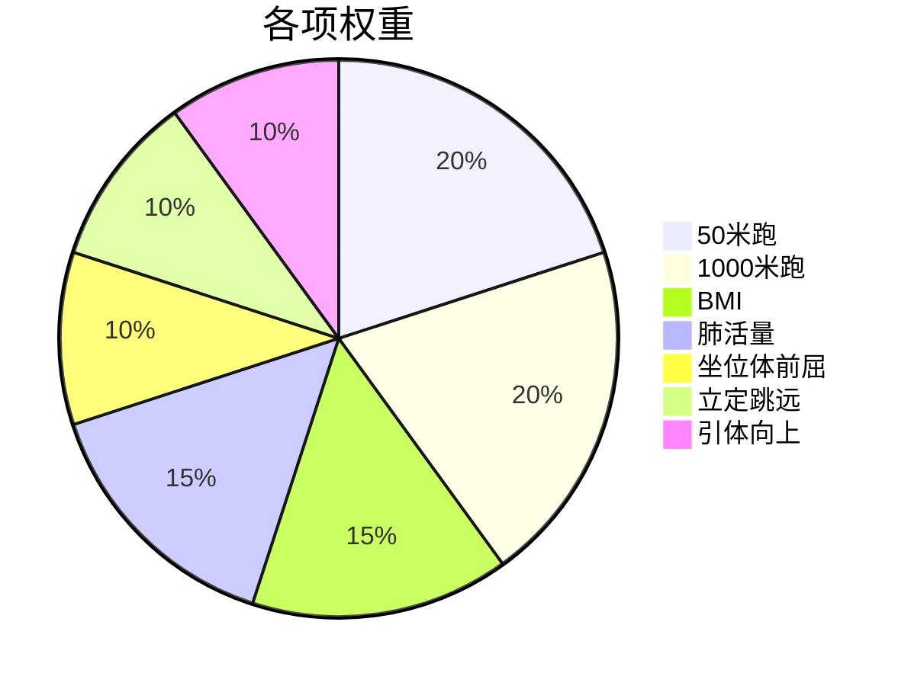

# 大学男生体测各项评分标准（引体向上、1000米等）

## 评分表是什么

大学男生体质健康测试由 **BMI、肺活量、50米跑、1000米跑、坐位体前屈、立定跳远、引体向上** 7项组成。各项先依据“大学男生评分标准”换算成分数，再按权重合成总成绩：

$$
总成绩=15\%\times BMI+15\%\times肺活量+20\%\times50米+20\%\times1000米+10\%\times坐位体前屈+10\%\times立定跳远+10\%\times引体向上
$$

其中，1000米跑、引体向上等耐力与力量项目成绩越好，得分越高；50米跑、1000米跑用时间表示，==用时越短分数越高==。

## 为什么要分年级

学校将男生分为 **1—2年级** 和 **3—4年级**，同一项目采用不同标准。高年级标准通常略高：例如1000米满分，1—2年级为3分17秒，3—4年级为3分15秒；引体向上满分分别为19个和20个。

因此，查看成绩时必须先确认年级，不能把两个年级对应的数据混用。

## 关键评分点

| 项目 | 1—2年级满分 | 3—4年级满分 | 满分分值 |
|---|---:|---:|---:|
| 肺活量 | 5040 ml | 5140 ml | 100 |
| 50米跑 | 6.7秒 | 6.6秒 | 100 |
| 1000米跑 | 3:17 | 3:15 | 100 |
| 立定跳远 | 273 cm | 275 cm | 100 |
| 坐位体前屈 | 24.9 cm | 25.1 cm | 100 |
| 引体向上 | 19个 | 20个 | 100 |

优秀、良好、及格、不及格是等级范围，而表中的具体分数用于实际计分。例如，引体向上在1—2年级完成16个得85分，完成15个得80分；在3—4年级完成17个得85分，完成16个得80分。

## 算分示例

某大学男生为1—2年级，各项成绩如下：

- 1000米跑：3分34秒，对应85分；
- 引体向上：16个，对应85分；
- 50米跑：7.0秒，对应85分；
- 立定跳远：256厘米，对应85分；
- 坐位体前屈：19.5厘米，对应85分。

若BMI与肺活量也均达到85分，则总成绩为：

$$
85\times(20\%+20\%+10\%+10\%+10\%+15\%+15\%)=85
$$

即该男生总成绩为 **85分**。当所有项目得分相同时，按权重加权后仍等于该分数。

## 常见坑

> [!WARNING]
> 引体向上表中的“—”表示该分数段没有对应数据或数据缺失，不能理解为“该分数段不得分”。

> [!CAUTION]
> 1000米跑和50米跑不是“用时越长越好”，必须==越快越高分==；坐位体前屈则是数值越大越好。

> [!TIP]
> 计算总成绩时，可先把“单项分数×权重”逐项算出，再求和；也可先将所有项目得分求平均，再乘以100%。两种方法结果相同，但逐项计算更不容易漏项。

此外，引体向上同时出现在“大学男生评分标准”和“加分项目评分表”中，二者用途不同：前者用于基础项目评分，后者用于额外加分，不能混为一谈。
