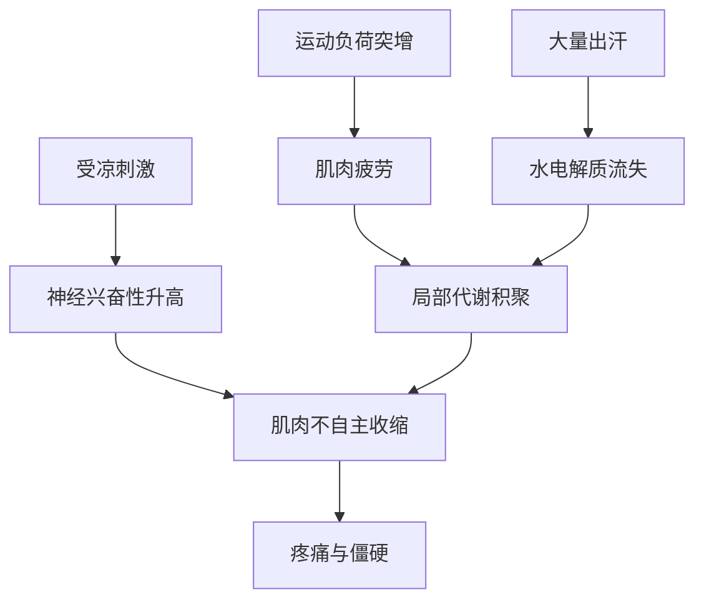

# 肌肉痉挛（抽筋）的原因与缓解方法

## 什么是肌肉痉挛

肌肉痉挛俗称“抽筋”，是骨骼肌突然出现的不自主收缩，常表现为局部疼痛、僵硬和短时间不能随意活动。运动中较常见于小腿腓肠肌，也可见于足底、大腿前后侧等肌群。

它不同于一般的肌肉紧张：肌肉紧张多在运动后逐渐出现，痉挛则是突然、强烈、持续地收缩，常由神经兴奋性异常、局部缺血、疲劳或受凉等因素共同引起。

## 为什么会发生

运动中肌肉持续收缩，能量消耗加快，乳酸等代谢产物容易积聚；若补水不足、电解质流失、肌肉疲劳或神经兴奋性升高，就更容易出现痉挛。寒冷刺激、突然增加运动负荷、准备活动不足也会增加风险。

> [!NOTE]
> 肌肉痉挛是肌肉、神经和局部循环共同参与的现象，不能简单归结为“缺钙”或“着凉”。

可以用下面的流程理解诱因：

## 运动中如何缓解

处理痉挛的基本思路是：**停止运动，缓慢牵拉痉挛肌肉，必要时补充水分和电解质。**

1. **立即停止运动**，不要强行继续活动，也不要突然用力反向屈拉。
2. **沿肌肉走向缓慢牵拉**，使痉挛肌肉逐渐被动延展。例如小腿腓肠肌痉挛时，可伸直膝关节并使踝关节背屈；足底痉挛时，可缓慢勾脚并轻推足底。
3. **牵拉应循序渐进**，以缓解痉挛和疼痛为目标，不能超过关节的正常活动范围。
4. 若症状持续，可轻柔按摩痉挛部位，并注意保暖；大量出汗后可适量补充含电解质的饮品。

> [!IMPORTANT]
> 对痉挛部位立即用力按摩是错误的。痉挛尚未缓解时，强烈刺激可能加重疼痛，甚至造成肌肉或软组织损伤。

> [!TIP]
> 口诀：**停下、牵拉、保温、补液**。牵拉方向要顺着肌肉走向，动作要慢。

## 容易混淆的处理方法

| 方法 | 是否正确 | 原因 |
|---|---|---|
| 马上沿肌肉走向缓慢牵拉 | 正确 | 有助于肌肉被动延展，缓解不自主收缩 |
| 尽可能使肌肉被动延伸 | 正确 | 但不能超过正常活动范围 |
| 对痉挛部位立即用力按摩 | 错误 | 可能加重痉挛和疼痛 |
| 用力猛拉、快速反向伸展 | 不当 | 容易造成拉伤或其他软组织损伤 |

## 例题分析

题目问：“对运动中发生的肌肉痉挛的处理方式错误的叙述是。”

- A“马上对痉挛部位进行牵拉”：正确。
- B“牵拉一定沿着肌肉走向进行”：正确。
- C“立即对痉挛部位进行按摩”：错误。痉挛时不宜立即进行强力按摩。
- D“尽可能使肌肉被动延伸”：在安全和缓慢的前提下正确。

因此答案为 **C**。

> [!CAUTION]
> 如果痉挛持续时间很长、反复发生，或伴有肿胀、发热、无力、外伤，应停止运动并及时就医，不要反复自行强行拉伸。

> [!WARNING]
> 大量出汗后的补液不能一次猛灌大量白水，应少量多次，并兼顾电解质补充。
