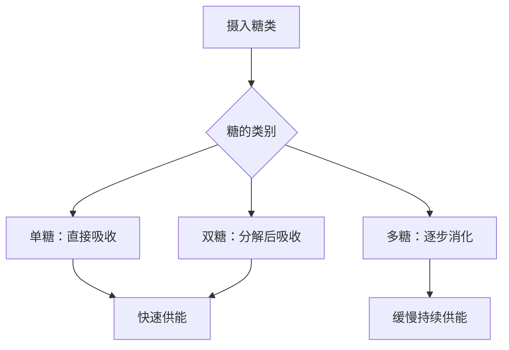

# 运动营养补充与合理膳食搭配
人体运动或活动的能量从哪里来？想一想：跑步时肌肉收缩、心跳加快，这些都需要能量，而==人体唯一的能量来源是有机物质的氧化分解==，也就是糖、脂肪、蛋白质在细胞内被逐步"燃烧"放出能量。外源电能、光能、核能不能直接被人体利用。

### 三大供能物质

| 物质 | 主要功能 | 供能特点 |
|------|----------|----------|
| 糖（碳水化合物） | 主要供能物质 | 供能快，是运动首选 |
| 脂肪 | 储能供能 | 供能慢但持久 |
| 蛋白质 | 修复组织，次要供能 | 长期饥饿或高强度时才大量参与 |

### 糖的分类与吸收

糖是人体最直接的"燃料"。但糖的种类很多，哪种最容易被身体快速利用？

- **单糖**：葡萄糖、果糖、半乳糖 —— ==不需要消化分解，直接吸收进血液==，是最易被人体吸收的糖。
- **双糖**：蔗糖、麦芽糖、乳糖 —— 需分解为单糖后才能吸收。
- **多糖**：淀粉、糖原、纤维素 —— 淀粉需逐步消化；纤维素人体基本不能消化吸收。

> [!IMPORTANT]
> 最易被人体吸收的糖是==葡萄糖、果糖、半乳糖==（单糖），不要与双糖（蔗糖、麦芽糖、乳糖）或多糖（淀粉、糖原、纤维素）混淆。

### 合理膳食搭配原则

- **糖为主**：运动人群膳食中糖应占总热量的 $55\%\sim 65\%$。
- **蛋白适量**：占 $12\%\sim 15\%$，用于修复肌肉组织。
- **脂肪控制**：不超过 $30\%$，避免高脂影响运动表现。
- **维生素与矿物质**：参与能量代谢调节，不可忽视。
- **补水**：运动前、中、后及时补充水分，防止脱水。

> [!WARNING]
> 常见误区：认为运动后要大量补蛋白。实际上糖才是运动后的首要补充，蛋白质过量会增加肝肾负担。

> [!TIP]
> 记忆口诀：==糖是主力，蛋白修复，脂肪少量，水不能少==。

### 例题解析

**例题**：最易被人体吸收的糖是（ ）

A. 蔗糖、麦芽糖、乳糖  
B. 葡萄糖、果糖、半乳糖  
C. 淀粉、糖原、纤维素  
D. 葡萄糖、蔗糖、糖原

**解析**：单糖（葡萄糖、果糖、半乳糖）分子结构最简单，无需消化酶分解即可被小肠直接吸收入血，故选 **B**。A 项均为双糖，需分解后吸收；C 项均为多糖，消化吸收慢；D 项混有双糖和多糖，不符合"最易吸收"。
