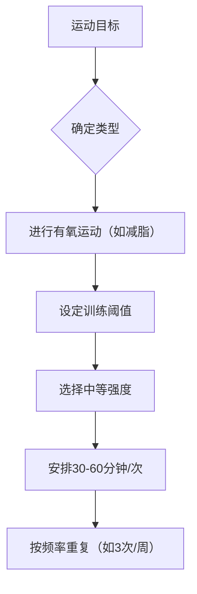

# 运动处方的基本要素（FITT：频率、强度、时间、类型）

## 什么是运动处方？

运动处方不是一张简单的“健身卡”，而是由专业人员根据你的健康状况、体能水平和目标，量身定制的科学锻炼计划。它就像医生开的药方，只不过这里的“药”是==运动==。

> [!IMPORTANT]
> 运动处方的核心是 **FITT 原则**。它规定了运动中最关键的四个变量：频率（Frequency）、强度（Intensity）、时间（Time）和类型（Type）。合理调配这四要素，是运动安全和有效的基石。

## 为什么需要 FITT 原则？

你是否想过，为什么同样是跑步，别人能减肥，你却伤了膝盖？
答案是：==运动负荷的刺激必须恰到好处==。盲目锻炼，强度太低没效果，强度太高易受伤。

FITT 原则提供了一个标准化框架，来精确控制这个“刺激量”。它能帮你：
1.  **确保安全**：避免运动过量导致的心血管风险或运动损伤。
2.  **提升效果**：针对减脂、增肌、提升心肺耐力等不同目标，设计最高效的方案。
3.  **实现量化监控**：让锻炼有据可依，不再凭感觉。

## FITT 四要素详解

下面我们逐一拆解这张“药方”上的四味主药。

### 频率（Frequency）

**它是什么？** 在单位时间内（通常是一周）运动的次数。
**为什么需要？** 它决定了身体受到运动刺激的密度。两次运动之间需要留出足够的恢复时间，避免过度训练；间隔太久，上一次的训练效果则会消退。

> [!TIP]
> **通用建议**：每周 3～5 次是提升心肺耐力的理想频率。初学者可从每周 2～3 次开始，有经验者可增至 5～6 次。

### 强度（Intensity）

**它是什么？** 运动时的费力程度，是运动处方的==核心与难点==。
**为什么需要？** 强度直接决定了运动对身体系统的刺激深度，是产生训练适应的关键。

**如何监控？** 体育理论中常用以下三种方法：
1.  **心率（HR）**：最客观的指标。
    -   **最大心率（HRmax）** = $220 - \text{年龄}$。
    -   **靶心率（THR）** = $(HRmax - \text{安静心率}) \times \text{期望强度\%} + \text{安静心率}$。
    -   *例：欲达到 60% ~ 80% 强度的中等强度运动。*
2.  **主观疲劳感觉（RPE）**：对自身疲劳和吃力程度的主观评分。常用的是 6～20 分伯格量表（Borg Scale），12～16 分通常对应中等至较大强度。
3.  **谈话测试**：运动中能自如交谈但不能唱歌，大致为中等强度；只能说短句，则为较大强度。

> [!WARNING]
> 心率公式是群体估算，个体差异大。服用降压药（如 β 阻滞剂）者，心率不能准确反应真实负荷，应结合 RPE 使用。

### 时间（Time）

**它是什么？** 每次运动所持续的时长。
**为什么需要？** 与强度共同构成了单次运动的总负荷量（运动量 = 强度 × 时间）。强度和持续时间可相互调配，通常==高强度运动时间短，低强度运动时间长==。

> [!NOTE]
> 建议每天进行 30～60 分钟的中等强度有氧运动。可一次完成，也可分段累计，但每段不应少于 10 分钟。

### 类型（Type）

**它是什么？** 选择的具体运动模式。
**为什么需要？** 不同运动类型发展的身体素质不同，目标决定类型。

-   **有氧运动**：如慢跑、游泳、骑行。主要改善心肺耐力，是减脂和控制体重的基础。
-   **抗阻运动**：如举重、俯卧撑。主要增加肌肉力量、耐力和体积，提高基础代谢。
-   **柔韧性运动**：如瑜伽、静态拉伸。主要改善关节活动度和减少运动损伤风险。
-   **综合性运动**：如球类、高强度间歇训练（HIIT），能综合发展多种素质。

## FITT 要素的协同关系

这四个要素并非独立，而是相辅相成的。调整任何一个，都会影响整体训练效果。例如，当你运动频率过高时，就必须相应降低单次运动的强度或时长，以控制整体负荷，防止过度训练和损伤。

## 与“身体活动量”的区别

> [!NOTE]
> 运动处方（FITT）是一个**周密的计划过程**，侧重于“如何设计”一个安全有效的锻炼方案。而身体活动量（如每日 6000 步）则是一个**简单的总量目标**，它更关注结果，执行灵活但不精确。FITT 可以看作是实现目标活动量的具体路线图。

## 常见的坑：只动不调

一个常见的错误是，在开始一个运动计划后，长期保持不变。身体具有很强的适应性，最初的训练负荷在 4～6 周后可能就不再构成有效刺激了。

这就是**超负荷原则**（Progressive Overload）的要求：==当身体适应当前负荷后，必须逐步增加 FITT 中的一个或多个变量，才能持续取得进步==。你可以先增加时间，再提高频率，最后才去挑战强度，这是最安全有效的进阶顺序。

## 一个算对了的例子

**张三，男，20 岁，安静心率 70 bpm，想通过中等强度（60% 储备心率）跑步提升心肺耐力。**

1.  **计算最大心率**：$HR_{max} = 220 - 20 = 200 \text{ bpm}$
2.  **计算靶心率**：
    $\text{THR} = (200 - 70) \times 60\% + 70 = 130 \times 0.6 + 70 = 78 + 70 = 148 \text{ bpm}$
3.  **制定 FITT 处方**：
    -   **F（频率）**：每周 3 次
    -   **I（强度）**：心率维持在 **148 bpm** 左右
    -   **T（时间）**：持续跑步 **30 分钟**
    -   **T（类型）**：慢跑（有氧运动）

> [!TIP]
> 实操时，不用死磕 148 这个点，将心率控制在 143～153 bpm 的区间内，就是非常精准的中等强度跑步了。

这个例子为你展示了如何将一个模糊的“我要跑步”变成一份清晰、可执行、可量化的==FITT 运动处方==。
