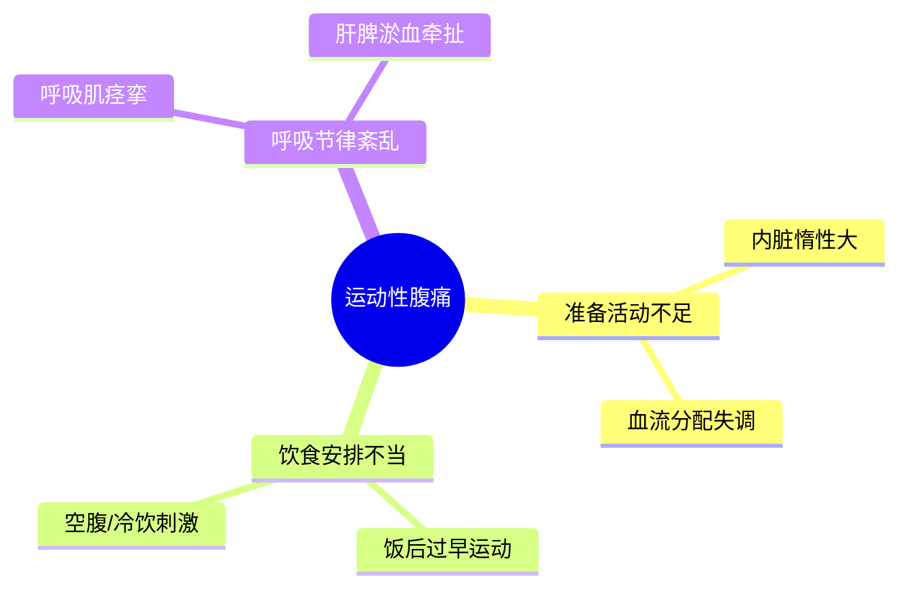

# 运动性腹痛的原因及预防处理

## 什么是运动性腹痛

运动性腹痛是指在体育运动过程中或运动后，腹部出现的疼痛症状。它并非一种独立疾病，而是==多种生理或病理因素在运动应激下的综合表现==。理解这一概念的关键在于区分“功能性”与“器质性”：绝大多数运动性腹痛属于暂时性的功能紊乱，但必须首先排除阑尾炎、胃肠穿孔等急腹症风险。

> [!IMPORTANT]
> 核心定性：运动性腹痛多为==功能性、一过性==症状，停止运动或调整节奏后通常可缓解；若休息后疼痛加剧或部位固定，需立即就医排查器质性病变。

## 为什么会发生：三大诱因解析

腹痛的发生机制复杂，我们可以从以下三个维度追问：是准备不足？是饮食不当？还是呼吸节奏乱了？

-   **准备活动不足**：内脏器官的生理惰性大于运动器官。当肌肉已进入高强度工作状态时，内脏血管尚未充分扩张，导致==肝脾淤血==，牵拉被膜上的神经末梢引发胀痛。
-   **饮食因素**：饭后过早运动使胃肠道受到机械性震动；空腹运动易致胃酸刺激黏膜；大量摄入冷饮则引起胃肠平滑肌痉挛。
-   **呼吸与动作**：中长跑中呼吸节奏与步伐不协调，导致膈肌疲劳痉挛；或憋气用力使腹压骤增，均可诱发疼痛。

## 现场处理与预防策略

遇到腹痛时，应遵循“降速—调整—观察”的流程，切忌盲目坚持或随意用药。

> [!TIP]
> 现场处理口诀：==减速深呼吸，按压痛点区；若痛不缓解，停训速就医==。

| 处理阶段 | 正确做法 | 禁忌行为 |
| :--- | :--- | :--- |
| 即时应对 | 降低跑速、加深呼吸、手按痛点 | 强行冲刺、立即躺卧 |
| 补水补液 | 少量多次饮用温盐水 | 大口灌饮冰水 |
| 后续观察 | 休息至疼痛完全消失再恢复 | 痛感减轻即恢复原强度 |

预防的核心在于==科学安排==：饭后至少间隔 1.5～2 小时再进行剧烈运动；准备活动要充分激活内脏机能；运动中保持“两步一呼、两步一吸”等稳定节律。

## 易混辨析与真题避坑

运动性腹痛常与中暑、低血糖等症状混淆。如何快速鉴别？关键看==伴随症状==：腹痛以局部疼痛为主；中暑必有体温升高、面色潮红或苍白、无汗或多汗；低血糖则以心慌、手抖、出冷汗为特征。

> [!CAUTION]
> 高危误区：切勿将中暑误判为普通腹痛而延误降温！中暑急救严禁给予热饮，这会加重核心体温蓄积。

结合本章关联考点“中暑救护”，来看一道典型真题：

**【例题】** 中暑的现场救护中，哪个做法是错误的？
a. 将患者移至阴凉通风处
b. 给患者饮用清凉饮料
c. 给患者饮用热饮料
d. 尽快进行物理降温

**解析**：选项 c 错误。中暑的核心病理是==体温调节失衡导致过热==，此时补充热饮料会进一步增加体内热负荷，违背“迅速降温”的急救原则。正确做法是移至阴凉处（a）、物理降温（d）并补充含盐清凉饮料（b）。此题虽考中暑，但与运动性腹痛同属“运动急症现场处置”知识模块，复习时需==对比记忆==，避免张冠李戴。
