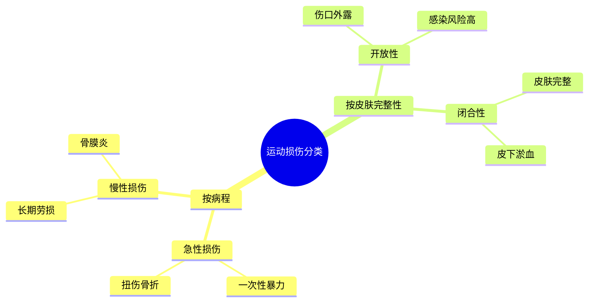

# 运动损伤的分类（急性/慢性、开放性/闭合性）

## 运动损伤的分类

运动损伤是指在体育运动过程中发生的各种伤害。学会分类，是正确进行现场急救与后续处理的第一步——**判断损伤类型，决定处理方式**。

## 两大分类维度

### 按病程：急性损伤 vs 慢性损伤

| 维度 | 急性损伤 | 慢性损伤 |
|------|----------|----------|
| 发病 | 一瞬间遭受直接/间接暴力 | 长期局部负荷过度积累 |
| 病程 | 短，症状立刻出现 | 长，逐渐加重 |
| 典型 | 踝关节扭伤、骨折、脱位、肌肉拉伤 | 疲劳性骨膜炎、腰肌劳损、髌骨劳损 |

> [!IMPORTANT]
> ==急性看"当时发生了什么"，慢性看"长期反复做了什么"==。急性损伤多因一次性暴力超出组织承受极限；慢性损伤多因局部负担量超过组织修复能力。

### 按皮肤/黏膜完整性：开放性 vs 闭合性

| 维度 | 开放性损伤 | 闭合性损伤 |
|------|------------|------------|
| 皮肤/黏膜 | 破裂，伤口与外界相通 | 完整，无伤口 |
| 出血 | 外出血，可见 | 内出血或皮下淤血 |
| 感染风险 | 高，需清创 | 低 |
| 典型 | 擦伤、切伤、刺伤、撕裂伤 | 挫伤、扭伤、拉伤、闭合性骨折 |

## 为什么要分这两类？

现场处理思路完全不同：

- **开放性损伤**：先止血、防感染。出血量大时直接压迫止血，必要时用填塞止血法（但不能填塞有腔隙的部位，如头部伤口——见选择 266）。
- **闭合性损伤**：先制动、冰敷、抬高患肢（RICE 原则），防止肿胀加重。

> [!TIP]
> 记忆口诀：==急性看瞬间，慢性看积累；开放有伤口，闭合皮完整==。

## 常见的坑

> [!WARNING]
> 1. "慢性损伤"≠"不严重"。长期劳损若不停训休息，可能发展为应力性骨折。
> 2. 闭合性损伤也可能很严重——比如闭合性骨折，皮肤没破但骨头断了，同样需要固定。
> 3. 开放性损伤现场不要自行冲洗深部伤口，简单覆盖后送医，避免二次感染。

## 例子

篮球落地时踩到别人脚背，脚踝立刻肿痛、无法行走，皮肤无破损。

- 按病程：==急性损伤==（一次性暴力导致）。
- 按完整性：==闭合性损伤==（皮肤未破，皮下淤血肿胀）。

处理：立即停止运动，冰敷 15–20 分钟，加压包扎并抬高患肢，尽快就医排除骨折。
