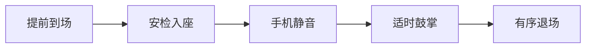

# 体育比赛通用观赛礼仪（入场、退场、着装、手机静音）

## 为什么需要观赛礼仪

体育比赛不只是运动员的竞技，也是观众共同参与的公共活动。观赛礼仪的核心，是在表达热情的同时，==不影响运动员比赛、不干扰其他观众、不破坏赛场秩序==。它既体现个人文明素养，也关系到赛事能否安全、顺利进行。

可以这样想：如果观众随意走动、大声接打电话，或在关键时刻使用闪光灯，运动员和周围观众会受到什么影响？因此，礼仪不是“不能加油”，而是要求==在合适的时间，用合适的方式加油==。

## 入场、退场与着装

| 环节 | 正确做法 | 常见错误 |
|---|---|---|
| 入场 | 提前到场，主动接受安检；按票面对号入座；了解场馆禁带物品 | 临近开赛才匆忙入场、跨越座位、随意占座 |
| 观赛 | 保持座位区域整洁；需要离座时尽量避开比赛关键阶段，并轻声致歉 | 长时间站在过道、频繁进出、向场内投掷物品 |
| 退场 | 比赛结束后有序离场，服从工作人员引导，带走垃圾 | 未结束便拥挤退场、推搡抢行、逆向穿行 |
| 着装 | 整洁、舒适，符合场馆和项目要求；可按赛事氛围文明佩戴助威饰品 | 穿带攻击性、侮辱性文字或图案的服饰；使用过大道具遮挡他人 |

> [!IMPORTANT]
> 入场看“安检与对号入座”，退场看“结束与有序”，着装看“整洁与不妨碍他人”。遇到大型活动或突发情况，应以现场广播和工作人员指引为准。

## 手机静音与文明助威

入场后应将手机调至静音或振动，避免铃声、外放视频和大声通话干扰比赛。确需接听电话时，应离开观众席，到指定区域低声处理。拍照、录像还要遵守场馆规定；尤其在体操、花样滑冰等需要高度集中注意力的项目中，==不得随意使用闪光灯==。

喝彩也要看项目特点和比赛进程。一般可在精彩表现后鼓掌，但不应使用侮辱性语言、激光照射、刺耳噪声等方式干扰运动员和裁判员。

## 与相近礼仪的区别

通用观赛礼仪适用于多数赛事，具体项目还可能有更严格要求。例如，花样滑冰选手完成高质量表演后，观众可以起立鼓掌表达赞赏，但不宜吹口哨、锣鼓喧天或持续高喊运动员名字，以免影响运动员情绪及赛场氛围。

> [!WARNING]
> “不使用闪光灯拍照”通常是正确行为，不能误选为“不宜做的事”。审题时要先看清题干问的是“应当”“可以”，还是“不宜”“不包括”。

## 例题解析

**题目：**在花样滑冰比赛中，选手的表现臻于完美，观众不宜____，以避免影响运动员情绪。

A. 起立鼓掌欢呼  
B. 吹口哨  
C. 锣鼓喧天，呼喊运动员名字助威呐喊  
D. 不使用闪光灯拍照  

**答案：C。**选手表现精彩时，起立鼓掌属于文明赞赏；不使用闪光灯有利于减少干扰。相比之下，锣鼓喧天并持续呼喊名字噪声强、刺激性大，最符合题干所说的“影响运动员情绪”。

> [!TIP]
> 做观赛礼仪题可用一句口诀：==提前入场、安静观赛、适时喝彩、有序退场==。若多个选项都显得不礼貌，再结合具体项目和题干语境，选择影响最直接、最典型的一项。
