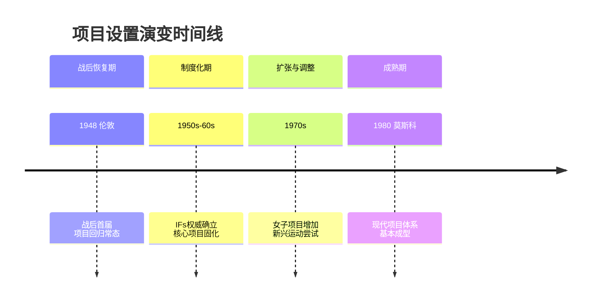

# 奥运会项目设置的发展完善阶段（1948～1980年）

# 奥运会项目设置的发展完善阶段（1948～1980年）

这一阶段是奥林匹克运动从战后恢复走向制度化、规范化的关键时期。二战后，奥运会项目设置不再随意增减，而是建立了严格的准入与退出机制，形成了相对稳定的核心项目群。

## 核心特征与演变逻辑

为什么需要“发展完善”？早期奥运会项目杂乱，缺乏统一标准。1948～1980年间，国际奥委会（IOC）通过确立**国际单项体育联合会（IFs）**的权威地位，实现了项目管理的标准化。

==核心结论==：此阶段确立了以**28个大项**（后续稳定值）为基准的夏季奥运会项目架构雏形，并强化了“只有被IOC承认的IF所管辖的项目才能入奥”的原则。

## 关键数据与考点辨析

在复习中，需区分“历史阶段特征”与“当前静态数据”。虽然本知识点聚焦1948-1980，但考试常结合当前数据考察演变结果。

| 考察维度 | 关键数据/事实 | 备注 |
| :--- | :--- | :--- |
| **国际单项联合会** | **38个** (当前承认) | 对应选择题22，注意是“得到承认并列人”的总数 |
| **夏季奥运大项** | **28个** (经典稳定值) | 对应选择题94，2008年北京奥运会即为此配置 |
| **北京奥运项目** | **28大项, 302小项** | 对应选择题121，这是该阶段完善后的典型成果 |
| **新中国首参** | **1952年, 第15届** | 对应选择题50，赫尔辛基奥运会 |

> [!IMPORTANT]
> **核心考点**：2008年北京奥运会设**28**个大项、**302**个小项。这是“发展完善阶段”形成的项目体系在当代的典型体现。

> [!TIP]
> **记忆技巧**：记住“28-302”组合。28个大项是长期稳定的骨架，302个小项是北京奥运的具体血肉。若题目问“目前”IF数量，选**38**；若问“夏奥大项”经典数，选**28**。

## 常见误区与易错点

1.  **混淆“承认”与“列入”**：并非所有被IOC承认的IF项目都在当届奥运会中比赛。例如，棒球、垒球曾进出奥运名单，但IF始终存在。
2.  **忽视冬季残奥会独立计数**：冬季残奥会与夏奥项目设置演变平行但独立。截至特定考题时间点，冬季残奥会已办**8届**（对应选择题24），勿与夏奥届数混淆。
3.  **青年营的文化属性**：东京奥运会青年营成为奥林匹克文化活动组成部分（对应选择题56），这体现了项目设置之外“文化奥运”的完善，属于广义的奥林匹克体系发展。

> [!WARNING]
> **高危误区**：不要将1948-1980年的“完善”理解为项目数量无限增加。相反，这一阶段的核心是**质量控制**和**标准化**。例如，剔除表演性项目，确立竞技性标准。

## 典型例题解析

**题目**：2008年奥运会比赛项目为____个大项，____个小项。
*   A. 24 300
*   B. 25 301
*   C. 26 302
*   D. 28 302

**解析**：
1.  **定位阶段**：2008年奥运会处于现代奥运会项目设置高度成熟期，其基础框架源于1948-1980年的制度化建设。
2.  **调用数据**：根据南邮《体育理论》课件，夏季奥运会经典大项数为**28**个。
3.  **验证小项**：北京奥运会具体小项数为**302**个。
4.  **结论**：选项D符合。此题虽考2008年数据，但根源在于理解“发展完善阶段”建立的**28大项**稳定结构。

==答案==：**D**
