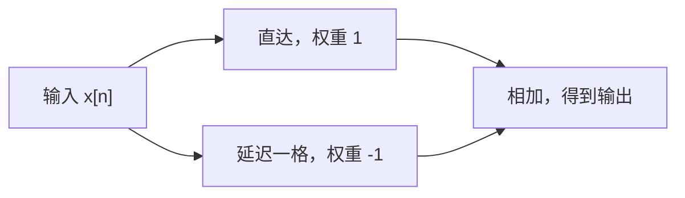

# 冲激响应与卷积

如果只测过系统对一个单位冲激的反应 $h[n]$，为什么能据此算一段任意输入？任意序列都能拆成按原样值加权的移位冲激 $x[n]=\sum_k x[k]\delta[n-k]$。时不变保证第 $k$ 个冲激产生的是 $h[n-k]$，线性才允许按权重相加。在和式能定义、且可对这种分解做叠加的条件下，

$$
y[n]=(x*h)[n]=\sum_{k=-\infty}^{\infty}x[k]\,h[n-k].
$$

连续时间把求和换成 $\int_{-\infty}^{\infty}x(\tau)h(t-\tau)\,d\tau$，直觉不变：过去或未来的每次激励，经系统的延迟特性给此时输出贡献多少？这是零状态的输入输出关系；若存储元件初始已有能量，还需另算零输入响应。非线性时不能相加，时变时不能只移位，同一个 $h$ 不足以描述一般系统。

例：$x[n]$ 仅在 $n=0,1$ 取 $1,2$；$h[n]$ 仅在 $n=0,1$ 取 $1,-1$。题面给的是有限支撑序列，“不重叠就没有贡献”比逐项展开快：支撑全集只可能在 $0\le n\le2$。三个样点分别是

$$
y[0]=1,\qquad y[1]=2-1=1,\qquad y[2]=-2.
$$

另由 $h[n]=\delta[n]-\delta[n-1]$ 看出这是差分，$y[n]=x[n]-x[n-1]$，独立回算得到同样结果。最后的 $-2$ 是下降沿。如果误把卷积写成逐点相乘，输入明明已经回到零，结果中这个下降沿却会消失。直觉上系统的延时单元还记得前一刻的 $2$；形式上这就是 $-x[n-1]$ 仍能贡献一项。

图里两条路其实是同一个卷积。已知响应是一个简单差分时，走两支路最快；已知的是一串样值时，按重叠位置求和更直接。

用冲激响应还可以区分两个容易混淆的检验：因果 LTI 的 $h[n]$ 在 $n<0$ 为零；离散 LTI 的 BIBO 稳定要求 $\sum_n|h[n]|<\infty$，不是仅要求 $\sum_n h[n]$ 可因正负抵消。连续情形换成相应的支撑和绝对积分（这里说的是普通可积的响应函数）。
