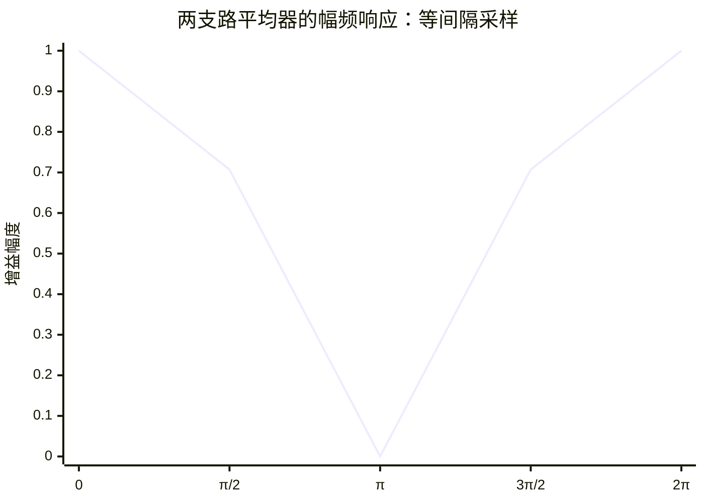

# 复指数、傅里叶级数和傅里叶变换

不妨把延迟看成一次实验。对同一个复指数 $e^{j\omega t}$，无论延迟多久，新波形仍是那个频率，只乘了一个复数 $e^{-j\omega\tau}$。因此，用卷积的连续式计算能接纳该输入的 LTI 系统时，

$$
y(t)=e^{j\omega t}\int h(\tau)e^{-j\omega\tau}\,d\tau
    = e^{j\omega t}H(j\omega).
$$

输出并不需要重新描述一条任意曲线：同频复指数不变，系统只改变幅度和相位。这就是选它作分析单位的理由。两个移位不变的滤波步骤串联，时域是卷积，频域是逐频相乘；结构上和把矩阵换到对角形式一样，各分量互不混合，并不是拿频域公式替代因果等额外条件。

为什么有时用傅里叶级数，有时用傅里叶变换？如果有非零周期 $T_0$，每个基成分隔一个周期要回到同一相位，频率只能取 $k\omega_0$（$\omega_0=2\pi/T_0$）。傅里叶级数描述逐条离散谱线，系数从一周期积分求得。对普通可积的非周期波形，傅里叶变换 $X(j\omega)=\int x(t)e^{-j\omega t}\,dt$ 给的是随 $\omega$ 变化的连续变量表示。不能对不衰减的正弦直接套普通绝对可积 Fourier 积分；需要级数（有周期时）或广义函数。离散时间也有变换，但离散时间傅里叶变换在角频率上以 $2\pi$ 为周期，不能把“时间离散”与“谱线离散”当成一回事。

例：$y(t)=[x(t)+x(t-T)]/2$，$T>0$。题面只给了输入的两个移位版本，不必画任意的 $x(t)$；用 $e^{j\omega t}$ 一试，得

$$
H(j\omega)=\tfrac12(1+e^{-j\omega T})
          =e^{-j\omega T/2}\cos(\omega T/2).
$$

$\omega=0$ 时系数为 1，常值保持。若 $x(t)=\cos(\pi t/T)$，一个延迟恰翻成负波形，直接代回得输出为零，与频响零点吻合。“平均会削弱所有波动”却不对：$\omega=2\pi/T$ 时两项又同相，波形完全通过。决定相消的是两条支路的相位差，不只是频率高不高。

### 把相差画成幅频曲线

横轴取无量纲相位差 $\omega T$，纵轴取增益的模。图中五个点来自 $|H(j\omega)|=|\cos(\omega T/2)|$；折线只是连接样点，实际幅频曲线由公式决定。

> [!TIP]
> 只问通过多少，看振幅增益的模；还问输出相位，则保留复数 $H(j\omega)$。==相消找相差为奇数倍 $\pi$，不能仅看频率高低==。
