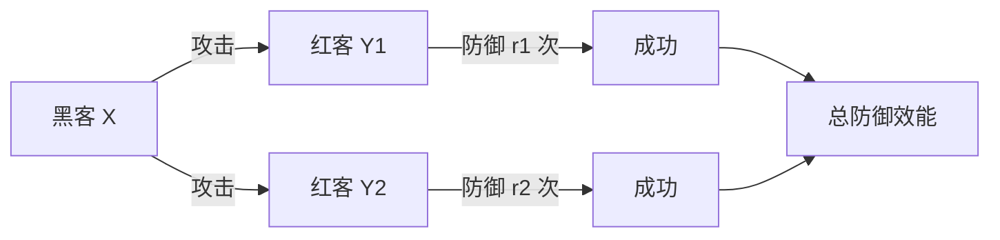

# 一攻多可达极限（一个黑客对多个红客）

# 一攻多可达极限

在《安全通论》的对抗模型中，“一攻多”指**单个攻击者（黑客）同时或交替对抗多个防御者（红客）**的场景。本节核心在于推导这种非对称对抗下的**防御成功概率极限**，即系统在长期攻防博弈中能够维持安全的理论上限。

## 概念解析与模型构建

为什么需要研究“一攻多”？现实网络中，往往是一个高级持续性威胁（APT）组织面对企业庞大的安全运营中心（SOC）。理解其极限有助于评估防御体系的冗余度是否有效。

假设一个黑客 $X$ 攻击 $m$ 个独立的红客 $Y_1, Y_2, \dots, Y_m$。
- 若红客之间**独立防御**，黑客必须突破所有防线才算整体成功。
- 若红客之间**协同防御**，则视为一个整体超级红客。

本题考察的是**独立防御**场景下的概率计算。关键在于理解“成功防御”的定义：只要任一红客在对应回合拦截了攻击，该次交互即为防御成功。

## 概率计算推导

> [!IMPORTANT]
> 核心结论：在独立事件中，联合概率等于各事件概率的乘积。但需注意题目问的是“防御概率”而非“被攻破概率”。

回顾考题：两个黑客 $X_1, X_2$ 独立攻击一个红客 $Y$（注：此处题干描述为“两攻一”，但知识点标题为“一攻多”，根据南邮课程惯例，二者互为对偶，计算逻辑一致，即**多方独立作用的累积效应**）。

若在 $n$ 个回合中：
- 红客 $Y$ 成功防御 $X_1$ 的次数为 $r_1$，则防御 $X_1$ 的频率（概率估计）为 $p_1 = \frac{r_1}{n}$。
- 红客 $Y$ 成功防御 $X_2$ 的次数为 $r_2$，则防御 $X_2$ 的频率（概率估计）为 $p_2 = \frac{r_2}{n}$。

**关键提问**：红客要被视为“完全成功防御”，是需要挡住 $X_1$ **且** 挡住 $X_2$ 吗？
是的。因为只要有一个黑客突破，系统即失守。因此，红客在面对两个独立黑客时，单次回合的**综合防御成功率** $P$ 为：

$$ P = p_1 \times p_2 = \frac{r_1}{n} \times \frac{r_2}{n} = \frac{r_1 r_2}{n^2} $$

> [!WARNING]
> 常见坑：切勿将概率相加（$\frac{r_1+r_2}{n}$）。概率相加适用于互斥事件，而此处是两个独立攻击同时存在的联合事件。

## 示例演算

**题目**：$n=100$ 回合，$Y$ 防御 $X_1$ 成功 $90$ 次，防御 $X_2$ 成功 $80$ 次。求 $Y$ 的综合防御概率。

1.  计算单点防御率：
    $$ p_1 = \frac{90}{100} = 0.9, \quad p_2 = \frac{80}{100} = 0.8 $$
2.  计算联合防御率：
    $$ P = 0.9 \times 0.8 = 0.72 $$

==核心高亮==：随着攻击者数量增加，若每个攻击者的突破概率不为0，红客的综合防御概率将呈**指数级下降**。这就是“一攻多”或“多攻一”的极限困境——防御方必须保持极高的单体胜率，才能维持整体安全。

| 场景 | 概率公式 | 趋势 |
| :--- | :--- | :--- |
| 单攻单防 | $p$ | 基准 |
| 多攻一防 (独立) | $\prod p_i$ | 随攻击者增多急剧降低 |
| 一攻多防 (串联) | $\prod p_j$ | 随防御者增多急剧升高 |

> [!TIP]
> 记忆技巧：独立事件“且”的关系用乘法。防御变难，概率变小，符合直觉。
