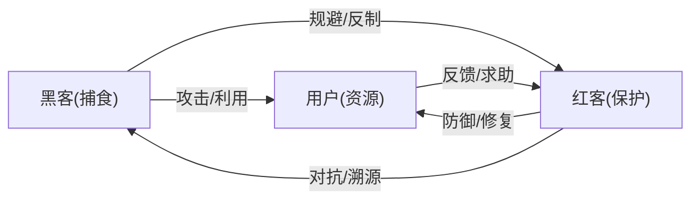

# “黑客+用户+红客”生态学

如果网络空间只有攻击者和防御者，那它和两军对垒有什么区别？但现实中，绝大多数人既不想攻击也不想防御，他们是谁？这就引出了网络安全生态学的核心三角。

## 三方角色与生态定义

“黑客+用户+红客”生态学将网络空间视为一个==由三类主体构成的动态生态系统==，而非简单的攻防二元对立。

- **黑客（Hacker）**：网络空间的“捕食者”，寻找漏洞并实施攻击以获取利益。
- **用户（User）**：网络空间的“生产者/资源”，数量最庞大，是安全服务的对象，也是黑客的攻击目标。
- **红客（Honker）**：网络空间的“卫士/免疫细胞”，主动防御、修补漏洞、对抗黑客的正义力量。

> [!IMPORTANT]
> 核心结论：网络安全不是“黑客 vs 红客”的单挑，而是三方相互制约、共同演化的==生态平衡问题==。用户规模决定了生态的“能量底座”。

三者之间的互动关系可用下图表示：

## 为什么需要生态学视角

传统安全观只关注“如何挡住攻击”，却忽略了一个现实：若用户安全意识极差，红客的防线再厚也会被从内部瓦解；若黑客无利可图（用户都被保护得很好），黑客群体也会萎缩或转移。

引入生态学视角，是为了用==种群动力学==的方法量化分析三者的消长规律，从而制定全局最优的安全策略，而非局部“头痛医头”。

## 怎么做：Lotka-Volterra 演化模型

《安全通论》中常借鉴生物学的 Lotka-Volterra 捕食模型来描述三方数量的动态变化。设 $H(t)$、$U(t)$、$R(t)$ 分别为时刻 $t$ 的黑客、用户、红客规模（或活跃度），其简化交互方程为：

$$
\frac{dH}{dt} = H(\alpha_1 U - \beta_1 R - d_1)
$$

$$
\frac{dU}{dt} = U(r - \gamma H + \delta R)
$$

$$
\frac{dR}{dt} = R(\alpha_2 H - d_2)
$$

- $\alpha_1 U$：用户越多，黑客获利越容易，黑客规模增长。
- $\beta_1 R$：红客越多，黑客被打击的概率越大，黑客规模衰减。
- $r$：用户的自然增长率。
- $\gamma H$：黑客攻击导致用户流失或受损。
- $\alpha_2 H$：黑客越猖獗，社会对红客的需求越大，红客规模增长。

> [!TIP]
> 记忆口诀：“黑客吃用户，红客打黑客，黑客养红客”。三者的导数符号决定了谁是促进项（正号），谁是抑制项（负号）。

## 算对了的例子：生态平衡点求解

**题目**：假设某简化的“黑客-用户”双种群生态模型（暂不考虑红客干预）满足：
$\frac{dH}{dt} = H(0.5U - 2)$，$\frac{dU}{dt} = U(3 - 0.1H)$。求该系统的非零生态平衡点 $(H^*, U^*)$。

**解析**：
生态平衡点即系统不再变化的状态，令 $\frac{dH}{dt} = 0$ 且 $\frac{dU}{dt} = 0$，且要求 $H \neq 0, U \neq 0$。

1. 由 $H(0.5U - 2) = 0$ 且 $H \neq 0$，得：
   $$0.5U^* - 2 = 0 \implies U^* = 4$$
2. 由 $U(3 - 0.1H) = 0$ 且 $U \neq 0$，得：
   $$3 - 0.1H^* = 0 \implies H^* = 30$$

==最终平衡点为 $(H^*, U^*) = (30, 4)$==。这意味着当用户规模为 4、黑客规模为 30 时，双方数量达到动态稳定。若引入红客项，则需联立三元方程组求解。

## 相近概念区别与常见坑

| 对比维度 | 传统攻防博弈论 | “黑客+用户+红客”生态学 |
| :--- | :--- | :--- |
| **参与主体** | 仅攻、防两方 | 必须包含“用户”第三方 |
| **分析目标** | 寻找纳什均衡策略 | 寻找种群规模的动态平衡点 |
| **用户地位** | 被动的背景或资产 | 决定生态演化的核心变量 |

> [!WARNING]
> 易错坑：列微分方程时搞错符号。记住判断标准——对谁有利就是正号，对谁有害就是负号。例如“红客打击黑客”，在黑客的增长率方程中红客项必须是负号（$-\beta_1 R$）。

> [!CAUTION]
> 高危误区：不要把“红客”等同于杀毒软件等死物。在《安全通论》语境下，红客是具有主观能动性的防御主体，其规模会随黑客威胁的增加而“繁殖”（增长）。
