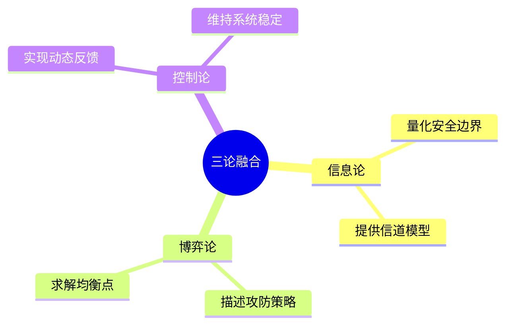

# 三论融合的几点反醒

在《安全通论》第 7 章中，我们尝试将信息论、博弈论与控制论（即“三论”）融合来解释安全问题。但融合并非简单的概念拼凑，**“几点反省”**正是对这种强行跨界可能产生的逻辑漏洞与适用边界进行纠偏。

> [!IMPORTANT]
> 核心结论：三论融合的反省，本质是厘清==各理论的假设前提与适用边界==，防止将信息论的“信道容量”、博弈论的“纳什均衡”与控制论的“负反馈”混为一谈。

## 为什么要反省

试想一个问题：如果攻击者完全掌握了系统的控制规律（如加密算法），博弈论中的“不完全信息”假设还成立吗？

如果不加反省地融合，会产生以下矛盾：

- **目标冲突**：信息论追求传输效率最大化（香农极限），而安全博弈往往需要主动引入冗余或噪声来对抗攻击。
- **理性假设失效**：博弈论默认参与者“完全理性”，但在实际网络攻防中，攻击者常表现出有限理性甚至非理性的破坏行为。
- **静态与动态错位**：经典信息论多处理静态信道，而控制论和演化博弈强调动态过程。

## 怎么做：划定融合边界

正确的做法不是抛弃融合，而是明确各理论在安全模型中扮演的角色。

| 维度 | 信息论视角 | 博弈论视角 | 控制论视角 |
| :--- | :--- | :--- | :--- |
| **核心关注** | 数据的不确定性与传输极限 | 攻防双方的收益与策略选择 | 系统的状态调节与稳定性 |
| **关键指标** | 熵 $H(X)$、信道容量 $C$ | 效用函数 $U_i$、纳什均衡 | 传递函数、反馈增益 |
| **安全映射** | 完美保密条件 $H(K) \ge H(M)$ | 攻防博弈的最优混合策略 | 入侵检测与自适应响应 |

> [!TIP]
> 记忆口诀：**信息定边界，博弈找策略，控制保稳定**。三者各司其职，不可互相替代。

## 常见误区与辨析

> [!WARNING]
> 易错坑：认为“信道容量 $C$ 越大，安全性越高”。
> 事实上，高容量信道若缺乏密钥保护，反而为窃听者提供了更多信息量。安全性的上限由信息论决定，但达到该上限的策略需由博弈论给出。

> [!CAUTION]
> 高危误区：将“纳什均衡”等同于“系统最优状态”。
> 在囚徒困境类的安全博弈中，纳什均衡往往是双输局面。必须引入控制论的机制设计（如惩罚反馈）来改变博弈结构。

## 算例验证：融合视角下的安全容量

考虑一个简化场景：发送方与窃听者构成零和博弈，信道为二元对称信道（BSC），交叉概率为 $p$。

1. **信息论反省**：不能直接套用无噪信道容量。主信道容量为 $C_m = 1 - H(p)$，窃听信道容量为 $C_w = 1 - H(q)$。
2. **博弈论反省**：发送方选择编码策略以最大化安全容量，窃听者选择攻击策略以最小化它。
3. **控制论反省**：若 $p$ 随时间变化，需引入自适应纠错反馈。

根据 Wyner 窃听信道模型，安全容量定义为：

$$
C_s = \max [C_m - C_w] = \max [H(q) - H(p)]
$$

**计算示例**：设主信道交叉概率 $p = 0.1$，窃听信道交叉概率 $q = 0.3$。
- $H(0.1) = -0.1\log_2 0.1 - 0.9\log_2 0.9 \approx 0.469$ bit
- $H(0.3) = -0.3\log_2 0.3 - 0.7\log_2 0.7 \approx 0.881$ bit
- 安全容量 $C_s = 0.881 - 0.469 = ==0.412 \text{ bit/符号}==$

> [!NOTE]
> 这个结果说明：只有当窃听信道的噪声大于主信道噪声（即 $H(q) > H(p)$）时，才存在正的安全容量。这正是信息论定量约束与博弈论策略选择成功融合的体现，而非简单叠加。
