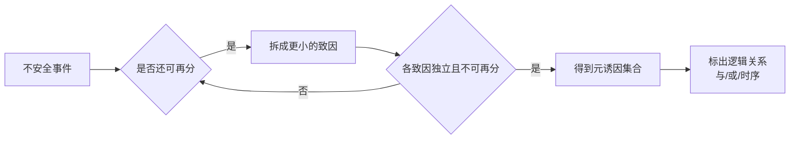
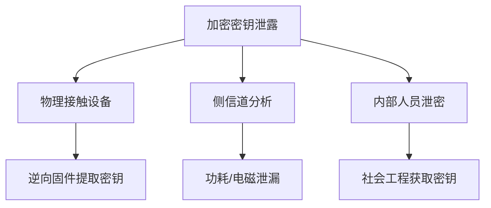

# 不安全事件的素分解

## 不安全事件的素分解

### 为什么需要“素分解”

在分析一个安全事件时，我们很容易被表面现象带走：这次是密码被暴力破解了，那次是管理员误删了文件，还有一次是缓冲区溢出。事件五花八门，但安全理论要做的事是——**找出不可再分的最小致因单元**。

这很像算术基本定理：任何合数都能唯一分解为素数的乘积。安全事件也一样，如果能定义出“安全事件中的素数”，那么再复杂的事件也可以被结构化地拆解，进而判断两个事件是否同源、是否可以类比预防。

> [!IMPORTANT]
> ==素分解==是把一个不安全事件拆成若干**元诱因**的逻辑组合。元诱因就是“素事件”——不可再分、彼此独立的最小不安全因素。

### 什么是元诱因

**元诱因**的定义包含三层含义：

1. **不可再分**：在当前的观察粒度下，它已经是最小单元；
2. **可独立引发后果**：单独出现就可能破坏某个安全属性；
3. **可组合**：多个元诱因通过逻辑“与”“或”等方式构成复杂事件。

以操作系统为例，常见的元诱因有：

| 元诱因 | 破坏的安全属性 | 示例 |
|---|---|---|
| 身份冒充 | 真实性 | 未授权进程以 root 身份运行 |
| 权限提升 | 机密性/完整性 | 普通用户利用漏洞获得管理员权限 |
| 资源耗尽 | 可用性 | fork 炸弹耗尽进程表 |
| 信息泄露 | 机密性 | 侧信道读取内核内存 |
| 绕过访问控制 | 机密性/完整性 | TOCTOU 竞态条件 |
| 恶意代码执行 | 完整性 | 缓冲区溢出后植入 shellcode |

> [!NOTE]
> “元诱因”和“攻击方法”不是一回事。攻击方法是实现手段，元诱因是致因本质。缓冲区溢出是方法，它可能触发**恶意代码执行**和**权限提升**两个元诱因。

### 怎样做素分解

给定一个不安全事件，分解步骤如下：

以“分组加密系统的加密密钥泄露事件”为例：

> [!TIP]
> 素分解时先问两个问题：
> ① 这个因素能不能再拆？能拆就继续拆。
> ② 拆出来的因素是“原因”还是“结果”？只有原因才能作为元诱因。

### 常见的坑

> [!WARNING]
> **坑一**：把“事件链”误当作逻辑分解。素分解是找并列的致因，不是按时间顺序讲故事。一个事件有且仅有一组元诱因集合，但可以有多个攻击路径。

> [!CAUTION]
> **坑二**：分解粒度不一致。同一张经络图里，如果“缓冲区溢出”和“输错了三次密码”放在同一层，粒度就已经混乱了。前者在系统层，后者在用户层。

### 一个算对了的例子

**题目**：给出该系统安全事件的安全经络图，并标注元诱因。

**事件**：某 Linux 服务器被入侵，攻击者最终以 root 权限执行了恶意程序。

**分解过程**：

- 攻击者通过 Web 应用的 SQL 注入拿到了数据库账号 → 这是**信息泄露**；
- 用数据库账号读取了 `/etc/shadow` 的备份文件 → 仍是**信息泄露**；
- 离线破解了弱口令 → **凭证猜测**属于资源型攻击，元诱因是**身份冒充**的前提；
- 用破解的 SSH 账号登录 → **身份冒充**；
- 利用内核漏洞提权 → **权限提升**；
- 执行挖矿程序 → **恶意代码执行**。

**素分解结果**：

$$事件 = 信息泄露 \land 身份冒充 \land 权限提升 \land 恶意代码执行$$

> [!IMPORTANT]
> ==分解后的元诱因之间是“与”关系==：任何一个环节被阻断，整条攻击链就无法成功。这就是素分解用于防御设计的关键价值——不必堵死所有路，只需保证每个元诱因至少有一种有效的对抗手段。
