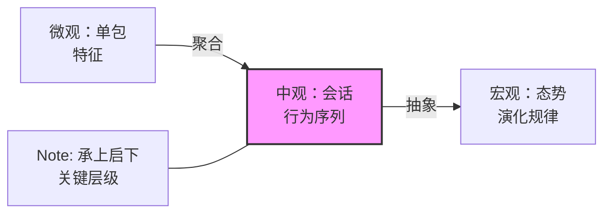

# 为什么需要中观画像

# 为什么需要中观画像

在安全通论的体系中，我们通常将安全视角划分为微观（比特/代码级）、中观（系统/网络级）和宏观（社会/生态级）。既然有了微观的精细和宏观的广阔，**==为什么还需要中观画像？==**

试想：如果你只盯着每一个数据包的字节（微观），会陷入“只见树木不见森林”的细节泥潭；如果你只看整体威胁态势（宏观），又无法定位具体的攻击路径。**中观画像正是为了填补这一“粒度断层”，它关注的是实体间的交互关系与行为模式。**

## 核心定义与价值

中观画像是对网络空间中**特定主体（如主机、用户、应用）**在一段时间内的**行为特征、资源访问关系及状态变化**的结构化描述。

> [!IMPORTANT]
> 中观画像的核心价值在于：**从离散事件中提取连续行为模式，实现从“检测异常点”到“识别异常链”的跨越。**

## 为什么微观和宏观不够？

| 视角 | 关注对象 | 局限性 | 中观的补充作用 |
| :--- | :--- | :--- | :--- |
| **微观** | 比特、指令、单包 | 数据量过大，噪声极高，难以理解意图 | ==提供语义上下文==，将孤立事件串联 |
| **宏观** | 产业、政策、生态 | 过于抽象，无法指导具体防御操作 | ==提供可操作实体==，定位具体攻击源 |

## 怎么做：构建中观画像的关键步骤

1.  **实体识别**：确定画像主体（如 IP $A$、用户 $U$）。
2.  **特征提取**：提取时间窗口 $T$ 内的统计特征（如连接频率 $f$、流量熵 $H$）。
3.  **关系建模**：构建主体间的交互图 $G=(V, E)$，其中边权重代表交互强度。

> [!TIP]
> 记忆口诀：**定主体、抽特征、建关系、看时序。**

## 常见误区与辨析

> [!WARNING]
> **易错坑**：混淆“中观画像”与“微观指纹”。
> *   微观指纹是静态的（如 MAC 地址、TLS  JA3 哈希）；
> *   中观画像是**动态的**（如“该 IP 在过去 10 分钟内扫描了 50 个端口”）。

## 算对了的例子

**场景**：检测内网横向移动。

*   **微观视角**：看到 100 个 SMB 连接请求包。结论：正常流量或异常？不确定。
*   **中观画像**：
    *   主体：主机 $H_1$。
    *   行为序列：$H_1$ 在 $\Delta t=5s$ 内，向子网内 20 个不同 IP 的 445 端口发起连接。
    *   特征值：连接成功率 $< 5\%$，目标离散度 $D$ 极高。
*   **结论**：中观画像判定为**扫描行为**，而非正常文件共享。

通过中观画像，我们将杂乱的包转化为清晰的**行为语义**，这是安全对抗中实现精准防御的关键一环。
