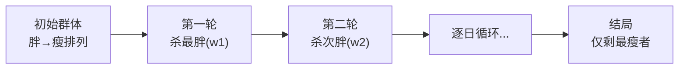

# 民意演化的一个传说的启发
你也许听过这样一个故事：一群人被困孤岛，民主投票决定“杀掉最胖的人吃掉以求生存”——每天投一次，直到有人死亡。乍听之下毛骨悚然，但细想：如果大家都很理性、贪生怕死，这个投票会怎样演化？

### 为什么需要一个模型？
现实中的民意在网络效应下常出现“极端化”或“一边倒”。要理解《安全通论》中网络舆论如何走向稳定或崩塌，我们需要一个能刻画==理性人策略互动==的工具。

这里的核心矛盾是：==个体最优选择，却可能把群体拖向灾难。==

### 博弈视角下的“吃人传说”
我们可以用==博弈论（Game Theory）==来建模。把每轮投票看作一个博弈：

- **局中人**：$N$ 个幸存的“胖瘦不同”个体。
- **策略**：投一个“非我”的人，希望他被选中。
- **收益**：活命（+生存值） vs 被杀（-∞）。

一个直接结论是：如果你是最瘦的人，你最安全，因为很少有人会投你（你肉少，杀了你大家下一顿还得再杀，不可持续）。而==最胖的人永远最危险==，因为杀他“一顿饱”。

### 演化路径的推演
假设我们按体重降序排列：$w_1 \ge w_2 \ge \dots \ge w_n$。

**第一轮投票：**

- $w_1$（最胖）必然会投给 $w_2$（次胖），试图转移视线。
- 其他人呢？他们会想：如果 $w_1$ 不死，明天他很可能联合别人投死我。所以，==除掉 $w_1$ 对所有人（除他自己）都是占优策略==。
- 结果：$w_1$ 高票出局。

**第二轮投票：**

- 原来的 $w_2$ 自动变为“余下人群中的最胖”。
- 同理，他也会被其他人默契投票出局。

依此类推，==这个投票会像“剥洋葱”一样，从最胖的人开始，逐天杀掉，直到只剩最后一个最瘦的人。==

### 模型的修改与“安全引信”
在安全通论中，我们借鉴此传说，是为了分析**阈值**的魔力。假如我们修改一下规则：

- 不杀最胖，改为“==杀历史上投过最胖者的人==”（即惩罚背叛者）。
- 或者引入“联盟”：数个小个体联合投票。

**常见的坑**  
[!CAUTION]  
> 直觉认为“越中庸越安全”在这个模型里完全失效。==在多数决的吞噬博弈中，极值（最胖或结盟领袖）最先被清除，而非被保护。==

### 一个算对了的例子
假设有 5 人，体重数据 $weight = [200, 150, 80, 70, 60]$（单位略）。

**情形：纯粹的“去最胖”机制**

1.  **第 1 天**：200 斤的 A 被处决。
2.  **第 2 天**：150 斤的 B 变为最重，被处决。
3.  **第 3 天**：80 斤的 C 变为最重，被处决。
4.  **第 4 天**：70 斤的 D 被处决。
5.  **存活者**：60 斤的 E。

这个推演揭示了一个残酷结论：如果群体按照“去除当前最显著特征（如威胁最大者）”的规则不断演化，最终存活的==并非最强者，而是刚好卡在阈值之下、最不引人注目的小透明==。

### 与网络安全审查的联系
这启示我们，在==网络舆情审查==或==蜜罐诱捕==中：

- **识别“最活跃攻击者”**：类似识别“最胖的人”，系统优先封堵或诱捕流量最大的 IP。
- **防御“剥洋葱”陷阱**：攻击者可能使用“自首”策略（送掉一个大的，以掩护核心渗透），安全系统需具备长周期关联分析能力，防止被规则所骗。
- **演化稳定策略 (ESS)** ：要设计一个规则，让恶意节点无法通过模仿良性节点获利，从而瓦解攻击联盟。
