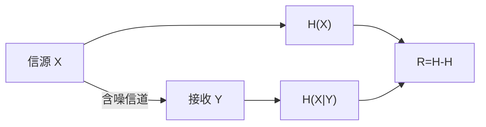

# 信息传输率R（信道中平均每个符号所能传送的信息量）

> [!IMPORTANT]
> 信息传输率 $R$ 是指信道中==平均每个符号所能传送的信息量==，单位为 bit/符号。

## 它是什么与为什么需要

设想你是红客，正在评估一条通信链路：信源每秒发出大量符号，但信道存在噪声干扰，接收端收到的符号并不完全可靠。此时你需要回答一个关键问题：**这条信道实际传递有效信息的效率到底有多高？**

信道容量 $C$ 告诉你的是“理论天花板”，而信息传输率 $R$ 衡量的是你当前编码方案下“实际跑到了多少”。在红客视角下，分析对手通信系统时，只有弄清其真实的 $R$，才能判断该系统是否逼近极限、是否存在冗余可被利用或压制。

## 怎么算

假设信源符号集为 $X$，接收端符号集为 $Y$。每个发送符号携带的平均信息量是信源熵 $H(X)$，但由于噪声，接收端对发送符号仍存在不确定性，即条件熵 $H(X|Y)$（也称疑义度）。

因此，平均每个符号真正传送到对端的信息量为：

$$R = H(X) - H(X|Y)$$

若考虑时间维度，设信道每秒传输 $r_s$ 个符号，则单位时间的信息传输率为：

$$R_t = r_s \cdot R = r_s \left[ H(X) - H(X|Y) \right] \quad (\text{bit/s})$$

> [!NOTE]
> 注意区分 $R$ 和 $R_t$：课件中未特别指明速率时，“信息传输率”通常指每符号的 $R$；带上时间才是 $R_t$。

## 与相近概念的区别

| 概念 | 含义 | 决定因素 | 关系 |
| :--- | :--- | :--- | :--- |
| 信息传输率 $R$ | 当前方案下每符号实际传送的信息量 | 信源分布 + 信道转移概率 | $R \leq C$ |
| 信道容量 $C$ | 所有可能输入分布下 $R$ 的最大值 | 仅由信道转移概率决定 | $C = \max_{p(x)} R$ |
| 信源熵 $H(X)$ | 信源每符号包含的平均信息量 | 仅由信源分布决定 | $R \leq H(X)$ |

> [!TIP]
> 记忆口诀：“$H(X)$ 是家底，$H(X|Y)$ 是路上丢的，$R$ 是到手剩下的，$C$ 是运气最好时能到手最多的。”

## 算对了的例子

**题目**：某二元对称信道（BSC），交叉概率 $\varepsilon = 0.1$，信源等概发送（即 $P(0)=P(1)=0.5$），求信息传输率 $R$。

**求解步骤**：

1. **求 $H(X)$**：信源等概，故 $H(X) = 1$ bit/符号。
2. **求 $H(X|Y)$**：对于 BSC，当输入等概时输出也等概，条件熵退化为二元熵函数：
   $$H(X|Y) = H(\varepsilon) = -\varepsilon \log_2 \varepsilon - (1-\varepsilon)\log_2(1-\varepsilon)$$
   代入 $\varepsilon = 0.1$：
   $$H(0.1) = -0.1\log_2 0.1 - 0.9\log_2 0.9 \approx 0.469 \text{ bit/符号}$$
3. **求 $R$**：
   $$R = H(X) - H(X|Y) = 1 - 0.469 = ==0.531 \text{ bit/符号}==$$

> [!WARNING]
> 常见坑：不要误把 $H(Y)$ 当成 $H(X|Y)$！$H(Y)$ 是接收端熵，只有在计算互信息 $I(X;Y)=H(Y)-H(Y|X)$ 时才用。本题用 $R = H(X) - H(X|Y)$ 更直接。

> [!CAUTION]
> 高危误区：认为只要信源等概，$R$ 就等于 $C$。对于 BSC 确实如此（因为 BSC 是对称信道，等概输入达到容量），但对于非对称信道，等概输入未必使 $R$ 最大化，此时 $R < C$。
