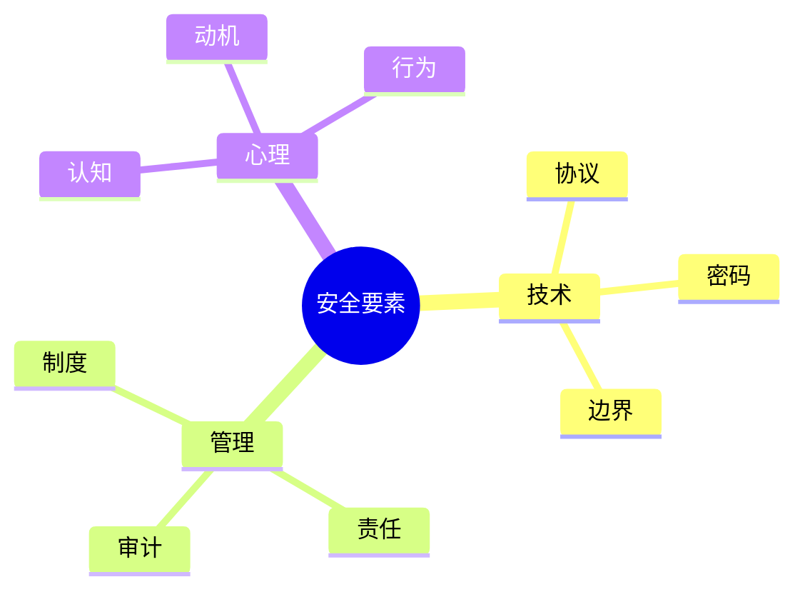

# 信息安全心理学

信息安全心理学是一门研究人在信息安全活动中的心理过程与行为规律的交叉学科，它把心理因素从"被忽视的盲区"提升为"必须设计的安全要素"。传统信息安全工程大多面向技术边界（协议、密码、防火墙），但大量事故最终落在人的环节：一个点击、一次抄写、一条转发的消息，都可能让完美的技术防线失效。课程指出，==信息安全心理学与信息安全管理学是全球信息安全界必须尽快弥补的两大缺陷==，是信息安全保障体系中不可或缺的关键。

## 为什么需要它

一个反复出现的问题是：技术上无懈可击的方案，为什么还是会被"内部人"或"低级失误"击穿？答案在于人。设计者如果只考虑攻击者的计算能力，而不考虑使用者的认知负荷、注意偏差、从众心理、恐惧与贪利等动机，==就无法覆盖"人"这一最薄弱的一环==。

## 研究什么

信息安全心理学主要围绕三类要素展开：==认知心理==（人如何感知、理解、记忆安全提示）、==动机心理==（人为何违规、为何被诱导，如恐惧、贪利、服从权威）、==行为心理==（人在压力、疲劳、时间紧迫下的实际操作）。典型的攻击如社会工程学、钓鱼邮件、假冒客服，本质都是对心理弱点的利用。

## 和相近概念的区别

| 维度 | 信息安全心理学 | 信息安全管理学 | 信息安全工程 |
| --- | --- | --- | --- |
| 关注点 | 人的认知与行为 | 制度与责任 | 协议与算法 |
| 研究对象 | 心理过程 | 组织流程 | 技术机制 |
| 典型工具 | 问卷、行为实验 | 制度、审计 | 模型、协议 |

三者不是替代关系，而是互补：==心理学解释"人为何这样做"，管理学规定"人应当怎样做"，工程学提供"让人不易出错的技术手段"==。

> [!IMPORTANT]
> 核心定位：信息安全心理学与信息安全管理学是信息安全界必须尽快弥补的两大缺陷，是保障体系中不可或缺的关键。

> [!WARNING]
> 常见坑：把"人的问题"简单归结为"意识不强、培训不够"。真正有效的做法是从认知负荷、动机与情境压力出发设计流程与提示，而不是空喊口号。

> [!TIP]
> 记忆口诀：技术防"外"、管理防"乱"、心理防"内"，三者缺一不可。

一个可核对的小例子：某单位部署了强口令与双因素认证，但员工在接到"IT 紧急维护"电话后主动提供了验证码，最终导致账号失守。==技术与制度都在，缺的是对人服从权威、时间压力下顺从的心理防范==，这正是信息安全心理学要补的位置。
