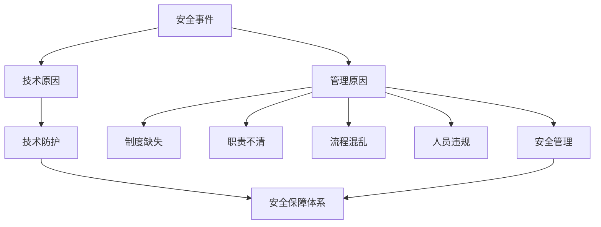

# 信息安全管理学

## 信息安全管理学是什么

长期以来，信息安全被当成纯技术问题：加密、防火墙、入侵检测……但统计显示，**绝大多数安全事件源于管理缺陷而非技术漏洞**——制度缺失、职责不清、流程混乱、人员违规。信息安全管理学就是把管理学的理论和方法系统地引入信息安全领域，研究"如何通过计划、组织、领导、控制来保障信息安全"，是信息安全保障体系中与技术手段==并列的另一条腿==。

> [!IMPORTANT]
> 信息安全管理学是信息安全保障体系不可或缺的关键组成部分，与信息安全心理学并列为全球信息安全界必须尽快弥补的两大缺陷。

## 为什么技术不够

可以这样想：再强的锁，如果钥匙随便放、没人登记谁开过门，安全吗？技术提供的是"能力边界"，管理决定的是"这些能力是否真正落地"。

## 核心内容框架

信息安全管理学围绕经典管理职能展开，落到安全场景中：

| 管理职能 | 在信息安全中的体现 |
|---------|------------------|
| 计划 | 安全战略、安全规划、风险评估 |
| 组织 | 安全组织架构、岗位职责（如 CISO）、人员配备 |
| 领导 | 安全文化培育、安全意识培训、激励机制 |
| 控制 | 安全审计、合规检查、事件响应、绩效考核 |

> [!TIP]
> 记忆主线：==计划—组织—领导—控制==，四项职能循环往复、持续改进（对应 PDCA 思想），而不是一次到位。

## 与相近概念的区别

| 对比项 | 信息安全管理学 | 信息安全技术 |
|-------|--------------|------------|
| 解决问题 | 人、流程、制度 | 算法、协议、设备 |
| 失效原因 | 执行不到位 | 被攻破 |
| 改进手段 | 审计、培训、问责 | 升级、加固、补丁 |
| 学科归属 | 管理学交叉 | 计算机/密码学 |

> [!WARNING]
> 不要把"安全管理"窄化为"装几个安全设备"。设备采购属于管理活动的一部分，但管理学的核心是==制度设计与人的治理==，这是考点最容易设陷阱的地方。

## 一个具体例子

某高校数据中心部署了防火墙和加密系统，但仍频繁发生数据泄露。用信息安全管理学的视角分析：

1. **计划缺失**：没有明确的数据分级制度，员工不知道哪些数据敏感；
2. **组织缺位**：没有专职安全管理员，安全责任分散在 IT 部门；
3. **领导乏力**：新员工未接受安全意识培训，对钓鱼邮件无警惕；
4. **控制薄弱**：没有日志审计和违规追责机制。

整改方案对应补齐四项职能：制定数据分类标准 → 设立安全管理员岗位 → 开展全员安全培训 → 建立季度审计与问责制度。半年后泄露事件显著下降——==这证明管理手段与技术手段同样有效，且不可互相替代==。

> [!CAUTION]
> 常见误区：认为"管理是软任务、可有可无"。实际考试中凡出现"技术措施齐全但仍出事故"的案例，答题方向应指向==管理缺陷==，而非继续堆砌技术方案。
