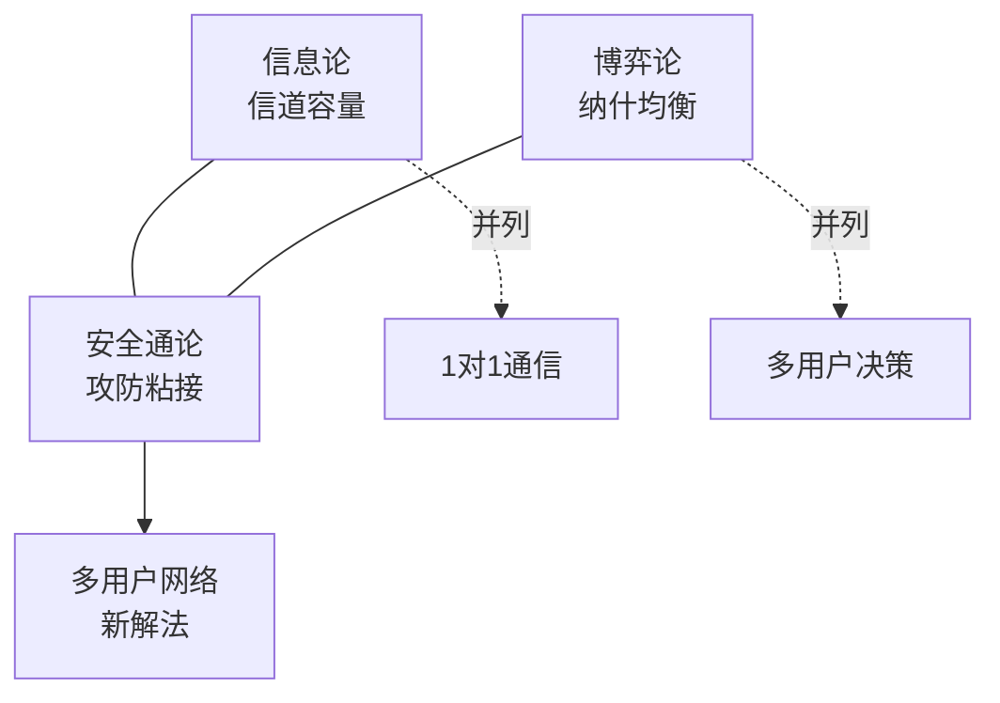

# 信息论与博弈论的再认识

信息通信领域有一本"圣经"《信息论》（香农），经济学领域有另一本"圣经"《博弈论》（冯·诺伊曼），二者几乎同时诞生于上世纪中叶，却长期互不往来。《安全通论》在用博弈论研究攻防对抗时偶然发现：==《信息论》与《博弈论》其实是同一本圣经的上下两册，灵魂完全一致==，而将二者粘接起来的"胶水"正是安全对抗。

先问一句：红客与黑客的攻防，究竟是一次博弈，还是一次通信？

## 三论的融合图景

- **博弈论最广**：可处理任意多用户的策略与目标；
- **信息论最深**：以熵、互信息刻画"传了多少信息"；
- **安全通论粘性最强**：把"对抗"同时解读为"博弈"与"通信"，促成融合。

## 为什么要再认识

[!IMPORTANT]
香农的信息论天生是为 ==1 对 1 通信== 设计的，转移矩阵、互信息、信道编码定理都建立在单用户对单用户之上；直接"照猫画虎"搬去多用户网络信息论，在多输入单输出信道上取得过部分成果，但==多用户网络"信息传输极限"数十年停滞不前==——说明不是技巧不够，而是框架缺一角。

问题的症结在于：多用户场景下，每个用户的通信意图、优化目标如何说清楚？经典信息论没有这个语言。

## 融合的思路：权重 + 条件互信息

博弈论恰好提供了表达"多用户意图"的工具：

- 给重要通信对象提高 ==权重==，次要用户调低权重，不关心的用户权重设 $0$；
- 用 ==条件互信息== 度量"从所关心的用户群能获得的信息量"：
$$I(X_A;Y \mid X_B)=H(X_A\mid X_B)-H(X_A\mid Y,X_B)$$
- 把每个用户的优化目标视为博弈中的"策略与效用"，用 ==纳什均衡==（含混合战略）刻画各用户达到企望值的**最大可达目标值**。

[!NOTE]
和香农信道编码定理的地位类似，博弈论方法也只给"可达上界"，具体逼近仍要靠编码、译码专家挖掘。

## 融合后的第一处核心发现

| 维度 | 信息论 | 博弈论 | 融合后（安全通论） |
|---|---|---|---|
| 对象 | 1 对 1 | 多用户 | 多用户网络通信 |
| 核心量 | 信道容量 $C$ | 纳什均衡 | $C$ ↔ 均衡解 |
| 目标描述 | 转移矩阵、互信息 | 权重、效用 | 权重 + 条件互信息 |
| 局限 | 多用户难 | 无传输语义 | 互补 |

==信道容量与纳什均衡的融合点==：把每个用户的最大可达互信息视作效用函数，多用户信道容量区域的边界，正是一个"以各用户可达信息量为效用"的博弈的纳什均衡集合。这一视角为广播信道等存疑数十年的容量难题提供了新思路——不再孤立试图求一个统一容量，而是承认各用户目标权重不同，用均衡刻画折中。

## 常见坑

[!WARNING]
- 不要把"博弈"和"通信"当两件事：安全对抗中它们是同一件事的两种读法；
- 权重不是概率，权重之和不必为 $1$；
- 融合给的是"可达目标值"，不给"怎么编码达到"。

## 例子

某广播信道向红、黑两用户发信，权重 $w_1=2,w_2=1$，条件互信息 $I(X;Y_1\mid Y_2)=3$、$I(X;Y_2\mid Y_1)=1$。加权效用 $U=2\times 3+1\times 1=7$。若黑方目标为 $U_2=2$（>1），则原解非均衡；调整策略直至双方都不愿单方面偏离，此时 $U=(3,1)$ 对应的分配即纳什均衡，也是该权重下的信道容量边界点。
