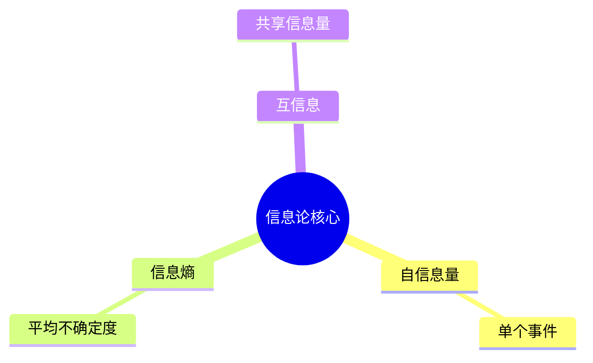

# 《信息论》核心凝练

在攻防对抗中，攻击者窃取信息、防御者保护信息。那么，我们如何精确度量“信息”本身？如果连信息的量都无法量化，安全策略的制定就失去了标尺。这就是将《信息论》核心凝练引入安全博弈的原因。

## 它是什么与为什么需要

《信息论》核心凝练，是指从香农（Shannon）经典信息论中提取出对安全分析最关键的三个度量工具：==自信息量、信息熵与互信息==。

在《安全通论》第7章的语境下，我们需要用这些工具来刻画“攻防双方的信息不对称程度”。例如，密码系统的安全性本质上取决于密钥的不确定性；而攻击者通过窃听能获取多少有效情报，则需要用互信息来衡量。没有这套数学语言，我们就无法严格证明一个系统是否达到了“完善保密”。

> [!IMPORTANT]
> 核心结论：信息熵 $H(X)$ 是随机变量 $X$ 平均不确定度的唯一合理度量，也是安全系统中“混乱度”或“保密潜力”的理论上限。

## 怎么做：三大核心公式

**1. 自信息量**
事件 $x_i$ 发生所带来的信息量：
$$I(x_i) = -\log_2 P(x_i)$$
概率越小的事件一旦发生，带来的“惊讶程度”（信息量）越大。

**2. 信息熵（平均自信息量）**
离散无记忆信源 $X$ 的信息熵为所有可能事件自信息量的数学期望：
$$H(X) = -\sum_{i=1}^{n} P(x_i) \log_2 P(x_i)$$

> [!TIP]
> 记忆技巧：当且仅当所有事件等概率发生时，信息熵取得最大值 $\log_2 n$。这在密码学中意味着：密钥空间均匀分布时，系统最难被攻破。

**3. 互信息**
已知观测变量 $Y$ 后，关于目标变量 $X$ 的不确定度减少量：
$$I(X;Y) = H(X) - H(X|Y)$$
在安全博弈中，$I(X;Y)$ 代表攻击者通过截获密文 $Y$ 所提取到的明文 $X$ 的信息量。若 $I(X;Y)=0$，则系统达到完善保密。

## 与相近概念的区别

初学者极易混淆“信息熵”与“热力学熵”或“方差”，它们的本质区别如下：

| 比较维度 | 信息熵 $H(X)$ | 方差 $D(X)$ | 热力学熵 |
| :--- | :--- | :--- | :--- |
| **度量对象** | 符号的不确定度 | 数值偏离均值的程度 | 物理系统的无序度 |
| **依赖因素** | 仅依赖概率分布 | 依赖具体取值与概率 | 微观状态数 |
| **安全意义** | 衡量猜测难度 | 衡量数据波动范围 | 无直接对应 |

> [!NOTE]
> 延伸辨析：即使两个随机变量的方差相同，只要概率分布不同，它们的信息熵就不同。因此，评估密码安全性只能用信息熵，不能用方差。

## 常见的坑

> [!WARNING]
> 易错边界条件：计算信息熵时，若某个事件的概率 $P(x_i) = 0$，公式中会出现 $0 \log_2 0$。根据极限约定，必须取 $\lim_{p \to 0^+} p \log_2 p = 0$，绝不能将其算作未定义或无穷大。

> [!CAUTION]
> 高危误区：不要把“互信息 $I(X;Y)$”等同于“条件熵 $H(X|Y)$”。互信息是“消除了的”不确定度，而条件熵是“剩余的”不确定度。两者相加才等于总熵 $H(X)$。

## 一个算对了的例子

设某安全系统的认证口令 $X$ 只有两种可能：$x_1$（概率为 $1/4$）和 $x_2$（概率为 $3/4$）。求该口令的信息熵。

**计算过程：**

$$H(X) = -P(x_1)\log_2 P(x_1) - P(x_2)\log_2 P(x_2)$$

$$H(X) = -\frac{1}{4}\log_2\frac{1}{4} - \frac{3}{4}\log_2\frac{3}{4}$$

$$H(X) = -\frac{1}{4} \times (-2) - \frac{3}{4} \times (-0.415)$$

$$H(X) = 0.5 + 0.311 = ==0.811 \text{ (bit)}==$$

**结果解读：**
如果口令是等概率的（各 $1/2$），最大熵应为 $1 \text{ bit}$。实际熵仅为 $0.811 \text{ bit}$，说明概率分布不均匀导致系统的不确定度下降，攻击者盲目猜测的成功率高于理想情况。这就为后续引入博弈论中的“混合策略优化”提供了信息论依据。
