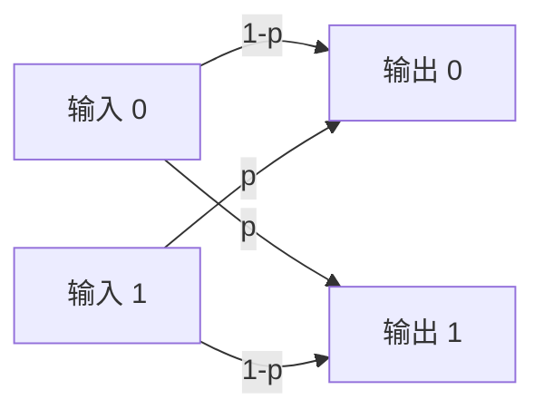

# 信道容量C（平均互信息极大值）

在“红客”与黑客的单挑盲对抗中，如果将攻击过程看作信息传输，那么黑客一次成功的突破，本质上意味着什么？这就要用到信道容量的概念。

## 它是什么

> [!IMPORTANT]
> 信道容量 $C$ 是平均互信息 $I(X;Y)$ 关于输入分布 $P(x)$ 的极大值：
> $$C = \max_{P(x)} I(X;Y)$$

在《安全通论》第4章语境下，我们将黑客的攻击动作视为信源 $X$，防御方的观测结果视为信宿 $Y$，两者之间构成一条“攻击信道”。信道容量 $C$ 就是这条攻击信道每使用一次，黑客最多能向系统“注入”多少比特的有效信息。

## 为什么需要

如果不知道攻击信道的容量，就无法量化单挑盲对抗的理论极限。

- **对红客（防守方）**：$C$ 越小，说明防御机制引入的噪声越大，黑客单次攻击成功传递的信息越少。
- **对黑客（攻击方）**：若总攻击次数为 $N$，则至多能成功传输的信息量为 $NC$ 比特。结合具体获胜判定阈值，即可推算出理论上的最大获胜次数。

## 怎么做

计算信道容量通常分三步：

1. 写出转移概率矩阵 $P(y|x)$。
2. 列出互信息表达式 $I(X;Y) = H(Y) - H(Y|X)$。
3. 对输入分布 $P(x)$ 求导或利用对称性，找到使 $I(X;Y)$ 最大的 $P^*(x)$，代入得 $C$。

> [!TIP]
> 遇到**二进制对称信道（BSC）**，交叉概率为 $p$ 时，直接套公式：
> $$C = 1 - H(p)$$
> 其中 $H(p) = -p\log_2 p - (1-p)\log_2(1-p)$。

## 算对了的例子

假设单挑盲对抗中，黑客攻击信道为 BSC，转移概率如下：

设交叉概率 $p = 0.11$，黑客共发起 $N = 100$ 次攻击。问：攻击信道容量是多少？至多获胜多少次？

**解：**
1. 计算信道容量：
   $$C = 1 - H(0.11) = 1 - (-0.11\log_2 0.11 - 0.89\log_2 0.89) \approx 1 - 0.5 = 0.5 \text{ bits/use}$$
2. 计算最大获胜次数：
   在盲对抗中，若定义每次攻击成功等价于无误码地传输 1 bit 信息，则 $N=100$ 次攻击的最大信息传输量为 $NC = 100 \times 0.5 = 50$ bits。因此黑客至多获胜 ==50== 次。

## 和相近概念的区别

| 对比项 | 信道容量 $C$ | 纳什均衡 |
| :--- | :--- | :--- |
| 所属理论 | 信息论 | 博弈论 |
| 优化目标 | $\max_{P(x)} I(X;Y)$（单方最优） | 任何一方单方面改变策略均无法获益 |
| 安全应用 | 评估单次攻击信息泄露极限 | 分析攻防双方长期策略稳定态 |

> [!NOTE]
> 考题常问“如何将信道容量与纳什均衡融合”。思路是：在多用户广播信道中，各黑客竞争信道资源，此时不仅要求互信息极大，还需满足各方策略互为最优响应，从而引出博弈信道容量难题。

## 常见的坑

> [!WARNING]
> 互信息 $I(X;Y)$ 是关于 $P(x)$ 的**上凸函数**，所以求的是“极大值”而非极小值。千万不要对 $P(y|x)$ 求导，信道转移概率是给定的客观条件！

> [!CAUTION]
> 算出 $C$ 后乘以 $N$ 得到的是**总信息量（bits）**，要换算成“获胜次数”，必须看清题目对“获胜”的定义（例如是否 1 bit 对应 1 次成功）。不要无脑把 $NC$ 当次数。
