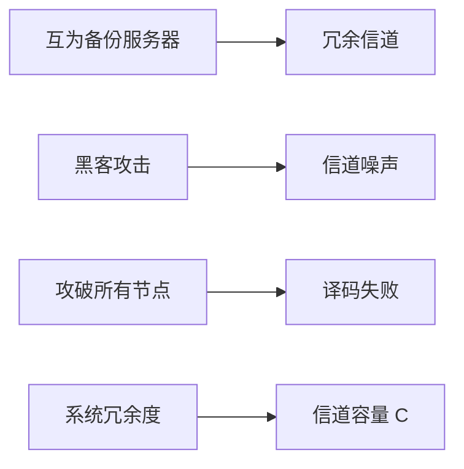

# 信道编码定理

## 什么是信道编码定理

在《安全通论》“红客”视角下，信道编码定理不再仅是通信纠错的理论基石，更是==衡量攻击成功极限的标尺==。它指出：只要信息传输速率 $R$ 小于信道容量 $C$，就存在一种编码方式使错误概率 $P_e$ 随码长 $n$ 增加而指数级趋于零。

> [!IMPORTANT]
> 核心映射关系
> 在攻防对抗中，**系统冗余度等价于信道容量**，**攻击强度等价于噪声干扰**。黑客若想彻底破坏系统可用性，其攻击效能必须突破由冗余构建的“安全信道容量”。

为什么需要这个定理？因为单纯堆砌备份服务器并不能直观告诉我们“到底多安全”。信道编码定理给出了可靠性的理论上限，回答了“在给定冗余下，攻击者成功的概率下限是多少”这一关键问题。

## 从通信到攻防的映射机制

如何将抽象定理落地到服务器攻防场景？我们可以通过以下对应关系来理解：

当黑客对 $N$ 个互为备份的服务器发起攻击时，这本质上是一个==带冗余的信道传输模型==。攻击者试图让所有路径同时失效，如同噪声试图淹没所有信号副本。根据联合界（Union Bound），随着备份数 $N$ 增加，攻击全成功的概率呈指数下降：

$$ P_{\text{attack\_success}} \leq K \cdot e^{-N \cdot E(R)} $$

其中 $E(R)$ 为可靠性函数，取决于系统冗余与攻击强度的博弈。只有当攻击强度对应的“等效噪声”使 $R > C$ 时，$P_e$ 才无法趋于零，即攻击才可能确证成功。

## 与相近概念的区别

| 概念 | 关注点 | 在安全通论中的角色 |
| :--- | :--- | :--- |
| 信道编码定理 | 可靠传输的**理论极限** | 定义攻击成功的**上界** |
| 具体编码方案 | 如何构造码字实现纠错 | 对应具体的防御/冗余策略 |
| 香农公式 | 无差错传输的**最大速率** | 量化系统可承受的最大攻击阈值 |

> [!NOTE]
> 辨析要点
> 信道编码定理是“存在性证明”，只保证极限存在；而具体防御措施（如多活架构、异地灾备）是“构造性方法”。考试中问“成功极限”时，应答定理本身而非具体技术。

## 常见误区与解题示范

> [!WARNING]
> 易错坑
> 切勿将“攻击成功率低”直接等同于“信道编码定理”。定理强调的是**极限条件**，即“错误概率趋于零的充要条件”，而非某个具体概率值。

**真题解析**：假设黑客对互为备份的多个服务器发起攻击，试分析它的成功极限等价于信息论中的什么问题？

**解题思路**：
1.  **识别模型**：“互为备份” $\rightarrow$ 冗余信道；“攻击” $\rightarrow$ 引入噪声。
2.  **定位定理**：题目问“成功极限”，即系统保持可用（不出错）的理论边界，直接对应==信道编码定理==或==可靠性界限==。
3.  **规范作答**：明确指出该问题等价于信道编码定理。解释备份服务器构成冗余信道，攻击视为噪声，黑客需克服系统冗余度（信道容量）才能使错误概率不趋于零。

> [!TIP]
> 记忆口诀
> 备份即冗余，攻击即噪声；极限看编码，成败比容量。
