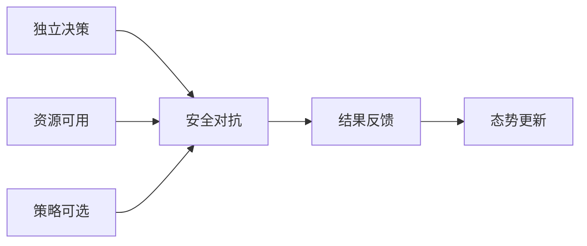

# 充分竞争的共性

## 什么是充分竞争

在安全对抗的宏观描述中，**充分竞争**是指参与安全博弈的各方都具备相应的行动能力和对抗条件，因而能够在较充分的信息、资源和策略选择下展开竞争。它强调的不是“竞争一定激烈”，而是竞争参与者有条件进行较充分的选择。

可把竞争条件概括为：

- **主体独立**：不同参与者能够独立作出判断和决策；
- **资源可用**：拥有采取行动所必需的信息、能力和资源；
- **策略可选**：面对同一局面时，存在多种可能行动；
- **结果反馈**：行动结果会影响后续判断和策略调整。

> [!IMPORTANT]
> 充分竞争的共同特征，是参与者在信息、资源和策略选择上具有相对充分的自主性与行动空间。

## 为什么需要这一概念

安全对抗往往不是简单的“攻击者—防御者”二元模型。实际环境中可能同时存在攻击者、防御者、管理者、监管者和普通用户等主体。如果忽略各主体的能力和约束，就容易把安全分析简化为技术能力对比。

引入“充分竞争”，是为了从宏观上考察：

1. 哪些主体参与对抗；
2. 各自掌握什么资源和信息；
3. 可以采取哪些行动；
4. 不同行动如何改变后续对抗态势。

## 如何判断是否形成充分竞争

分析时可按“主体—条件—过程—结果”展开：

| 检查维度 | 主要问题 | 判断重点 |
|---|---|---|
| 主体 | 谁参与竞争 | 是否有独立决策能力 |
| 资源 | 谁能掌握什么 | 信息、技术和权限是否匹配 |
| 策略 | 可以怎样行动 | 是否存在多种有效选择 |
| 过程 | 如何相互作用 | 行动之间是否相互影响 |
| 结果 | 竞争走向如何 | 是否产生反馈和态势变化 |

如果某一方实际上无法独立行动，或者其行为完全由另一方决定，那么这种关系更像依赖、控制或普通协作，而不能直接称为充分竞争。

## 与相近概念的区别

| 概念 | 关注重点 | 与充分竞争的区别 |
|---|---|---|
| 完全竞争 | 竞争是否充分、彻底 | “充分”不要求“完全” |
| 恶性竞争 | 竞争的损害性和失序性 | 充分竞争也可能有序、规范 |
| 安全对抗 | 对抗关系及攻防过程 | 充分竞争是描述其宏观条件 |
| 协同合作 | 主体之间的配合 | 合作追求共同目标，竞争存在目标差异 |
| 零和博弈 | 一方收益是否对应另一方损失 | 充分竞争未必是零和结果 |

> [!NOTE]
> 充分竞争描述的是竞争条件是否充分，不是对竞争结果作价值判断，也不等同于经济学意义上对“完全竞争市场”的严格定义。

## 常见误区

> [!WARNING]
> 不要把“有攻防行为”直接等同于“充分竞争”。只有双方具有相对独立的行动能力和可选择的策略，才具备充分竞争的基本特征。

还要注意：现实安全对抗很少达到所有主体、资源都绝对充分的状态。因此更准确的表述通常是“某种程度的充分竞争”，而不是机械地判定为“完全竞争”。

## 算对了的例子

某网络攻防实验中，攻击方能够独立选择扫描、漏洞利用或钓鱼方案；防御方能够独立部署补丁、调整访问控制或启用日志审计。双方掌握的信息和资源虽有差异，但都足以支持自己的决策，并且一方的行动会改变另一方的策略选择。

因此，这一场景属于**安全对抗中的充分竞争**：双方能够独立决策，也有多种可选策略。虽然防御方资源更多，但这并不自动否定“充分竞争”，因为充分竞争并不要求双方资源完全相同。

> [!TIP]
> 做题时抓住三问：==能否独立决策==、==是否有多种策略==、==结果是否影响后续==。三问大多得到肯定回答，就可判断为较充分的竞争。
