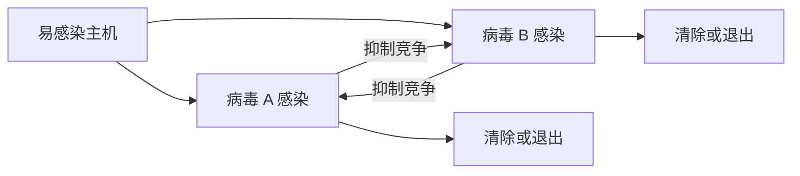

# 免疫型病毒的动力学分析

## 是什么

“免疫型病毒”是指病毒感染宿主后，能够感知系统中已有的病毒，并通过**抢占资源、抑制竞争者或主动清除其他病毒**来维持自身优势的一类病毒。这里的“免疫”不是说宿主获得免疫力，而是病毒获得了某种“排斥同类”的能力。

动力学分析，就是用计算机数量随时间变化的方程，描述病毒传播、竞争、抑制和清除的过程。常用状态包括：

- $S(t)$：未感染、易被感染的主机数；
- $I(t)$：已被某类病毒感染的主机数；
- $R(t)$：感染后恢复或被清除的主机数。

## 为什么需要

仅用普通传播模型，无法解释“系统里同时有两种病毒时，数量为什么会一升一降”。免疫型病毒会改变其他病毒的感染率或存活率，因此必须增加**竞争、抑制和免疫状态**，才能分析最终是哪种病毒占优势。

需要回答的核心问题是：

> 两种病毒相遇后，是先感染者获胜，还是具有更强抑制能力的病毒获胜？

## 怎么做

设两种免疫型病毒分别为 $A$、$B$，其感染数量为 $I_A(t)$、$I_B(t)$。可先建立如下模型：

$$
\frac{\mathrm d I_A}{\mathrm dt}
=\beta_A S I_A\left(1-\frac{I_B}{K_B}\right)-\mu_A I_A
$$

$$
\frac{\mathrm d I_B}{\mathrm dt}
=\beta_B S I_B\left(1-\frac{I_A}{K_A}\right)-\mu_B I_B
$$

其中：

- $\beta_A、\beta_B$：两种病毒的传播能力；
- $S$：易感染主机数量；
- $K_A、K_B$：竞争抑制阈值；
- $\mu_A、\mu_B$：清除速率；
- $1-I_B/K_B$：病毒 $A$ 因受到 $B$ 抑制而保留的传播能力。

若某一病毒的传播能力强、清除速度低，且抑制项更有效，它就会成为优势病毒；反之，数量会逐渐衰减。实际答题时不一定要求复杂方程，但要说明：**新增感染率与清除率共同决定数量变化，竞争项决定两种病毒能否共存。**

## 与康复型病毒的区别

| 对比项 | 康复型病毒 | 免疫型病毒 |
|---|---|---|
| 核心行为 | 自我清除、修复或生命周期结束 | 排斥竞争者、争夺资源 |
| 典型结果 | 感染量最终下降，系统恢复 | 可能长期潜伏或形成单一优势种 |
| 动力学重点 | 恢复率、移除项 | 交叉抑制项、竞争阈值 |
| 是否直接作用于其他病毒 | 通常没有 | 通常具有 |
| 数学模型 | 更接近 SIR 模型 | 在传播模型中加入竞争或免疫项 |

==核心结论==：康复型病毒研究“如何退出”，免疫型病毒研究“如何压制对手”；前者多表现为 $I(t)$ 下降，后者可能出现稳定共存或优势种替代。

## 常见坑

1. **把“免疫”理解成宿主免疫**：免疫型病毒的免疫对象通常是其他病毒，不是人，也不是主机。
2. **只写传播率，不写清除率**：若没有 $\mu I$，无法解释感染数量为何下降。
3. **忽略抑制方向**：$A$ 抑制 $B$ 与 $B$ 抑制 $A$ 的项不能写反。
4. **把实验性名称当作权威实例**：具体病毒名称在不同教材中可能不一致；答题应优先给出机制明确的实验型例子，并注明其“排他、抑制竞争病毒”的特征。

## 算对了的例子

假设某实验性免疫型病毒 $A$ 感染 100 台主机，其传播率为 $\beta=0.2$，清除率为 $\mu=0.05$，且暂时没有竞争病毒，则：

$$
\frac{\mathrm d I_A}{\mathrm dt}=(0.2-0.05)I_A=0.15I_A
$$

因此感染量呈指数增长：

$$
I_A(t)=100e^{0.15t}
$$

若系统中出现病毒 $B$，并使 $A$ 的有效传播率下降为 $0.04$，而清除率仍为 $0.05$，则：

$$
\frac{\mathrm d I_A}{\mathrm dt}=(0.04-0.05)I_A<0
$$

此时 $A$ 的感染量开始下降。这说明免疫型病毒的最终走势取决于“==有效传播率与清除率的比较==”，而不是单看感染初期数量。
