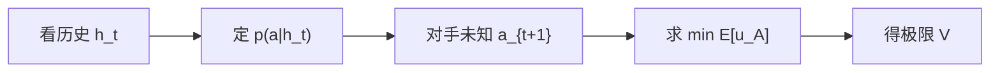

# 单挑非盲对抗极限之“劝酒令”“猜拳”

## 它是什么

在《安全通论》第5章“红客与黑客的单挑对抗极限”里，所谓“单挑非盲对抗”，是指红客 $A$ 与黑客 $B$ 一对一攻防，且双方都能看见对方已出的动作，但不知道对方下一轮要出什么。课件用“劝酒令”来描述这种==知道历史、不知未来==的博弈结构：每一次出手就像席间行令，你听见了我刚喊的令，却猜不中我下一杯敬谁。而“猜拳”则被抽象为在==非盲对抗==中求==极限胜率==或==最优混合策略==的问题：双方各以一定概率分布选择攻或防，系统在长期交互中达到某个平衡。

为什么需要它？因为真实网络单挑不是掷一次骰子就结束，而是多轮重复；若只按单回合最大收益行动，容易被对手利用规律反制。只有把历史可见、未来随机的约束写成模型，才能算出“不被剥削”的极限。

## 怎么做

先看课件记号：设红客有纯策略集 $S_A=\{\text{攻},\text{防}\}$，黑客有 $S_B=\{\text{偷},\text{骗}\}$；一轮收益矩阵给出 $u_A(i,j)$。在非盲对抗中，$t$ 轮前的历史 $h_t$ 双方共知，但 $a_{t+1},b_{t+1}$ 独立按分布 $p,q$ 抽取。劝酒令的含义是：==当前动作可依赖历史，但对手当前选择仍不可预测==。

求极限时，课件走的是最小最大路线：
$$V=\max_{p}\min_{q}\mathbb{E}_{p,q}[u_A]$$
也就是红客选混合策略 $p$，黑客用最能克制的 $q$，红客保证至少拿到 $V$。

做题步骤一般是：写收益矩阵；设双方概率 $(x,1-x)$ 与 $(y,1-y)$；列期望收益；令对方无差异（让黑客两选择收益相等）解 $x$；再代回算 $V$。

## 与相近概念的区别

| 概念 | 是否见历史 | 是否知未来 | 极限算法 |
|---|---|---|---|
| 盲对抗 | 否 | 否 | 单回合最小最大 |
| 非盲劝酒令 | 是 | 否 | 条件分布+最小最大 |
| 全信息博弈 | 是 | 是 | 逆向归纳 |

## 常见的坑

> [!WARNING]
> 别把“可看历史”当成“可预判下一轮”。历史只改条件分布，不改对手本轮随机性。

> [!CAUTION]
> 期望收益写错行或列，会导致无差异方程反号；先标清是谁对谁。

## 一个算对了的例子

课件题：收益矩阵
$$u_A=\begin{pmatrix}2&0\\0&1\end{pmatrix}$$
行=攻/防，列=偷/骗。设红客以 $x$ 攻、$1-x$ 防。黑客选“偷”收益 $2x+0(1-x)=2x$；选“骗”收益 $0x+1(1-x)=1-x$。令无差异：
$$2x=1-x\Rightarrow 3x=1\Rightarrow x=\frac13$$
黑客任取 $y$ 期望都不低于此支配比下红客所得：
红客期望 $=\frac13\cdot2y+\frac13\cdot0(1-y)+\frac23\cdot0y+\frac23\cdot1(1-y)$
取黑客最小化，令两列给红客收益相等：攻列 $2$、防列 $0$ 对偷；骗列 $0$、$1$ 对防，实际直接代 $x=1/3$ 且黑客选骗列期望 $=0\cdot\frac13+1\cdot\frac23=\frac23$，选偷列 $=2\cdot\frac13+0=\frac23$，故
$$V=\frac23$$
==核心结论==：劝酒令式非盲单挑的极限值由混合策略无差异点决定，等于 $\frac23$。
