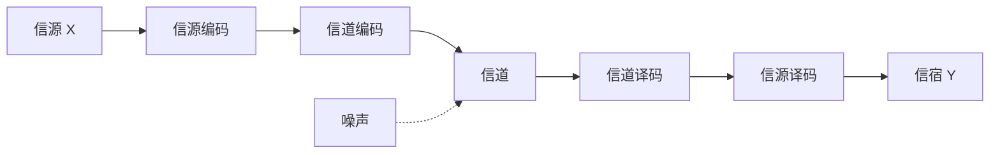

# 协作式对话（通信）与问题的提出

## 什么是协作式对话

协作式对话是最常见的对话形式，此时对话双方的目标一致：==共同努力，减少或消除彼此之间的不确定度（熵，或叫“信息熵”）==。研究协作式对话最成功的理论，当数香农创立的《信息论》。

香农信息论研究的核心问题是：
1. **信源编码**：如何把话语 $X$ 中的冗余信息充分压缩，使信息量达到最小值 $H(X)$（香农第一定理）。
2. **信道编码**：由于 $Y$ 的积极贡献，使 $I(X;Y)$ 的信息量能传达给另一方，求 $I(X;Y)$ 的最大值（即信道容量 $C$），并研究如何无失真地传达这一最大信息量（香农第二定理）。

## 问题的提出：对话只有协作式吗

半个多世纪以来，信息论取得巨大成就，但所有成果都有一个暗含假设：==通信或对话双方是彼此协作的，目的都是减少熵、增加信息==。

难道对话真的只有这一种吗？1950 年，维纳在《人有人的用处》中明确提出了这个问题。他指出：

- 正常通信谈话的主要敌手是**自然界自身的熵趋势**（噪声），并非主动的、有自觉目的的敌人；
- 辩论式对话遭遇的则是**可怕得多的敌人**，其自觉目的在于限制乃至破坏谈话的意义。

由此可确定两个重要事实：
1. 非协作式对话很可能是维纳首先发现并明确提出的；
2. 协作式对话与非协作式对话“根本不同”，以协作为前提的香农信息论确有值得扩展之处。

维纳还指出：噪声是协作式对话的主要破坏力量，信息论已对其有完美研究；但协作式对话的成果，**完全不适合法庭上的非协作式对话**。

## 对话的分类与方向熵

对话可分为三大类：

| 类型 | 协作性 | 方向矢量 $\mathsf{a}$ | 方向熵 $H(\mathsf{a},X)$ |
|------|--------|----------------------|--------------------------|
| 协作式对话（通信） | 协作 | $(1,1,\ldots,1)$ | 非负，减少不确定性 |
| 骂架式对话 | 非协作 | $(-1,-1,\ldots,-1)$ | 非正，增加不确定性 |
| 法庭辩论式对话 | 非协作 | 一般取向 | 可正可负 |

设 $\mathsf{a}=(\mathsf{a}_1,\mathsf{a}_2,\ldots,\mathsf{a}_n)$ 为 $X$ 的取向矢量，$a_i=1$ 或 $-1$。当 $a_i=1$ 时，事件 $p_i$ 提供正信息 $p_i\log(1/p_i)$；当 $a_i=-1$ 时，提供负信息 $-p_i\log(1/p_i)$。

$H(\mathsf{a},X)$ 称为 $X$ 的方向为 $\mathsf{a}$ 的**方向熵**。香农研究的协作式对话只是一般对话的特例（方向矢量为 $(1,1,\ldots,1)$），但除骂架式对话外，香农信息论的几乎所有结论、方法和工具在一般辩论式对话面前都失灵了。

## 计算示例：接收 $y=0$ 后的信息增益

**题目**：Alice 符号集 $X=\{0,1\}$，$P(0)=P(1)$；Bob 符号集 $Y=\{0,1\}$，$P(y=1|x=0)=1/4$，$P(y=0|x=1)=1/8$。求 Bob 接收到 $y=0$ 后提供的关于 $X$ 的平均条件互信息。

**解**：
$$P(Y=0)=\frac{3}{4}\cdot\frac{1}{2}+\frac{1}{8}\cdot\frac{1}{2}=\frac{7}{16}$$

由贝叶斯公式：
$$P(X=0|Y=0)=\frac{3/8}{7/16}=\frac{6}{7},\quad P(X=1|Y=0)=\frac{1/16}{7/16}=\frac{1}{7}$$

先验熵 $H(X)=1$ bit，后验熵：
$$H(X|Y=0)=-\left(\frac{6}{7}\log_2\frac{6}{7}+\frac{1}{7}\log_2\frac{1}{7}\right)\approx 0.591\text{ bit}$$

信息增益：
$$I=H(X)-H(X|Y=0)\approx 1-0.591=0.409\text{ bit}$$

> [!TIP]
> 计算此类问题分三步：全概率求 $P(y)$ → 贝叶斯求后验 $P(x|y)$ → 先验熵减后验熵得信息增益。

> [!WARNING]
> 注意区分：$I(X;Y)$ 是平均互信息（对所有 $y$ 取期望），而本题求的是特定观测 $y=0$ 下的信息增益 $H(X)-H(X|Y=0)$，二者不要混淆。

> [!IMPORTANT]
> 协作式对话的核心是双方目标一致、共同减少熵；香农信息论以协作为暗含前提，不能简单套用到非协作式对话。
