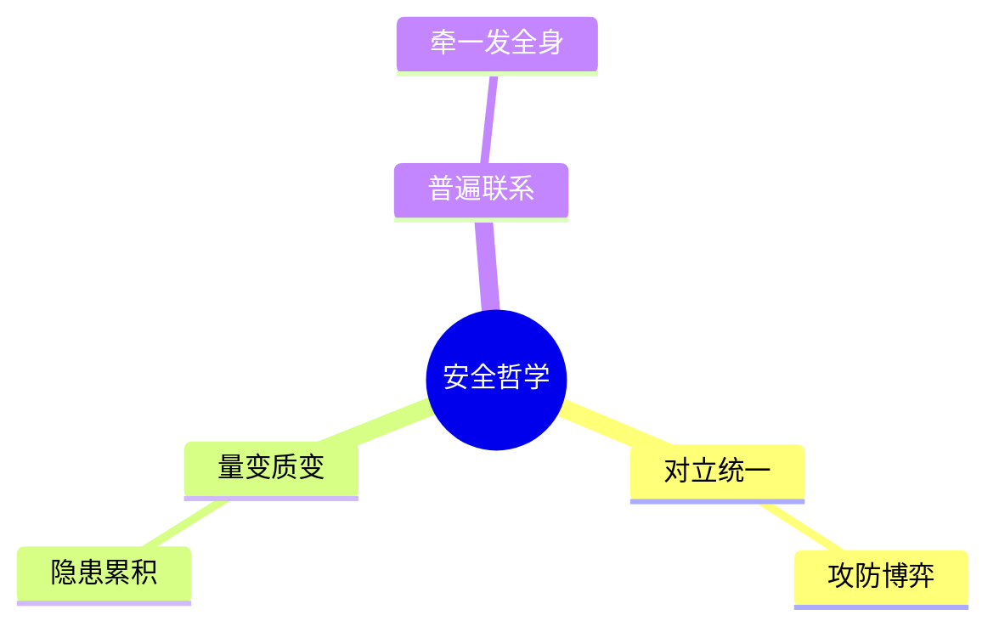
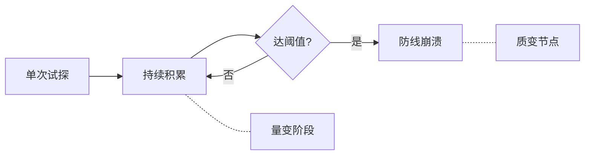

# 从哲学角度看安全

安全不仅是技术问题，更是哲学问题。为什么装了防火墙还会被攻破？因为孤立地看设备，而没从整体和演化的角度理解威胁。

> [!IMPORTANT]
> 核心结论：安全是==相对的、动态的==，不存在绝对安全；安全事件遵循唯物辩证法中“量变引起质变”的规律。

## 它是什么

从哲学角度看安全，是用唯物辩证法（对立统一、量变质变、普遍联系）重新审视信息安全。

- **对立统一**：攻与防、风险与收益相互依存。
- **量变到质变**：微小隐患积累最终引发系统崩溃或数据泄露。
- **普遍联系**：单点漏洞可能牵连整个网络信任链。

## 为什么需要

传统观念认为“装上杀毒软件就安全了”。但哲学视角告诉我们：

1. 系统是发展的，昨天的补丁防不住今天的 0day。
2. 局部安全 $\neq$ 整体安全。

> [!WARNING]
> 常见坑：将“相对安全”等同于“绝对安全”，导致忽视日常巡检和小漏洞修复。

## 怎么做：量变到质变的分析框架

遇到分析题时，按三步走：找量变源 $\to$ 看积累过程 $\to$ 定质变点。

| 步骤 | 含义 | 举例 |
|---|---|---|
| 找量变源 | 识别微小隐患 | 弱口令、未打补丁 |
| 看积累 | 隐患如何叠加 | 字典试探、横向移动 |
| 定质变点 | 突破临界状态 | 提权成功、拖库 |

> [!TIP]
> 记忆口诀：“小洞不补，大洞吃苦；量变不停，质变必行。”

## 算对了的例子

**题目**：何为信息安全中的量变和质变，列举一些安全中量变到质变的例子。（8分）

**解析与作答**：

**定义**：
- ==量变==：系统中微小的、渐进的安全隐患或攻击尝试的积累，尚未改变系统整体安全状态。
- ==质变==：量变积累突破安全阈值（临界点），导致系统安全属性（机密性、完整性、可用性）发生根本性破坏。

**例子**：

1. **暴力破解**：单次错误登录是量变（系统仍正常）；当尝试次数 $N \to N_{max}$ 且命中正确口令时，触发质变（账户失陷）。
2. **APT 攻击**：长期潜伏收集零散信息是量变；拼凑出核心拓扑并植入后门是质变。
3. **缓冲区溢出**：逐字节写入超界数据是量变；覆盖返回地址并执行恶意代码是质变。

## 相近概念辨析

| 维度 | 传统技术视角 | 哲学视角 |
|---|---|---|
| 关注点 | 单个漏洞/设备 | 系统演化与全局联系 |
| 安全观 | 追求绝对无漏洞 | 接受相对安全，强调动态对抗 |
| 应对策略 | 静态防御（如 ACL） | 持续监测量变指标，阻断质变 |

> [!NOTE]
> 延伸辨析：哲学视角不是替代加密或防火墙，而是提供顶层思维——指导我们何时该投入资源去修补那些看似“危害不大”的量变因素。

> [!CAUTION]
> 高危误区：答题时只写“量变就是变多，质变就是变坏”，必须结合**具体安全场景**（如上述暴力破解、APT）说明阈值是如何被突破的，否则拿不到采分点。
