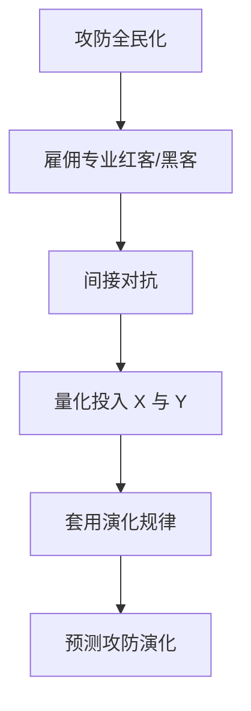

# 红客与黑客间接对抗的四要素小结

## 红客与黑客间接对抗的四要素

所谓**间接对抗**，指攻防双方并不亲自下场，而是雇佣专业红客或黑客为自己服务。随着网络安全攻防全民化，这种模式会越来越普及；而且从演化规律看，间接对抗与直接对抗并无本质区别——两者都是红客与黑客之间的激烈竞争，只是"代理人"变了。

要把这种对抗量化，先要回答一个问题：**红客和黑客的"投入"能不能放在同一个天平上比较？**

## 投入的可量化：X 与 Y

设黑客投入为 $X$，红客投入为 $Y$。无论是攻击方还是防守方，最终投入多少去逼近某个最优值，都是非常困难的问题，但从理论上说这个逼近值确实存在。因此我们可以直接用 $X$ 和 $Y$ 来量化攻守双方的能力。

> [!IMPORTANT]
> 1 块钱红客投资构建的防守体系，挡不住 1 块钱黑客投资产生的攻击力；反之亦然。但经过一段时间振荡后，从统计角度两者存在一个稳定的当量比值 $k$，且 $k$ 随网络系统、攻防场景和时间变化。为简化分析，后面统一假定 $K=1$。

## 四要素：谁、投多少、攻哪里、守哪里

把对抗双方、投入、目标放在一起，就得到间接对抗的四个要素：

| 要素 | 记号 | 含义 |
|------|------|------|
| 红客投入 | $Y$ | 防守方雇佣红客所花的钱 |
| 黑客投入 | $X$ | 攻击方雇佣黑客所花的钱 |
| 红客收益 | $R_i(t)$ | 红客对子系统 $i$ 的防守收益 |
| 黑客收益 | $E_i(t)$ | 黑客对子系统 $i$ 的攻击收益 |

攻击目标和防守目标都是系统 $A$ 的某些子系统，不同人攻击和防守的目标并不相同。由此可区分两类极端角色：

- **纯黑客**：只攻不守，$E_i(t)=0$ 不成立（应为 $R_i(t)=0$，即无防守收益）；
- **纯红客**：只守不攻，$R_i(t)=0$ 不成立（应为 $E_i(t)=0$，即无攻击收益）。

> [!WARNING]
> 课件原文中"纯黑客 $E_i(t)=0$、纯红客 $R_i(t)=0$"的表述极易记反。正确理解是：**纯黑客没有防守收益**，所以 $R_i(t)=0$；**纯红客没有攻击收益**，所以 $E_i(t)=0$。但本章进一步假定不存在纯黑客或纯红客，即每个参与者都既有攻也有守。

## 为什么能量化：向钱看

安全攻防最终可以转化为经济指标，这是能够进行量化研究的前提。虽然个别黑客和红客坚称自己追求正义、与钱无关，但幸好攻防能"向钱看"，否则就无法套用演化规律做数学分析。

> [!TIP]
> 记忆四要素的口诀：**"人、钱、攻、守"**——谁参与（红客/黑客）、投多少（$Y$/$X$）、攻哪（$E_i$）、守哪（$R_i$）。做题时先列出这四项，再判断是否存在纯黑客或纯红客。

> [!NOTE]
> 并非所有领域都能这样量化。例如"互联网将如何进化、其量化轨迹是什么"就没有公认答案，这也是为什么进化论在许多领域被批评为"滥用"——而网络安全恰好是少数能幸免的领域。
