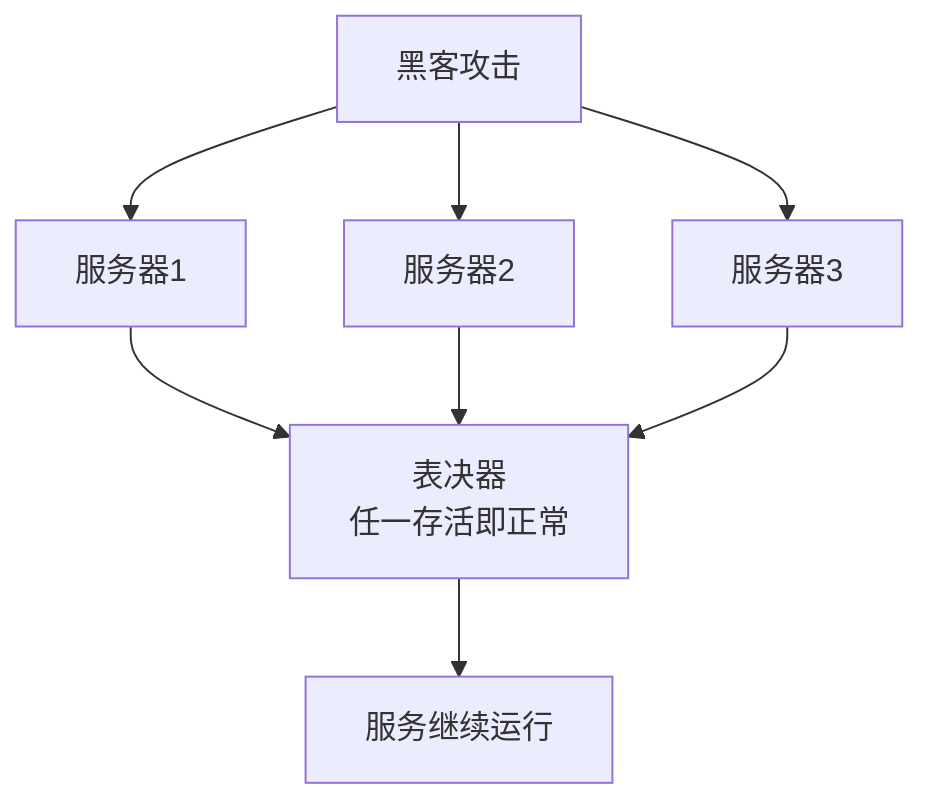

# 多攻一可达极限（多个黑客对一个红客）

## 多攻一可达极限

在网络安全对抗中，你经常会遇到这种情况：一个红客（防守方）把重要数据或服务在多个服务器上做了**互为备份**。黑客（攻击方）想要彻底摧毁这个服务，就必须同时攻破所有备份服务器——只要有一台服务器存活，服务就没有中断。这就是典型的“多攻一”场景。

### 为什么需要研究它

研究多攻一场景，本质上是在回答一个边界问题：==在给定系统冗余度下，黑客需要多大的攻击能力才能“确保”攻破整个系统？== 或者说，作为防守方的红客，配置多少台备份服务器，才能把黑客的成功率压低到一个可以接受的水平？

这个问题直接关系到系统设计与风险评估。如果红客不了解这个极限，就可能无限堆叠备份，造成资源浪费；反之，也可能备份不足，给黑客留下可乘之机。

### 核心思想：从冗余看对抗极限

我们可以把互为备份的服务器看作**具有冗余度的并行信道**，而黑客的攻击就是向这些信道注入“噪声”或制造“错误”。黑客想让整个系统瘫痪，就好比要使所有并行信道同时中断。

根据联合界（Union Bound），假设黑客攻破单台服务器的成功概率是 $p$，现在有 $N$ 台互为备份的独立服务器，那么黑客**同时攻破所有** $N$ 台服务器的概率是：

$$P_{\text{全面成功}} = p^N$$

这个式子揭示了一个关键现象：==随着备份数 $N$ 增加，黑客的全面成功率呈指数级下降==。哪怕 $p$ 很高（比如 $p = 0.9$），当 $N = 5$ 时，全面成功概率已经降到约 $0.59$；当 $N = 10$ 时，更是降到约 $0.35$。

从信息论角度看，这就等价于**信道编码定理**中的可靠性界限问题。在信道编码中，只要信噪比足够高（即冗余度足够大），就能实现几乎零错误的可靠传输。反过来看，黑客要确保成功，其攻击强度就必须超过系统冗余所设定的某个“信道容量”阈值。如果攻不破这个阈值，即使黑客对单机成功率很高，面对多备份时也会变得极其困难。

> [!IMPORTANT]
> 多攻一可达极限等价于信息论中的信道编码定理：黑客相当于噪声源，服务器冗余相当于信道编码的冗余比特。冗余度越大，黑客成功概率的衰减越快。

### 与相近概念的区别

| 概念 | 对抗方向 | 核心指标 |
|------|----------|----------|
| **多攻一（本文）** | 多个黑客目标 → 一个红客 | 冗余度 $N$ 对攻击成功率 $p^N$ 的压制 |
| 一攻多 | 一个黑客 → 多个红客目标 | 黑客需选择合适的攻击策略以最大化成果 |
| 多攻多 | 多个黑客 → 多个红客 | 双方资源分配博弈 |

容易混淆的地方在于：多攻一不是指“黑客人数多”，而是指==黑客需要同时攻克多个目标（备份服务器）才算取得最终胜利==。哪怕只有一个黑客，他面对多备份时也是在“多攻一”。

### 一个算对了的例子

**题目：** 假设某系统有 4 台互为备份的服务器，黑客对单台服务器的攻击成功概率为 $0.6$。求：
（1）黑客同时攻破全部 4 台的概率；
（2）至少需要多少台备份，才能把黑客的全面成功率压到 $0.1$ 以下？

**解答：**

（1）$P = 0.6^4 = 0.1296 \approx 13\%$

（2）要求 $0.6^N < 0.1$，取对数：

$$N \cdot \ln 0.6 < \ln 0.1$$

$$N > \frac{\ln 0.1}{\ln 0.6} \approx \frac{-2.3026}{-0.5108} \approx 4.51$$

因此 ==$N \ge 5$ 台== 才能把概率压在 $0.1$ 以下。验证：$0.6^5 \approx 0.078 < 0.1$。

> [!WARNING]
> 上面的推导假设各服务器被攻破的概率相互独立。在现实中，如果服务器共用同一套操作系统或配置，会存在**共因失效**，独立性被破坏，实际崩溃概率会远大于 $p^N$。安全评估时务必检查独立性假设。

> [!TIP]
> 记忆口诀：“备份成指数，概率降得猛；独立是关键，共因要小心。”
