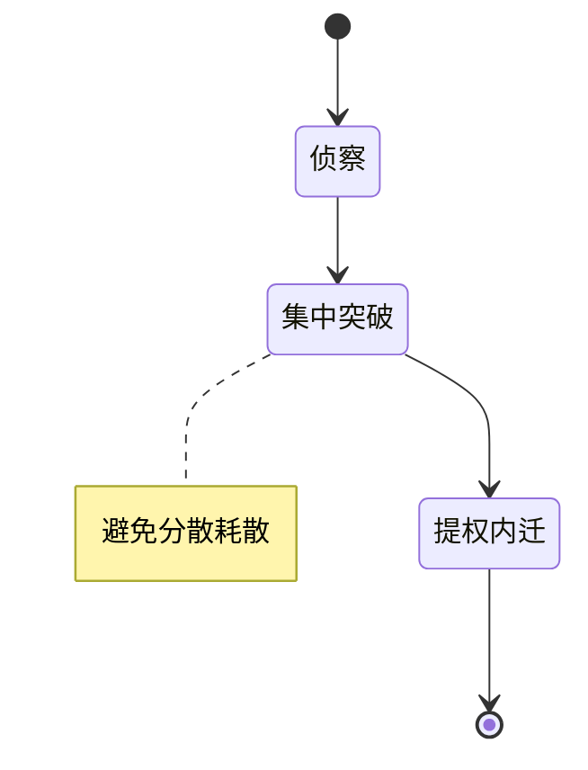

# 安全对抗的耗散行为

## 它是什么

在攻防对抗的中观视角里，==耗散行为==指黑客为达成入侵目标，必须把自身资源持续注入被攻系统并逐步消耗、散失的过程，如扫描探测、口令爆破、漏洞验证都伴随攻击方算力与时间的不可逆损耗。它不是防护方的被动掉血，而是**攻击侧的动态成本流动**。

> [!IMPORTANT]
> 耗散行为刻画的是攻击资源随对抗推进而发散、衰减的规律，是衡量最佳攻击战术的前提。

## 为什么需要

若攻击不耗散，黑客可零成本无限试探，防守将无从设防。正因为资源会耗散，防守方才可通过增加认证轮次、部署蜜罐、限速来放大对方消耗，促成==以守耗攻==。

## 怎么做：最佳动态攻击战术

先问一句：若你进攻一座壁垒，且每前进一步都花时间，你会一次性猛冲还是分阶段试探？答案偏向前者——因为耗散累积，越拖越亏。

课件指出：黑客最佳动态攻击战术是在耗散约束下，==以最短路径、最大并行度集中资源直取核心资产==，避免在多点外围纠缠导致散耗。其战术形态可表为状态推进：

## 和相近概念的区别

| 概念 | 主体 | 资源流向 |
|---|---|---|
| 耗散行为 | 攻击方 | 由攻向守发散 |
| 防护消耗 | 防守方 | 由守向系统注入 |
| 零耗散试探 | 理想模型 | 无损耗循环 |

## 常见的坑

> [!WARNING]
> 易错：把“耗散”只当成防守方流血；实际本章指黑客攻击资源耗散，别写反主体。

## 一个算对了的例子

考题：什么是黑客最佳动态攻击战术？
答：在安全对抗耗散行为约束下，黑客为减少自身资源随时间发散损耗，应采取集中优势资源、沿最短关键路径动态突防的战术，即最佳动态攻击战术。抓住“耗散+集中直取”即得分要点。
