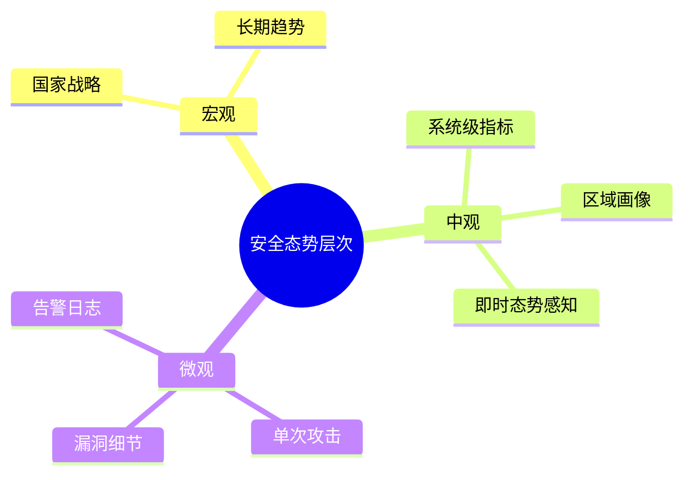

# 安全态势中观画像的解释

## 安全态势中观画像的解释

如果你手上有几千台服务器的安全日志，你会先看每一行的报错信息，还是先看一张“红黄绿”的整体态势图？显然是后者。安全态势中观画像要解决的就是这个“怎么看”的问题。

### 为什么需要中观画像

《安全通论》将安全对抗分为三个层次：微观聚焦单次攻防的技术细节，宏观关注全局的战略趋势，而==中观恰恰是衔接二者的桥梁==。中观画像的任务，是把大量微观事件“压扁”成一组可理解的指标，让管理者能在几分钟内判断当前系统整体处于什么状态。

如果把微观事件比喻成每一个病人的病历，那么中观画像就是整个医院的住院人数、危重比例和感染率。你不必知道每个病人叫什么，但必须知道现在医院还能不能正常运转。

### 中观画像的核心设计方法

构建中观画像的关键，是把==不可直接比较的指标统一映射为无量纲的“态势值”==。常用的映射方法有三种：

| 方法 | 思路 | 适用场景 |
|------|------|----------|
| 极差归一化 | $x' = \frac{x - x_{min}}{x_{max} - x_{min}}$ | 指标有明确上下界 |
| 对数映射 | $x' = \log(1 + x)$ | 数据跨度大、有长尾 |
| 分级打分 | 设定阈值区间，直接赋分 | 专家经验丰富时 |

这些方法都遵循同一个原则：==将原始数据压缩到 $[0,1]$ 或一个有界区间内，便于融合计算==。

> [!IMPORTANT]
> 中观画像不是简单地把数值变小，而是通过归一化消除量纲差异，让不同来源的指标可以直接加权合成。

### 一个算对了的例子

假设对一个系统采集到三个维度的指标：攻击频次、漏洞严重度、服务可用性。原始数据和归一化结果如下：

| 指标 | 原始值 | 范围 | 归一化公式 | 归一化值 |
|------|--------|------|------------|----------|
| 攻击频次 | 200 次/min | [0, 500] | $200/500$ | 0.40 |
| 漏洞严重度 | CVSS 8.5 | [0, 10] | $8.5/10$ | 0.85 |
| 服务可用性 | 99.9% | [90%, 100%] | $(99.9-90)/(100-90)$ | 0.99 |

设定权重：攻击频次 0.3，漏洞严重度 0.3，服务可用性 0.4。合成态势值：

$$
S = 0.3 \times 0.40 + 0.3 \times 0.85 + 0.4 \times 0.99 = 0.771
$$

> [!TIP]
> 权重分配的口诀：==越关键的指标权重越大，但单个权重不宜超过 0.5==，否则态势值会被单一因素主导，失去“综合”的意义。

### 常见的坑

1. **忽视动态基线的更新**
   系统环境在变，一个“正常”的流量范围三个月前和今天可能完全不同。如果用固定阈值归一化，态势值会逐渐漂移失真。

   > [!WARNING]
   > 归一化的上下界必须随业务周期动态调整，否则三个月后攻击频次永远归一化到 0.95 以上，态势图就变成“常红”的狼来了。

2. **混淆中观与宏观的时间粒度**
   中观画像的回答窗口通常是==分钟到小时级==，用于支持当班分析师的即时决策。如果窗口拉到天或周，那已经滑入宏观分析的范畴，失去了“即时态势感知”的功能。

3. **过度合成**
   把几十个指标一股脑加权融合成一个数字，看似“聪明”，实际上淹没了关键信号。中观画像应当保持==多指标并行的仪表盘结构==，而非强行压成单值。

### 与其他概念的边界

- **微观告警 vs 中观画像**：微观告警是离散事件（“某IP尝试SQL注入”），中观画像是统计特征（“SQL注入尝试密度上升至危险区”）。
- **宏观趋势 vs 中观画像**：宏观趋势用月度曲线描述攻防格局演变，中观画像用当前快照支撑实时决策。
- **态势值 vs 风险值**：态势值描述当前状态，是“是什么”；风险值是对未来损失的预判，是“可能怎样”。两者相关但不相同，中观画像的核心产出是态势值。

> [!NOTE]
> 在杨义先、钮心忻老师的《安全通论》体系中，中观画像正是“安全态势感知”从理论落地到工程的关键环节——它把对抗系统中攻防双方的力量分布，转化为可量化、可比较、可追踪的态势指标。
