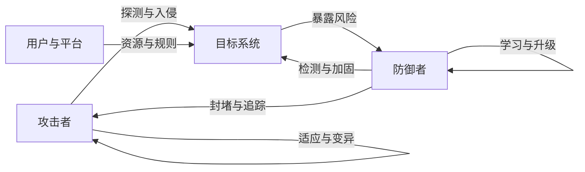

# 安全攻防生态学小结

## 为什么用“生态学”看安全

安全不是“装一个杀毒软件就结束”，而是攻击者、防御者、用户、平台、漏洞、恶意代码等共同构成的动态系统。安全攻防生态学关注：谁在对抗、依赖什么资源、如何演化、怎样形成相对稳定的平衡。其核心结论是：==安全是持续博弈和共同演化的过程，不存在一劳永逸的绝对安全==。

## 它分析什么

可把攻防双方简化为“投入—能力—损失”的关系：攻击方投入成本 $C_a$，获得攻击能力 $A$；防御方投入成本 $C_d$，形成防御能力 $D$。当 $A>D$ 时，入侵成功概率上升；防御升级后，攻击者又会选择新漏洞、新通道或新伪装。于是形成循环：

**漏洞出现 → 攻击利用 → 检测响应 → 修复加固 → 攻击适应 → 新风险出现。**

这里的“生态”还强调相互依赖。例如，木马依赖传播渠道和宿主环境，防御依赖样本、特征、情报和人员；系统补丁可能降低旧攻击成功率，却促使攻击者转向社会工程学或供应链。因而，==攻防技术、成本、环境和策略必须一起分析==。

## 与相近概念的区别

| 概念 | 主要关注点 | 与本知识点的关系 |
|---|---|---|
| 恶意代码分析 | 木马、病毒如何传播、隐藏和执行 | 提供具体研究对象 |
| 安全对抗 | 一次攻防中的策略与反制 | 是生态演化的局部过程 |
| 安全攻防生态学 | 多主体、长期适应及动态平衡 | 强调整体与演化 |
| 静态防护 | 用固定规则阻断已知威胁 | 难以单独应对持续变异 |

> [!WARNING]
> 不要把“生态平衡”理解为双方停止攻击，也不要把“共同演化”写成病毒必然越来越高级。它可能只改变传播渠道、伪装方式或攻击目标。

## 例题：分析新木马病毒早期的演变

题目要求“用安全通论的观点分析新木马病毒早期的演变过程”，可按“对象变化—攻防反馈—生态结论”作答：

1. **隐蔽性增强**：木马通过隐藏文件、进程或通信行为，降低被发现的概率。
2. **传播方式多样化**：由软件捆绑扩展到社会工程学、漏洞利用等渠道，以适应防御和环境变化。
3. **功能模块化**：窃密、远程控制等功能可组合、更新，降低修改成本并提高适应能力。
4. **攻防共同演化**：防御方依据样本和行为更新检测规则，攻击方再调整伪装与传播策略。

因此，早期演变并非孤立的技术升级，而是木马在检测压力下提高存活和获利能力的过程，体现“魔高一尺，道高一丈”的持续博弈。

> [!TIP]
> 答题不要只罗列木马功能。每个变化后补一句“防御如何响应、攻击为何再适应”，最后落到“动态对抗、共同演化”，才体现生态学视角。
