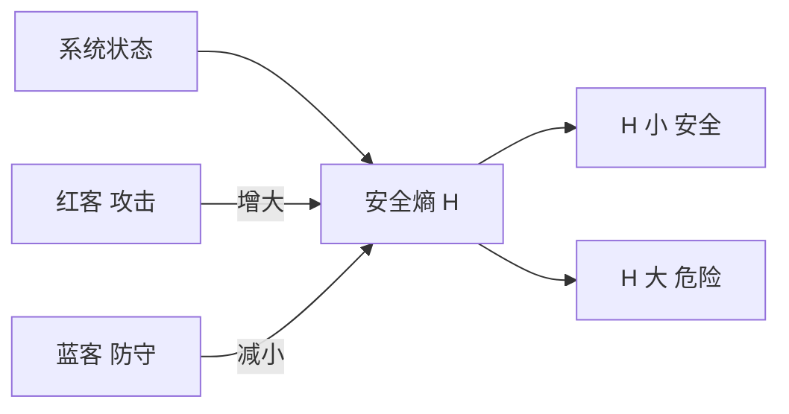
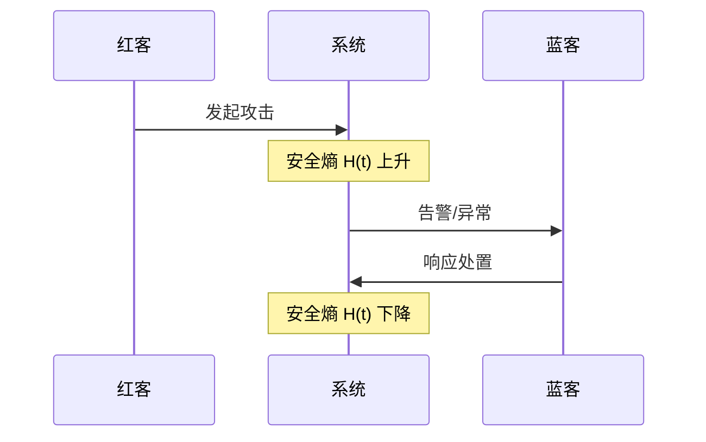

# 安全熵及其时变性

## 为什么需要"安全熵"

红客（攻击方）与客（防守方）的对抗，本质是一场**信息博弈**。我们能不能用一个统一的量，度量"系统安全状态有多混乱、防守方有多被动"？热力学里用熵度量无序，信息论里用熵度量不确定性——《安全通论》把这套思路搬进攻防对抗，定义了**安全熵**。

> [!IMPORTANT]
> ==安全熵是刻画攻防对抗中系统安全状态不确定性的度量==，红客的每一次攻击都在**制造安全熵**，蓝客的每一次防守都在**降低安全熵**。

## 安全熵是什么

设攻防对抗中系统处于某安全状态 $s_i$（如"未被攻破""已被植入后门""数据已泄露"等），其出现概率为 $p_i$，则系统的**安全熵**定义为：

$$
H = -\sum_{i=1}^{n} p_i \log p_i
$$

形式上与香农熵一致，但语义不同：==这里的 $p_i$ 是"红客攻击下系统落入状态 $s_i$ 的概率"==，$H$ 越大，说明系统越可能落入未知/危险状态，防守方越难掌握全局。

## 时变性：熵是时间的函数

对抗不是静态的，红客在 $t$ 时刻攻击、蓝客在 $t+\Delta t$ 响应，所以安全熵是**时间函数** $H(t)$。

- **红客行动**：制造新的未知状态，$H(t)$ **上升**。
- **蓝客响应**：消除未知、恢复确定性，$H(t)$ **下降**。
- **系统稳定**：攻防达到平衡，$H(t)$ 趋于一个动态平衡值。

> [!WARNING]
> 时变性是本知识点最容易被忽略的点。==安全熵不是常数==，考题里问"安全熵与红客的关系"时，必须答出"红客攻击使安全熵随时间**增大**"。

## 安全熵与红客的关系（考题落点）

> [!IMPORTANT]
> **红客是安全熵的"生产者"**：攻击行为引入未知漏洞、未授权状态，使系统状态分布更分散，$H(t)$ 增大。
> **蓝客是安全熵的"消费者"**：检测、阻断、恢复使状态重新收敛，$H(t)$ 减小。

一句话答简述题：**红客通过攻击不断制造安全熵，使系统安全状态不确定性随时间增大；蓝客通过防守压制安全熵。攻防对抗就是安全熵的动态博弈。**

## 与相近概念的区别

| 概念 | 度量对象 | 是否随时间变化 | 谁在主导 |
|------|----------|----------------|----------|
| 香农熵 | 信源不确定性 | 否（静态） | 信源本身 |
| 安全熵 | 攻防下安全状态不确定性 | ==是（时变）== | 红客制造 / 蓝客消除 |
| 风险 | 损失期望 | 可变 | 威胁 × 脆弱性 × 资产 |

> [!CAUTION]
> 别把"安全熵"写成"系统风险"。安全熵度量的是**不确定性**（信息层面），风险度量的是**损失期望**（代价层面），两者相关但不等价。

## 一个例子

某系统初始处于"未攻破"，概率 $p=1$，则

$$
H_0 = -1\cdot\log 1 = 0
$$

红客攻击后，系统可能落入 3 个状态：未攻破 $0.5$、被植入后门 $0.3$、数据泄露 $0.2$，则

$$
H_1 = -(0.5\log 0.5 + 0.3\log 0.3 + 0.2\log 0.2) \approx 1.485
$$

$H_1 > H_0$，安全熵因红客攻击而上升；蓝客检测处置后回到 $H \to 0$。

> [!TIP]
> 记忆口诀：**红客造熵，蓝客消熵；熵随时变，攻升守降**。简述题按"定义—红客作用—时变性—结论"四步答，8 分稳拿。
