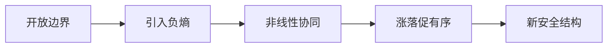

# 安全系统的耗散结构演化

## 它是什么：安全系统的自组织有序

为什么一个看似混乱、不断遭受攻击的系统，反而能维持长期的安全状态？这就要引入耗散结构理论。安全系统的耗散结构演化，是指==安全系统在远离平衡态的开放条件下，通过与外界持续交换物质、能量和信息（负熵流），自发形成并维持的一种宏观有序结构==。

> [!IMPORTANT]
> 核心定义：安全不是静态的“坚固”，而是动态的“耗散有序”。系统必须保持开放并持续输入负熵，才能对抗内部自然产生的正熵（无序化趋势）。

这种有序并非预设，而是在非线性相互作用下“涌现”出来的。例如，企业安全运营中心（soc）面对海量告警（混沌输入），通过人员研判、策略调优和情报反馈，最终形成稳定的防御节奏，这就是典型的耗散结构。

## 为什么需要：打破封闭系统的宿命

如果将安全系统视为封闭系统，根据热力学第二定律，其熵 $S$ 只会增加不会减少（$dS \geq 0$），最终走向无序和崩溃。现实中，任何试图“一劳永逸”建好安全体系然后封闭运行的做法，都必然失败。

我们需要耗散结构视角，是因为它解释了安全能力的来源：

$$ dS = d_iS + d_eS $$

其中 $d_iS > 0$ 是系统内部不可逆过程产生的正熵（如设备老化、人员懈怠、漏洞累积），而 $d_eS < 0$ 是从环境引入的负熵流（如安全更新、培训、外部威胁情报）。只有当 $|d_eS| > d_iS$ 时，总熵变 $dS < 0$，系统才能向更高级的有序演化。

## 怎么做：构建负熵输入机制

实现耗散结构演化需满足四个条件：开放系统、远离平衡态、非线性作用、涨落触发。落地到安全实践：

-   **保持开放**：主动接入威胁情报、合规要求、行业案例等外部信息源。
-   **远离平衡**：避免安全团队陷入机械重复的“舒适区”，定期开展红蓝对抗、应急演练制造可控扰动。
-   **强化非线性**：推动技术、管理、人员之间的深度耦合，使微小改进产生放大效应（如自动化编排提升整体响应效率）。
-   **利用涨落**：将单次安全事件视为系统升级的契机，而非单纯故障。

## 与相近概念的区别

| 维度 | 耗散结构演化 | 传统均衡安全观 |
| :--- | :--- | :--- |
| 系统状态 | 远离平衡态的动态有序 | 追求静态平衡与稳定 |
| 对待扰动 | 视涨落为进化驱动力 | 视异常为需消除的故障 |
| 熵的变化 | 依赖负熵流抵消正熵 | 忽略熵增，假设可永久维持 |
| 演进方式 | 自组织、非线性跃迁 | 线性叠加、计划驱动 |

> [!WARNING]
> 常见误区：把“耗散”等同于“消耗资源”。耗散强调的是==通过能量/信息流动换取秩序==，而非无谓浪费。若投入大量资源但未形成有效负熵流（如盲目堆砌设备却无联动），系统仍会熵增崩溃。

## 算对了的例子：某高校安全运营熵变分析

假设某校安全系统月内因漏洞未修、日志积压等产生内部正熵 $d_iS = +8.5$ 单位。同期引入外部威胁情报、完成2次攻防演练、更新3套规则，带来负熵流 $d_eS = -10.2$ 单位。则总熵变：

$$ dS = (+8.5) + (-10.2) = -1.7 < 0 $$

系统总熵减少，安全有序度提升。反之，若仅靠内部巡检（$d_eS = -6.0$），则 $dS = +2.5 > 0$，系统将退化。此例说明：==唯有外部负熵输入强度超过内部熵产生速率，安全系统才能持续演化==。

> [!TIP]
> 解题关键：判断安全系统是否处于耗散结构，先看它是否“开放”且有“净负熵流入”。考试中若描述系统封闭运行或仅强调内部优化，通常不符合耗散结构条件。
