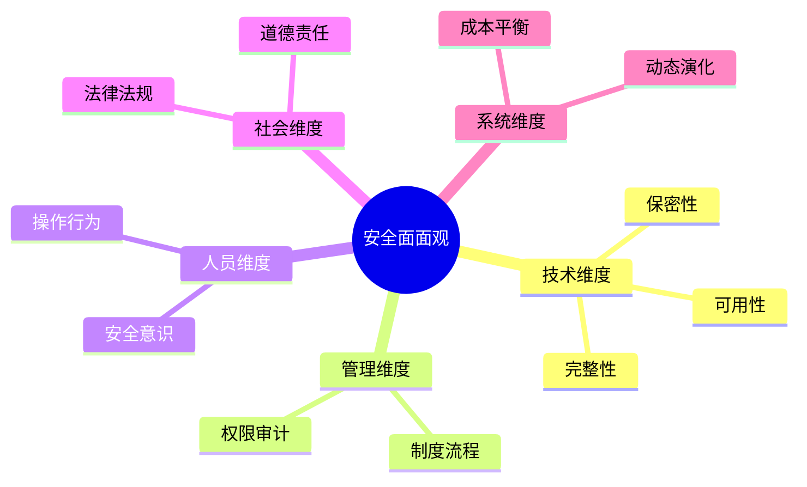

# 安全面面观（安全的多个维度）

## 为什么要“面面观”

“安全”不是单一指标，而是==多维度、相互制约的系统属性==。只看技术防护，容易忽略管理、人员、法律与成本；只看绝对安全，又可能把系统做得无法使用。安全面面观的目的，是建立整体安全观：先明确保护对象和威胁，再从多个维度检查风险，最后形成可接受、可持续的安全状态。

## 安全的主要维度

| 观察维度 | 核心问题 | 典型措施 |
|---|---|---|
| 技术安全 | 系统能否抵御攻击 | 加密、认证、备份、访问控制 |
| 管理安全 | 权限与流程是否规范 | 分级授权、日志审计、应急预案 |
| 人员安全 | 人是否成为薄弱环节 | 安全培训、防钓鱼、岗位监督 |
| 物理与环境安全 | 设备和场所是否可靠 | 门禁、防火、容灾、供电保障 |
| 法律与社会安全 | 行为是否合法合规 | 隐私保护、责任认定、依法处置 |
| 经济与系统安全 | 投入是否适当、能否持续 | 风险评估、成本收益、动态调整 |

这些维度不是简单相加。例如，严格密码策略属于技术措施，但若密码过长、更换过频，用户可能把密码贴在显示器旁，反而降低人员与管理安全。因此，安全设计要追求==整体风险降低==，而不是某一维度的极端强化。

## 从量变到质变

信息安全中的**量变**，是风险因素在数量、频率、范围或持续时间上的逐步积累；**质变**，是积累越过临界点后，安全状态发生根本改变，如由“局部异常”转为“系统失陷”，或由“信息可用”转为“秘密泄露”。

可用简化模型理解：设单次风险增量为 $\Delta r$，累计风险为

$$R_n=R_0+\sum_{i=1}^{n}\Delta r_i$$

当 $R_n$ 超过系统承受能力 $T$ 时，可能出现安全状态的突变。该公式用于帮助理解，并不表示现实风险都能精确线性相加。

> [!IMPORTANT]
> 量变不一定必然导致质变；只有当关键条件成熟、积累超过阈值或触发连锁反应时，才会发生质变。

典型例子包括：

- **弱口令暴力破解**：单次失败只是量变，尝试次数增加后命中口令，账户由安全变为失陷。
- **信息拼接泄露**：单条姓名、学号、行程似乎不敏感，多源信息持续汇聚后可识别个人并实施精准诈骗。
- **漏洞与权限积累**：一个低危漏洞影响有限，多个漏洞组合并完成提权后，可能形成完全控制。
- **日志与异常积累**：少量误报未造成事故，长期不审计使入侵持续潜伏，最终演变为大规模数据泄露。
- **备份长期失效**：偶尔备份失败是局部问题，长期无人验证，遇到勒索软件时便由“可恢复”质变为“业务中断”。

## 相近概念与常见误区

| 概念 | 关注重点 | 与安全面面观的关系 |
|---|---|---|
| 多维安全 | 从哪些方面观察安全 | 强调全面识别 |
| 纵深防御 | 设置多层防线 | 是多维观在技术防护中的体现 |
| 动态安全 | 安全随威胁和环境变化 | 说明各维度需持续调整 |
| 相对安全 | 风险是否处于可接受范围 | 反对不切实际的绝对安全 |

> [!WARNING]
> 常见误区是把“维度多”理解为“措施越多越好”。重复堆叠产品可能增加配置错误、管理成本和攻击面，必须依据风险选择措施。

## 例题作答示范

题目：何为信息安全中的量变和质变，列举一些安全中量变到质变的例子。

可先给出定义，再按“**积累过程—临界条件—状态改变**”组织答案：

> 量变是攻击次数、泄露信息量、漏洞数量或风险持续时间的逐渐增加；质变是风险积累越过临界条件后，系统安全属性发生根本变化。例如，攻击者反复尝试弱口令，失败次数增加属于量变；一旦口令被猜中，账户由合法受控变为被攻击者控制，属于质变。又如，姓名、学号等碎片信息逐步汇聚属于量变，当信息足以唯一识别个人并支撑精准诈骗时，便由一般信息暴露质变为严重隐私泄露。再如，多个低危漏洞被组合利用并完成提权，也会由局部缺陷质变为系统失陷。

> [!TIP]
> 答题不要只罗列事件。每个例子都点明“什么在积累”和“发生了什么根本变化”，才能完整体现量变到质变。
